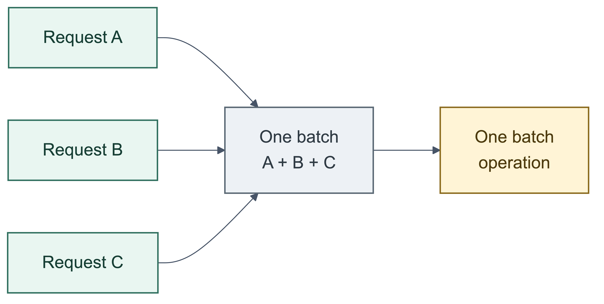
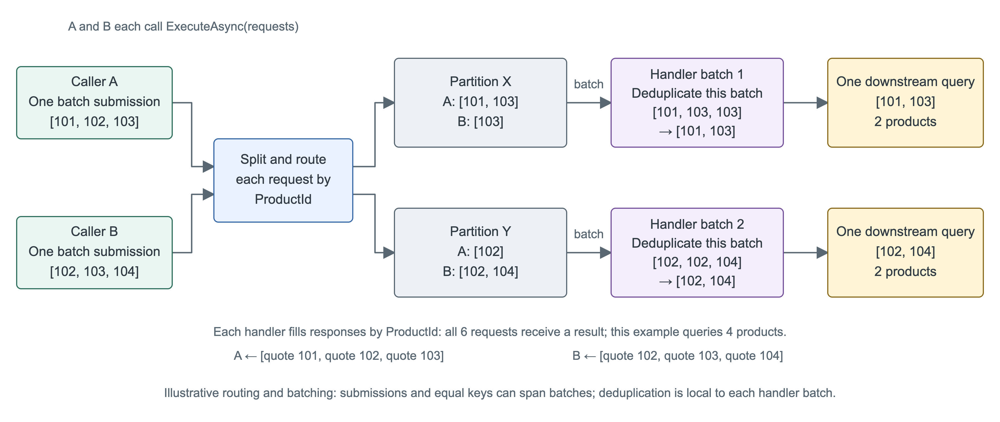
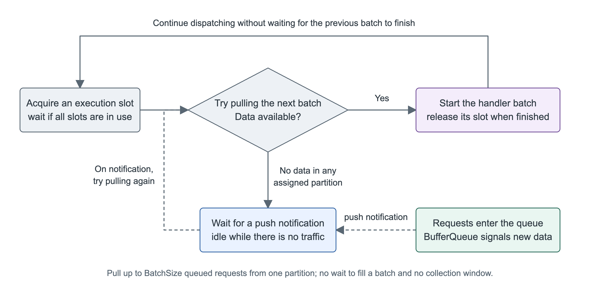
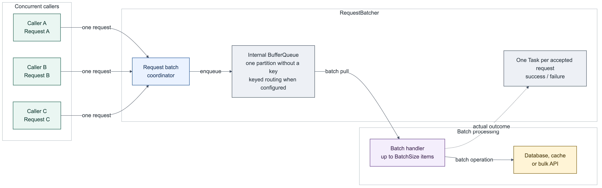
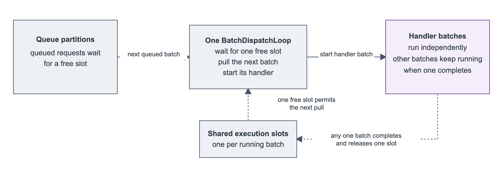
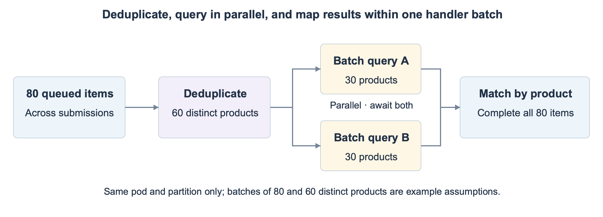
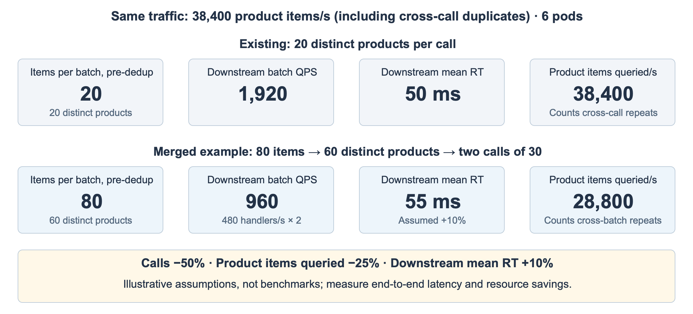
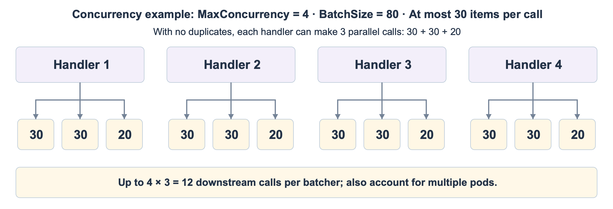
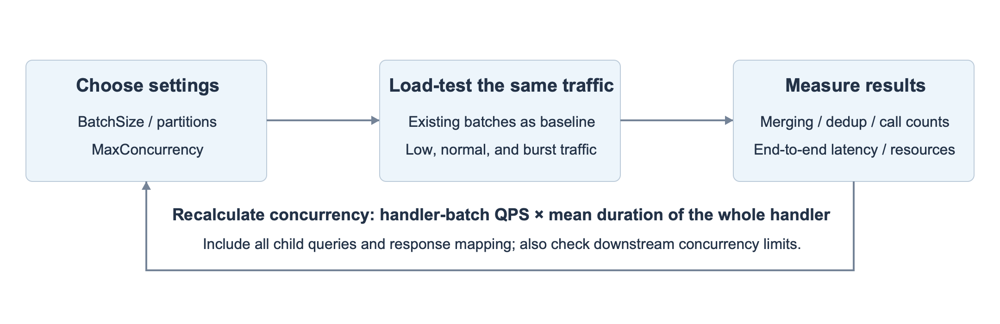

# RequestBatcher

[](https://www.nuget.org/packages/RequestBatcher)
[](https://github.com/eventhorizon-cli/RequestBatcher/actions/workflows/dotnet-build.yml)
[](https://codecov.io/gh/eventhorizon-cli/RequestBatcher)
[](LICENSE)

**English** | [简体中文](README.zh-CN.md)

RequestBatcher is an in-process .NET library with **native support for single and batch requests**. Callers submit
one request with `ExecuteAsync(request)` or a batch with `ExecuteAsync(requests)` and await the corresponding results.

RequestBatcher combines requests that are already queued, limits handler-batch concurrency and queue capacity, and
invokes the application handler with a batch. It is intended for database, cache, and API operations that support
processing multiple items together.



Separate concurrent requests can be combined into one batch before a downstream batch operation. The illustration is
an example: only requests already queued in the same partition can be combined into one handler batch.

**One batch API call does not imply one handler invocation.** Below, A and B each make one batch API call,
submitting queries for products `[101, 102, 103]` and `[102, 103, 104]` respectively.



Requests route individually by `ProductId`. In this example, 101 and 103 share one partition, while 102 and 104 share
another. Each partition combines queued requests from both submissions into a handler batch.

**Each handler deduplicates within its own batch.** The two handlers query `[101, 103]` and `[102, 104]` respectively,
then assign responses by `ProductId` to their own requests: four products are queried, and all six requests get a result.

This is one possible grouping. Actual batches depend on enqueue timing, `BatchSize`, and scheduling; equal keys are
not guaranteed to arrive in one batch.

## How Requests Are Batched: Opportunistic Merging

The illustration above shows how requests may be combined. This section explains how those handler batches are formed.

RequestBatcher uses [BufferQueue](https://github.com/eventhorizon-cli/BufferQueue) to combine queued requests within a
.NET process and pass them to an application handler. The current dependency is
[BufferQueue 2.0.4](https://www.nuget.org/packages/BufferQueue/2.0.4); applications do not register or configure it
separately.

This is **opportunistic batching**: writing a request to BufferQueue sends a push notification that wakes an idle
consumer. Once it has an execution slot, the consumer pulls requests queued at that moment; it does not wait for a
fixed time window to fill `BatchSize`.

Callers obtain `IRequestBatcher<TRequest>` or `IRequestBatcher<TRequest, TResponse>` through DI, submit requests, and
await their individual results.

After dispatching a batch, the loop continues. If another slot is available, it can pull and dispatch the next batch
without waiting for the previous batch to finish.

**It waits for the next push notification only when none of the assigned partitions has data.**

There is no periodic polling or fixed collection window. With a free slot, waiting mainly comes from wake-up and
scheduling; when all slots are occupied, requests must wait for capacity to execute. `BatchSize` limits the number of
requests per handler call: a batch may contain just one request at low traffic or several requests already queued in the
same partition during a burst.



The diagram shows normal consumption and omits cancellation and shutdown. [BufferQueue's consumer loop](https://github.com/eventhorizon-cli/BufferQueue/blob/75d4cbbc83358e5f026bbb4eef5c2f8f797fd90d/src/BufferQueue/BufferPullConsumer.cs#L69)
checks the notification version before waiting. If new data was signaled during the scan, it retries the pull to avoid a
missed wake-up.

Requests are held in memory and cannot be recovered after a process failure.

> **Batching does not require callers to assemble a collection.** Separate callers can each submit one `TRequest`
> concurrently. RequestBatcher coalesces requests already queued for the same partition into handler batches of up to
> `BatchSize`. `ExecuteAsync(IEnumerable<TRequest>)` is an additional submission option, not a prerequisite for
> batching.

## Installation and DI Registration

```bash
dotnet add package RequestBatcher
```

The package supports .NET 8 and .NET 10 applications through `net8.0` and `net10.0` assets.

Register the response-enabled handler and batcher with `AddRequestBatcher` at startup. The handler depends on your
application's `IPriceStore` implementation. At the call site, resolve `IRequestBatcher<PriceQuery, PriceQuote?>` from
the same DI container or inject it into an application service's constructor.

```csharp
using Microsoft.Extensions.DependencyInjection;
using RequestBatcher;

// At startup: register the store and response-enabled batcher.
services.AddScoped<IPriceStore, PriceStore>();
services.AddRequestBatcher<PriceQuery, PriceQuote?, PriceQueryHandler>(
    ServiceLifetime.Scoped,
    options =>
    {
        // Four concurrent handler batches, shared by all eight queue partitions.
        options.MaxConcurrency = 4;
        options.BatchSize = 100;
        options.MaxPendingRequests = 5_000;
        // Equal product IDs route to the same partition; separate batches can still run concurrently.
        options.UsePartitionKey(query => query.ProductId, partitionCount: 8);
    });

// At the call site: resolve the typed response interface from the application's service provider.
var batcher = serviceProvider.GetRequiredService<IRequestBatcher<PriceQuery, PriceQuote?>>();
var quote = await batcher.ExecuteAsync(new PriceQuery(ProductId: 101));
```

Use `Microsoft.Extensions.DependencyInjection` and `RequestBatcher`. The [Request/Response Batching](#requestresponse-batching)
section below defines `PriceQuery`, `PriceQuote`, `PriceQueryHandler`, and the `IPriceStore` dependency. In application
services, constructor-inject `IRequestBatcher<PriceQuery, PriceQuote?>` instead of resolving it manually.

## Named Batchers and Primitive Requests

A request can be a primitive ID. Use the `batcherName` overload when several operations accept the same request type:
for example, `"price"` and `"stock"` can each register an independent `int` pipeline. Each name has its own handler,
options, queue capacity, and concurrency limit. Named and unnamed registrations may coexist.

```csharp
using Microsoft.Extensions.DependencyInjection;
using Microsoft.Extensions.Options;
using RequestBatcher;

services.AddRequestBatcher<int, decimal?, PriceByIdHandler>(
    batcherName: "price",
    handlerLifetime: ServiceLifetime.Scoped,
    configure: options =>
    {
        options.BatchSize = 100;
        options.MaxConcurrency = 4;
        options.UsePartitionKey(id => id, partitionCount: 8);
    });

var batcher = serviceProvider.GetRequiredKeyedService<IRequestBatcher<int, decimal?>>("price");
var prices = await batcher.ExecuteAsync(new[] { 101, 102, 101 });
var options = serviceProvider.GetRequiredService<IOptionsMonitor<RequestBatchOptions<int>>>().Get("price");
```

The handler below uses the `IPriceStore` contract from the request/response example. Register its implementation
in the application's service collection as shown above:

```csharp
public sealed class PriceByIdHandler(IPriceStore store) : IRequestBatchHandler<int, decimal?>
{
    public async ValueTask HandleAsync(
        IReadOnlyList<RequestBatchEntry<int, decimal?>> entries,
        CancellationToken cancellationToken = default)
    {
        var ids = entries.Select(entry => (long)entry.Request).Distinct().ToArray();
        var prices = await store.FindAsync(ids, cancellationToken).ConfigureAwait(false);
        var pricesById = prices.ToDictionary(price => price.ProductId);
        entries.SetResponses(id => pricesById.GetValueOrDefault(id)?.Price);
    }
}
```

Results follow input order, including duplicates; missing products return null. An explicit list can split into
multiple handler batches.

In application services, inject the named batcher through the constructor. Register `PriceLookup` with
`services.AddScoped<PriceLookup>()`; the attribute selects the same `"price"` name used during batcher registration:

```csharp
using Microsoft.Extensions.DependencyInjection;
using RequestBatcher;

public sealed class PriceLookup(
    [FromKeyedServices("price")] IRequestBatcher<int, decimal?> batcher)
{
    public Task<IReadOnlyList<decimal?>> FindAsync(
        IEnumerable<int> productIds,
        CancellationToken cancellationToken = default) =>
        batcher.ExecuteAsync(productIds, cancellationToken);
}
```

In ASP.NET Core MVC, the same attribute can inject the batcher directly into a Controller Action parameter:

```csharp
using Microsoft.AspNetCore.Mvc;
using Microsoft.Extensions.DependencyInjection;
using RequestBatcher;

[ApiController]
[Route("api/prices")]
public sealed class PricesController : ControllerBase
{
    [HttpPost("query")]
    public Task<IReadOnlyList<decimal?>> FindAsync(
        [FromBody] int[] productIds,
        [FromKeyedServices("price")] IRequestBatcher<int, decimal?> batcher,
        CancellationToken cancellationToken) =>
        batcher.ExecuteAsync(productIds, cancellationToken);
}
```

Register MVC with `builder.Services.AddControllers()` and map it with `app.MapControllers()`. Minimal API handler
parameters support the same attribute, as shown in the runnable sample. See Microsoft's official documentation for
[keyed services and constructor injection](https://learn.microsoft.com/en-us/dotnet/core/extensions/dependency-injection/overview#keyed-services)
and [Controller Action injection](https://learn.microsoft.com/en-us/aspnet/core/mvc/controllers/dependency-injection?view=aspnetcore-8.0#action-injection-with-fromkeyedservices).

The request-only overload also accepts `batcherName`. Names are case-sensitive and must not be null, empty, or
whitespace; a request type and name identify one pipeline, regardless of response type. Use the original overload
for the unnamed default. Configuration is captured at registration; named options expose that configuration and
do not provide runtime queue reconfiguration. `UsePartitionKey` routes requests within the selected batcher and
does not select a batcher or serialize its handler batches.

The [named versus unnamed benchmark](docs/evaluations/named-batching/README.md) keeps request/response types,
handlers and batching options identical, comparing single and explicit submissions with singleton and scoped handlers.

The runnable [PostgreSQL sample](samples/RequestBatcher.Deduplication) uses a named `int` price-query batcher with
`decimal?` responses, widens IDs for its PostgreSQL `bigint` column, and accepts a JSON `int[]` at `POST /prices/query`.

## Delegate Handlers

Delegate handlers keep short batch-processing logic next to the `ExecuteAsync` call that submits the work, so you
can read and update the submission and handling code together. They suit straightforward batch lookups or result
mapping. At the call site, use a static lambda, static anonymous method, static local function, or static method
group. When the logic grows or needs to be reused and tested independently, use a separate `IRequestBatchHandler`
class.

**Delegate handlers are optimized for repeated execution**: signature inspection and expression-tree compilation of a
strongly typed invoker happen once on first binding. Subsequent submissions use a reference-equality fast path, and
dispatched batches reuse the cached invoker without reflection, `DynamicInvoke` or argument arrays. This automatic
binding mode requires dynamic code and is not supported for NativeAOT or trimming.

In-memory benchmarks using the same configuration show individual-submission means for delegate and typed handlers
differing by about 1%, with similar allocations and no clear steady-state regression. These measurements exclude the
initial compilation cost; see the [delegate-handler performance comparison](docs/evaluations/delegate-handlers/README.md).

Use `AddDelegateRequestBatcher` to declare the request/response contract and options, then supply a static handler
target at the call site:

**Handlers must use static implementations without capturing locals or instance state.** Lambdas, anonymous
methods and local functions must explicitly declare `static`; method groups must refer to ordinary or generic
static methods. Receive services through injected parameters. Delegates may be passed directly or through variables,
fields, parameters, properties or factories, including explicit construction, parentheses and casts.

```csharp
using Microsoft.Extensions.DependencyInjection;
using RequestBatcher;

services.AddKeyedScoped<IPriceStore, PriceStore>("catalog");
services.AddDelegateRequestBatcher<int, decimal?>(
    batcherName: "price",
    configure: options =>
    {
        options.BatchSize = 100;
        options.MaxConcurrency = 4;
    });

var batcher = serviceProvider.GetRequiredKeyedService<IRequestBatcher<int, decimal?>>("price");
var prices = await batcher.ExecuteAsync(
    new[] { 101, 102, 101 },
    static async ValueTask (
        IReadOnlyList<RequestBatchEntry<int, decimal?>> entries,
        [FromKeyedServices("catalog")] IPriceStore store,
        CancellationToken batchCancellation) =>
    {
        var ids = entries.Select(entry => (long)entry.Request).Distinct().ToArray();
        var rows = await store.FindAsync(ids, batchCancellation).ConfigureAwait(false);
        var pricesById = rows.ToDictionary(row => row.ProductId);
        entries.SetResponses(id => pricesById.GetValueOrDefault(id)?.Price);
    });
```

Alternatively, replace the lambda above with a static method or static local function. Choose one form per pipeline:

```csharp
var price = await batcher.ExecuteAsync(101, HandlePricesAsync);

static async ValueTask HandlePricesAsync(
    IReadOnlyList<RequestBatchEntry<int, decimal?>> entries,
    [FromKeyedServices("catalog")] IPriceStore store,
    CancellationToken batchCancellation)
{
    var ids = entries.Select(entry => (long)entry.Request).Distinct();
    var rows = await store.FindAsync(ids, batchCancellation).ConfigureAwait(false);
    var pricesById = rows.ToDictionary(row => row.ProductId);
    entries.SetResponses(id => pricesById.GetValueOrDefault(id)?.Price);
}
```

This uses the `IPriceStore` contract from the request/response example below; register your own implementation
(shown as `PriceStore`). Request-only pipelines use `AddDelegateRequestBatcher<TRequest>()` with a first lambda
parameter of `IReadOnlyList<TRequest>`. Both modes support individual requests and explicit lists through the
`ExecuteAsync` extension methods; the original interfaces have no added members.

For simple or shared request types such as `int` or `string`, prefer a distinct `batcherName` for each
business operation. For example, name a price `int` pipeline `"price"` when another operation also uses `int`,
to avoid delegate collisions or accidental binding. Omit `batcherName` to use the default pipeline. A request type
and name can use only one registration mode: delegate registrations require the handler on every submission, while
typed-handler registrations use the original overloads.

The first valid call binds one delegate to that pipeline. Repeated calls with an equal delegate reuse it; a
different delegate fails before enqueueing. Different handler targets represent different handlers even when their
bodies look identical, so use different batcher names for different operations. Concurrent first calls bind atomically.
Services are supplied per dispatched batch, not captured from the caller's scope.

The first parameter must be the exact batch list type. Other parameters are required DI services, with
`[FromKeyedServices(key)]` selecting a keyed service. The key must be explicit; inherited keys are unsupported.
Web applications may write `[FromServices]` on ordinary
service parameters; it is optional because services are injected by convention. The handler may omit the batch
lifecycle `CancellationToken`; if present, it must declare exactly one and must not give it a default such as
`= default`. This injected token is shared by the batch and is distinct from the optional caller
`ExecuteAsync` `cancellationToken`. The lambda may return `void`,
`Task` or `ValueTask`; `async void` and result-bearing return types are rejected. Every response entry must still
receive a response. List results preserve order and duplicates even when submission spans multiple handler batches.

The delegate handler and its bound delegate are always singleton per pipeline; registration has no
`ServiceLifetime` argument. Injected services retain their registered lifetimes: singleton instances are shared by
the container, scoped instances are shared within one batch, and transient instances are resolved separately for
each parameter. Resolved services are never cached in the singleton handler. Typed-handler registrations continue
to honor their explicit handler lifetime.

Each batch that injects services owns an async DI scope, and callers complete after scope disposal. A delegate
without service parameters skips scope creation.

**The built-in analyzer provides basic compile-time checks.** Both diagnostics are errors by default:

- `RB0001` rejects known non-static lambdas, local functions and instance methods.
- `RB0002` checks known delegate signatures, including batch-list and return types, parameter modifiers and defaults,
  and the restrictions on `CancellationToken` and `[FromKeyedServices]`.

Delegate targets may be unknown after passing through parameters, properties or factories. These forms remain
allowed; callers must ensure the eventual target is static. Runtime binding validates the actual signature, service
binding and delegate identity, but cannot reliably distinguish static-lambda source from a non-capturing ordinary
lambda. Ordinary typed-handler calls are unaffected, and consumers can disable the analyzers. See the
[delegate-handler design](docs/delegate-handlers-design.md).

The standalone [delegate PostgreSQL sample](samples/RequestBatcher.Delegates) uses delegate handlers for both price updates and
`POST /prices/query` list lookups. Each static lambda injects a keyed scoped `PriceStore` per handler batch.
The [typed-handler sample](samples/RequestBatcher.Deduplication) provides the original handler-class examples separately.

## When to Use It

Use RequestBatcher when requests are independent, temporary in-memory queuing is acceptable, and the downstream
operation benefits from receiving multiple items:

- database writes that can use batch `INSERT`, `UPDATE`, or `UPSERT`;
- cache reads or writes and downstream APIs that already accept multiple items;
- short traffic bursts where internal queue capacity and downstream concurrency must be bounded;
- work where caller cancellation should discard only requests that have not been dispatched, while dispatched work
  must be allowed to finish independently of that caller;
- related requests that benefit from batch-level merging without relying on handler ordering.

For database updates, if partial success within one handler invocation would leave inconsistent state, the handler
should execute that invocation in one transaction. RequestBatcher propagates the handler outcome but cannot roll back
writes that have already been committed.

## When Not to Use It

RequestBatcher is not a durable background queue or a transaction coordinator:

- Accepted work must survive process failure. Use durable storage or a reliable message broker.
- The operation must commit or roll back with the caller's transaction. Keep it in that transaction.
- The downstream operation requires automatic retries or exactly-once effects. RequestBatcher provides neither.
- The handler requires a minimum batch size or a fixed collection window. RequestBatcher dispatches currently queued
  work without waiting to fill a batch.
- An in-flight downstream operation must stop as soon as its individual caller disconnects, times out, or cancels.
  One handler batch can contain requests from several callers, so caller cancellation tokens are not forwarded to the
  handler and cannot cancel the shared handler call.

## APIs

The response wrapper is `RequestBatchEntry<TRequest, TResponse>`. When upgrading code that used
`RequestBatchItem<TRequest, TResponse>`, update that type and its extension class name to `RequestBatchEntry`
and `RequestBatchEntryExtensions`, then rebuild all consumers. This is a source and binary breaking change;
response assignment and completion behavior are unchanged.

### Request-Only API

Use `IRequestBatcher<TRequest>` when callers only need the handler outcome:

```csharp
public interface IRequestBatcher<in TRequest>
{
    // Submit one request and wait for its actual handler outcome.
    Task ExecuteAsync(TRequest request, CancellationToken cancellationToken = default);

    // Submit an existing group; the task waits for every request in that submission.
    Task ExecuteAsync(
        IEnumerable<TRequest> requests,
        CancellationToken cancellationToken = default);
}

public interface IRequestBatchHandler<TRequest>
{
    // Process one handler batch. A successful return completes every request in the batch.
    ValueTask HandleAsync(
        IReadOnlyList<TRequest> requests,
        CancellationToken cancellationToken = default);
}
```

### Request/Response API

Use `IRequestBatcher<TRequest, TResponse>` when every accepted request must yield a typed result:

```csharp
public interface IRequestBatcher<in TRequest, TResponse>
{
    // Submit one request and return its typed response.
    Task<TResponse> ExecuteAsync(
        TRequest request,
        CancellationToken cancellationToken = default);

    // Submit a group and return responses in the same order as the input sequence.
    Task<IReadOnlyList<TResponse>> ExecuteAsync(
        IEnumerable<TRequest> requests,
        CancellationToken cancellationToken = default);
}

public interface IRequestBatchHandler<TRequest, TResponse>
{
    // Process one batch and assign exactly one response to every entry.
    ValueTask HandleAsync(
        IReadOnlyList<RequestBatchEntry<TRequest, TResponse>> entries,
        CancellationToken cancellationToken = default);
}
```

RequestBatcher awaits each handler's `ValueTask` once and never returns it to a caller. Synchronously completing
handlers can therefore avoid a `Task` allocation, while asynchronous I/O can use `async ValueTask`.

## Request-Only Batching

Define the request and the code that handles one batch:

```csharp
public sealed record OrderWriteRequest(long OrderId, decimal Amount);

public interface IOrderStore
{
    Task WriteBatchAsync(
        IReadOnlyList<OrderWriteRequest> requests,
        CancellationToken cancellationToken);
}

public sealed class OrderWriteBatchHandler(IOrderStore store)
    : IRequestBatchHandler<OrderWriteRequest>
{
    public async ValueTask HandleAsync(
        IReadOnlyList<OrderWriteRequest> requests,
        CancellationToken cancellationToken = default)
    {
        await store.WriteBatchAsync(requests, cancellationToken);
    }
}
```

Register the handler and RequestBatcher together. The handler lifetime is part of the registration; the minimal setup
only needs a batch size:

```csharp
services.AddRequestBatcher<OrderWriteRequest, OrderWriteBatchHandler>(
    ServiceLifetime.Scoped,
    options =>
    {
        options.MaxConcurrency = 4;
        options.BatchSize = 256;
        options.MaxPendingRequests = 5_000;
        options.UsePartitionKey(request => request.OrderId, partitionCount: 8);
    });
```

Inject `IRequestBatcher<TRequest>` into the normal application call path:

```csharp
public sealed class OrderService(IRequestBatcher<OrderWriteRequest> batcher)
{
    public Task SaveAsync(
        OrderWriteRequest request,
        CancellationToken cancellationToken = default) =>
        batcher.ExecuteAsync(request, cancellationToken);
}
```

`SaveAsync` returns the same `Task` produced by RequestBatcher. It completes only after the handler has processed the
request; the caller does not need to know which batch or partition contained it.

## Request/Response Batching

Use the response-enabled API when each request should return a value. The handler receives entries that wrap the
original request and its response slot; `entry.Request` is the original `TRequest`. This example deduplicates repeated
product IDs within the current handler batch before querying the store:

```csharp
using System.Collections.Generic;
using System.Linq;
using System.Threading;
using System.Threading.Tasks;
using RequestBatcher;

public sealed record PriceQuery(long ProductId);
public sealed record PriceQuote(long ProductId, decimal Price);

public interface IPriceStore
{
    // The store returns at most one found quote per requested ID, in any order.
    Task<IReadOnlyList<PriceQuote>> FindAsync(
        IEnumerable<long> productIds,
        CancellationToken cancellationToken);
}

public sealed class PriceQueryHandler(IPriceStore store)
    : IRequestBatchHandler<PriceQuery, PriceQuote?>
{
    public async ValueTask HandleAsync(
        IReadOnlyList<RequestBatchEntry<PriceQuery, PriceQuote?>> entries,
        CancellationToken cancellationToken = default)
    {
        var keys = entries
            .Select(entry => entry.Request.ProductId)
            .Distinct()
            .ToArray();
        var prices = await store.FindAsync(
            keys,
            cancellationToken);
        var pricesByProductId = prices.ToDictionary(price => price.ProductId);

        entries.SetResponses(request => pricesByProductId.GetValueOrDefault(request.ProductId));

        // If query deduplication is unnecessary, remove Distinct() and keep the response factory.
        // Alternatively, replace the query and assignment above with ONE of these styles:
        // 1. Query all requested IDs, then assign each entry directly:
        // var prices = await store.FindAsync(entries.Select(entry => entry.Request.ProductId), cancellationToken);
        // var pricesByProductId = prices.ToDictionary(price => price.ProductId);
        // foreach (var entry in entries)
        // {
        //     entry.SetResponse(pricesByProductId.GetValueOrDefault(entry.Request.ProductId));
        // }
        // 2. If an already aligned response sequence is available, use the ordered overload:
        // var prices = await store.FindAsync(entries.Select(entry => entry.Request.ProductId), cancellationToken);
        // var pricesByProductId = prices.ToDictionary(price => price.ProductId);
        // var orderedResponses = entries
        //     .Select(entry => pricesByProductId.GetValueOrDefault(entry.Request.ProductId))
        //     .ToArray();
        // entries.SetResponses(orderedResponses);
        // Never pass raw backend results to the ordered overload: they may be unordered or omit missing keys.
    }
}

public sealed class PriceService(IRequestBatcher<PriceQuery, PriceQuote?> priceBatcher)
{
    public Task<PriceQuote?> FindAsync(
        long productId,
        CancellationToken cancellationToken = default) =>
        priceBatcher.ExecuteAsync(new PriceQuery(productId), cancellationToken);

    public Task<IReadOnlyList<PriceQuote?>> FindManyAsync(
        IEnumerable<PriceQuery> requests,
        CancellationToken cancellationToken = default) =>
        priceBatcher.ExecuteAsync(requests, cancellationToken);
}
```

Register your application's `IPriceStore` implementation (shown as `PriceStore`) and the batcher in the existing
service collection, then inject `IRequestBatcher<PriceQuery, PriceQuote?>` into application services. The runnable
[PostgreSQL Web API sample](samples/RequestBatcher.Deduplication) uses Dapper and PostgreSQL with a named
`IRequestBatcher<int, decimal?>`: callers submit primitive IDs and receive price values.

```csharp
using Microsoft.Extensions.DependencyInjection;
using RequestBatcher;

services.AddScoped<IPriceStore, PriceStore>();
services.AddRequestBatcher<PriceQuery, PriceQuote?, PriceQueryHandler>(
    ServiceLifetime.Scoped,
    options =>
    {
        options.MaxConcurrency = 4;
        options.BatchSize = 100;
        options.MaxPendingRequests = 5_000;
        options.UsePartitionKey(query => query.ProductId, partitionCount: 8);
    });
```

The handler must set exactly one response for every item before it returns. The example uses standard LINQ `Distinct`
to query each product ID once within the current handler invocation. `Distinct` also supports anonymous composite keys,
value tuples, and custom equality comparers. Missing product IDs are absent from the store result and map to `null`.

**Deduplication is limited to the current handler batch:** it does not combine entries across handler batches or queue
partitions. The selector overload evaluates the raw request for every entry after the unordered backend result has been
indexed by key, so duplicate entries receive the same response.

All responses are computed before assignment; a factory failure leaves unset entries unchanged. Reference-type results
are shared, not cloned.

If deduplication is unnecessary, remove `Distinct()` and keep the same response factory. Alternatively, assign entries
individually with `entry.SetResponse(response)`, or use the ordered `entries.SetResponses(responses)` overload after producing exactly one response per original entry in input order,
including duplicates and missing requests.

The keyed selector overload is recommended for unordered backend results; the ordered overload must receive the aligned
sequence, never raw backend rows. The explicit-group overload returns responses in input order even when RequestBatcher
splits the requests across handler batches or queue partitions.
The caller's `Task<TResponse>` completes only after the handler succeeds and its item's response has been set.

## Explicit Group Submission

When the caller already has multiple requests, it can submit them with one call:

```csharp
await batcher.ExecuteAsync(orderWriteRequests, cancellationToken);
```

RequestBatcher snapshots the sequence and submits it as one producer operation. In `Wait` mode, a group no larger than
`MaxPendingRequests` is admitted atomically; a larger group is admitted as consecutive capacity-sized slices as
capacity becomes available. In `Fail` mode, the whole group must fit immediately.

The returned `Task` waits for every request from the submission. **One submission does not force one handler call:** the
sequence may still be split by `BatchSize` or partition routing.

> **An explicit group is not a partition boundary.** With more than one partition, RequestBatcher routes every item
> independently; it does not send the whole submission to one partition. The group stays in one partition when no
> partition key is configured or when every item produces the same partition key. `MaxConcurrency = 1` limits handler
> concurrency but does not merge keyed partitions.

## Single vs. Group Submission

In this documentation, a **submission** is one caller invocation of `ExecuteAsync`. A **handler batch** is the
`IReadOnlyList<TRequest>` or `IReadOnlyList<RequestBatchEntry<TRequest, TResponse>>` passed to one `HandleAsync`
invocation.

**A submission and a handler batch are not the same boundary.**

| Behavior | Single request | Explicit group |
| --- | --- | --- |
| Input | Uses the supplied `TRequest`. | Enumerates once and snapshots the sequence. An empty sequence completes immediately. |
| Capacity | Reserves capacity for one request. | `Wait` admits an oversized group in consecutive capacity-sized slices; `Fail` requires the whole group to fit immediately. |
| Routing | Routes the request using the configured routing mode. | Routes every item independently, so one submission can span several partitions. |
| Handler calls | May be handled together with other requests already queued in the same partition. | Does not create a handler boundary. Items can be split by partition and `BatchSize`, and may run in parallel. |
| Completion | The returned `Task` represents this request's actual handler outcome. | The returned `Task` waits for every item in the submission. |
| Failure | A handler failure fails every request in that handler batch. | Some items may succeed before another handler batch fails. The group `Task` faults, but successful work is not rolled back. |
| Cancellation | Cancellation removes the request only before dispatch. | The same token applies to every item; undispatched items can be canceled while dispatched items continue to their actual outcome. |

## Request Processing Flow

**The internal queue's partition count is not the handler concurrency level.** Partitions organize queueing and routing;
the global `MaxConcurrency` setting limits the number of handler batches that can execute at once.

Multiple batches from one partition can execute concurrently, and all partitions share the same execution slots.

Without `UsePartitionKey`, RequestBatcher uses one internal queue partition. This avoids fragmenting unrelated requests
across queues and leaves them together for natural batching.

When `UsePartitionKey` is configured with a finite integer numeric key or a non-null string key and an explicit partition
count, the queue uses that many partitions so equal keys retain locality while different keys can progress independently.
`P` is a routing detail; `H = MaxConcurrency` remains the global handler-batch concurrency limit. A single partition can
continuously produce multiple asynchronous handler batches, so partitions do not impose a one-batch-at-a-time limit.

1. A caller submits one request through `ExecuteAsync`.
2. RequestBatcher admits the request according to the configured capacity and routes it to an in-memory partition.
3. The internal `BatchDispatchLoop` acquires a free handler slot, then pulls and auto-commits up to `BatchSize`
   requests that are already queued.
4. The handler outcome completes the `Task` returned to every caller represented in that handler batch.

`BatchSize` is an upper bound, not a minimum. RequestBatcher does not hold the first request for a fixed batching
window, so low traffic may produce single-request batches while concurrent traffic naturally produces larger batches.



The architecture diagram shows the coordinator, the in-memory partition queue, and the separate `Task` completion
path for each accepted request.

### Dispatch Scheduling

Here, `H = MaxConcurrency` is the maximum number of handler batches running at once. Without a partition key there is
one internal queue partition; with a numeric or string partition key, `P` is the explicit count supplied to
`UsePartitionKey`.



One `BatchDispatchLoop` owns all `P` partitions and shares `H` global execution slots. It waits for a free slot before
pulling a queue batch, then starts its handler and returns to waiting for another slot. When all slots are occupied,
requests remain in BufferQueue. As soon as any one handler batch completes, its slot becomes free and the loop can pull
the next batch while the other handlers keep running. It does not wait for all currently running batches to finish.

## Configuration

| Option | Default | Behavior |
| --- | ---: | --- |
| `BatchSize` | `128` | Maximum requests passed to one handler call. |
| `MaxConcurrency` | `1` | Maximum concurrent handler batches. It is independent of the keyed partition count. |
| `MaxPendingRequests` | `8192` | Internal BufferQueue capacity for requests that have not yet been pulled for execution. |
| `FullMode` | `Wait` | Waits for capacity; `Fail` rejects immediately when capacity is unavailable. |
| `UsePartitionKey(selector, partitionCount)` | Not set (one partition) | Enables keyed routing with the explicitly configured partition count; `partitionCount` must be greater than one and equal keys use one partition. |

No ordering is guaranteed for handler execution, including when `MaxConcurrency = 1`.

### Partition Count and Concurrency

**Without `UsePartitionKey`, all requests use one partition**, regardless of CPU count or `MaxConcurrency`.
A single partition can still supply several concurrent handler batches. Increase `MaxConcurrency` when you need more
downstream concurrency.

**One partition is the preferred default when keyed routing is not needed.** The existing [partition benchmark](docs/evaluations/bufferqueue-2.0.3/README.md#issue-6-partitions)
compared one and eight partitions at `BatchSize = 64` and `MaxConcurrency = 8`. In the unkeyed cases, eight partitions
achieved 0.97–1.01 times the throughput of one partition, showing no consistent advantage.

A preloaded burst of 64 unkeyed requests produced one batch with one partition, versus eight batches with eight
partitions. Keeping one partition avoids this fragmentation and reduces partially filled handler calls while retaining
asynchronous concurrency controlled by `MaxConcurrency`.

When keyed routing is needed, set the partition count explicitly through `UsePartitionKey`. This configuration uses
eight queue partitions sharing four handler execution slots:

```csharp
builder.Services.AddRequestBatcher<ProductQueryItem, ProductBatchHandler>(
    ServiceLifetime.Scoped,
    options =>
    {
        // Per-pod handler-batch limit. Six pods x four slots = at most 24 handler batches cluster-wide.
        options.MaxConcurrency = 4;
        options.BatchSize = 100;
        options.MaxPendingRequests = 5_000;

        // Routing/locality only. Eight queue partitions are independent of the four execution slots.
        options.UsePartitionKey(item => item.ProductId, partitionCount: 8);
    });
```

`partitionCount` controls how requests are distributed across queues; equal keys always route to the same partition.
`MaxConcurrency` limits concurrent handler batches for one registered batcher, with all partitions sharing those slots.
A single partition can also supply several concurrent batches.

### Sizing `MaxConcurrency` with Little's Law

For queries, assume one handler batch makes one downstream batch call and other handler work takes negligible time.
Then estimate concurrency using **downstream batch-call QPS** and mean response time (RT, in seconds):

```text
Average concurrent calls = batch-call QPS × RT
MaxConcurrency_per_pod ≈ ceil(average concurrent calls / pod_count × headroom)
```

Use monitoring data for an existing operation, or expected values and load-test results for a new one. QPS and RT must
refer to the same operation and configuration. Recalibrate with production metrics after launch.

For example, six active pods making a combined 1,920 downstream batch queries per second at a mean RT of 50 ms have
about `1,920 × 0.050 = 96` concurrent calls on average. With even traffic distribution, that is `96 / 6 = 16` per pod.

**16 estimates average load; it is not a recommended concurrency limit by itself.** Allow headroom within downstream
rate limits and connection-pool capacity, then load-test to verify latency and throughput.

### Tuning `BatchSize`, Partitions, and `MaxConcurrency` Together

Continuing the example, the existing calls each query 20 distinct products: `1,920 × 20 = 38,400` request items/s,
with possible duplicates across calls. Try `BatchSize = 80`: suppose a handler receives 80 items and deduplicates them
to 60 products. It queries those products in two parallel calls of 30, awaits both, and assigns results to all 80 items.



**Merging lets different submissions share a deduplication opportunity; splitting keeps individual downstream calls
small.** Choose the sizes separately: `BatchSize` limits items before deduplication, while the handler controls products
per downstream call.

Under these assumptions, handlers process `38,400 / 80 = 480` batches/s, making `480 × 2 = 960` downstream calls and
querying `960 × 30 = 28,800` product items/s. That is **50% fewer calls and 25% fewer product items queried**, while
all requests still receive results.



The diagram assumes downstream mean RT rises from 50 ms to 55 ms. **These are illustrative estimates, not benchmark
results.** Fewer calls and repeated queries are potential benefits; longer RT is a cost. Compare end-to-end latency
and actual resource use to decide whether the tradeoff is worthwhile.

`BatchSize = 80` guarantees neither batches of 80 nor 60 distinct products after deduplication. Split the actual distinct
products: with no duplicates, the handler needs three calls of `30 + 30 + 20`. Only requests currently queued in the same
pod and partition can merge, **without an added wait to fill a batch**. Partition count and consumption speed both
affect merging, so start load testing with fewer partitions.

### Estimating Handler and Downstream Concurrency Separately

**`MaxConcurrency` limits concurrent handler batches, not the downstream calls within each handler.** In this example,
handler-batch QPS is 480. Estimate handler concurrency using the mean duration of the whole handler, including all child
queries, response mapping, and scope disposal, rather than a single downstream call's RT:

```text
MaxConcurrency_per_pod ≈ ceil(handler-batch QPS × mean handler duration / pod_count × headroom)
```

Also check downstream concurrency against the maximum number of calls per handler. For example, with
`MaxConcurrency = 4`, batches of 80 can each split into three parallel queries, allowing `4 × 3 = 12` downstream calls
at once from one batcher. Account for all pods as well.



The value 4 illustrates the relationship; it is not a recommendation for the traffic above. To strictly limit downstream
calls, use a shared concurrency limit for child queries in the handler.

### Validating Merging and Deduplication with Load Tests

Use the existing 20-product batch calls as the baseline. Keep request data, arrival rate, duplicate fraction, hot-key
distribution, and downstream resource limits consistent. Cover low, normal, and burst traffic, comparing:

- **Work performed:** actual batch sizes, distinct products per batch, downstream call counts, and total product items
  queried, counting repeated queries across batches.
- **Latency and throughput:** downstream and handler mean RT, caller end-to-end P95/P99, queue wait, throughput, errors,
  and throttling.
- **Resource costs:** application and downstream CPU, memory allocations, and connection-pool use.



After each adjustment, recalculate concurrency using measured handler-batch QPS and duration, then retest merging.
**Aim to reduce downstream work while meeting latency and resource requirements**; larger batches or lower downstream
QPS alone do not determine the best configuration.

Size `MaxPendingRequests`, the queue capacity, from `items/second per batcher × acceptable queue time`, then verify
admission latency and memory use under bursts.

## Partition-Key Routing

A partition key is an optional routing rule for related requests:

```csharp
options.MaxConcurrency = 4;
options.UsePartitionKey(query => query.ProductId, partitionCount: 8);
```

Equal finite, integer-valued numeric keys or equal non-null string keys are routed to the same queue partition among the
configured partition count. The count must be greater than one.
Different keys can still share a partition, so keys and partitions are not one-to-one.

Partition routing does not force all requests for one key into the same handler batch, and it does not deduplicate
requests. It does not provide an execution-order or mutual-exclusion boundary.

### Example: Merging Repeated Queries

Several `PriceQuery` requests in one batch may refer to the same `ProductId`. The handler deduplicates product IDs,
issues one batch query, and maps results by `ProductId` to every original request, including duplicates. Response
assignment does not depend on database row order.

Routing by `ProductId` puts equal product IDs in one partition, but does not guarantee the same batch.
**Deduplication applies only within the current handler batch**; separate batches may query the same product again.
It is not a cache across batches.

The runnable [PostgreSQL Web API sample](samples/RequestBatcher.Deduplication) uses primitive `int` IDs in its named
`"price"` pipeline. Its `PriceQueryHandler` deduplicates IDs with `Distinct()`, queries PostgreSQL, and maps rows by
product ID with `entries.SetResponses(id => pricesById.GetValueOrDefault(id)?.Price)`. Callers receive `decimal?`
prices, with `null` for missing products. Both single-ID and list submissions use this handler; list results retain
input order and duplicates even when requests span several handler batches.

## Routing Rules and Dispatch

`MaxConcurrency` is the global maximum number of concurrent handler batches. Without a partition key, the queue has one
internal partition. With a numeric or string partition key, it has the explicit number of partitions supplied to
`UsePartitionKey`, and one `BatchDispatchLoop` pulls from all of them. The count is fixed at registration and is
independent of CPU count.

| Configuration | Request routing | Dispatch behavior |
| --- | --- | --- |
| No `UsePartitionKey` | Every request uses one queue partition, avoiding queue fragmentation for unrelated requests. | Batches use the shared global execution slots; one partition can supply multiple asynchronous batches. |
| `UsePartitionKey(selector, partitionCount)` | A finite integer numeric key or non-null string key routes equal values to one of the configured partitions; different keys can share a partition. | Equal keys can still be dispatched in separate handler batches at the same time. |

RequestBatcher provides no global, partition-local, or partition-key ordering guarantee. A partition key controls only
queue routing; it is not a serialization mechanism.

When keyed routing is enabled, the queue rotates pull opportunities among readable partitions. This does not promise
equal handler execution time or fairness between individual keys. String routing considers the complete key, so a shared
prefix alone does not force different keys into one partition. Exact partition assignments are internal and may change
between versions; equal keys still route together within a batcher instance. Such changes can affect batch composition
and the amount of duplicate work merged inside a handler batch.

A handler runs on the dispatch call path until it completes or reaches an incomplete asynchronous wait. CPU-heavy
or synchronously blocking work before that point can delay other batches even when execution slots remain free.
`MaxConcurrency` is an upper bound; it does not automatically parallelize synchronous handler code.

## Processing Semantics

### Completion and Failure

- A successful handler call completes every caller represented in that handler batch.
- If the handler throws a non-cancellation exception, those callers receive the original exception.
- Response tasks represent a handler `OperationCanceledException` as cancellation. A single response preserves its
  cancellation token and throws `TaskCanceledException` when awaited; the original cancellation exception instance,
  message, and derived type are not preserved.
- RequestBatcher does not retry a failed handler.
- The batch overload waits for the whole submitted group and faults if any handler call involved in that submission
  fails.
- If several handler calls fail for one explicit group, `await` throws one original exception following normal `Task`
  semantics. All distinct exception instances remain available through `Task.Exception.InnerExceptions`; one handler
  exception fanned out to several requests is recorded once.

### Caller Cancellation

Caller cancellation can remove a request only before handler dispatch. Once the handler starts, RequestBatcher reports
the real handler outcome instead of changing the caller's `Task` to canceled. This prevents cancellation from hiding a
side effect that may already have happened.

The token passed to the handler belongs to RequestBatcher's processing lifetime, not to an individual caller. One
caller's cancellation therefore cannot cancel work for the other requests in the same batch.

For an explicit group, the caller token is applied to every item. Cancellation can therefore leave a mix of canceled
items and items that were already dispatched. The returned `Task` still waits for all items; it faults if any item
faults, otherwise it is canceled when at least one item was canceled. Completed side effects are not rolled back.

### Capacity and Backpressure

`MaxPendingRequests` sets the bounded BufferQueue capacity for requests that remain queued. A batch is auto-committed
when the dispatch loop pulls it, before its handler starts. Therefore, up to `MaxConcurrency * BatchSize` pulled
requests can be executing in addition to queued capacity. It is not a limit on the size of an explicit submission or
on the number of callers waiting for capacity:

- `FullMode = Wait` waits asynchronously for enough capacity and honors caller cancellation while waiting.
- In `Wait` mode, a group no larger than the capacity is admitted atomically. A larger group is split into consecutive
  capacity-sized slices. Cancellation can leave already dispatched requests running while undispatched requests are
  canceled.
- `FullMode = Fail` requires the whole submission to fit immediately. Otherwise, including when a group is larger than
  the capacity, it returns a faulted `Task` with `RequestBatchQueueFullException` without admitting any item.

### Shutdown and Disposal

`DisposeAsync` stops accepting new requests, drains every accepted submission (including submissions waiting for
capacity), then releases coordinator-owned resources. Concurrent and repeated disposal calls share the same operation.
When registered through `AddRequestBatcher`, the application container owns async disposal.

## Dependency Injection and Logging

`AddRequestBatcher` registers the handler, coordinator, and internal BufferQueue topic in the application's existing
`IServiceCollection`. The application does not configure BufferQueue directly, and RequestBatcher never builds a
nested service provider.

Scoped and transient handlers are resolved once per handler batch in an asynchronous scope. A singleton handler is
reused across batches and must be thread-safe when `MaxConcurrency > 1`.

Logs use the application's `Microsoft.Extensions.Logging` pipeline under the category
`RequestBatchCoordinator<TRequest>`. Handler failures are logged with their original exception, and request payloads
are not logged.

## Sample Application

The [PostgreSQL Web API sample](samples/RequestBatcher.Deduplication) demonstrates two pipelines in a Minimal API:

- `POST /prices` submits a structured `PriceUpdate` to the unnamed write batcher. The handler merges updates by
  product ID, keeps the highest version in its batch, and performs a PostgreSQL upsert.
- `GET /prices/{productId}` submits one `int` ID to the named `"price"` batcher and returns a price value, or `404`
  when the product is missing.
- `POST /prices/query` submits a JSON `int[]` to the same named batcher and returns a `decimal?` array in input order,
  preserving duplicates and returning `null` for missing products.

Both query endpoints inject `[FromKeyedServices("price")] IRequestBatcher<int, decimal?>`. With product `101` stored
at `17.90` and products `102` and `999` absent, submitting `[101,102,101,999]` returns `[17.90,null,17.90,null]`.
The list can span multiple handler batches; duplicate IDs share a database lookup only within each handler batch.
See the [sample README](samples/RequestBatcher.Deduplication/README.md) for Docker startup and complete curl commands.

The standalone [delegate-handler PostgreSQL sample](samples/RequestBatcher.Delegates) uses `AddDelegateRequestBatcher` and static lambdas
for both `POST /prices` updates and `POST /prices/query` list lookups. The query pipeline is named `"price"` and accepts
primitive `int` IDs with `decimal?` responses. Each lambda receives a keyed scoped `PriceStore` from its batch scope;
the delegate handler is singleton and registration has no lifetime argument. The original sample remains the
handler-class version. The delegate sample has its own HTTP and database ports; see its
[README](samples/RequestBatcher.Delegates/README.md) for startup and curl commands.

## License

RequestBatcher is available under the [MIT License](LICENSE).
