# RequestBatcher

[](https://www.nuget.org/packages/RequestBatcher)
[](https://www.nuget.org/packages/RequestBatcher.OpenTelemetry)
[](https://github.com/eventhorizon-cli/RequestBatcher/actions/workflows/dotnet-build.yml)
[](https://codecov.io/gh/eventhorizon-cli/RequestBatcher)
[](LICENSE)

**English** | [简体中文](README.zh-CN.md)

RequestBatcher is an in-process .NET library with **native support for single and batch requests**. Callers submit
one request with `ExecuteAsync(request)` or a batch with `ExecuteAsync(requests)` and await the corresponding results.

RequestBatcher combines requests that are already queued, limits handler-batch concurrency and queue capacity, and
invokes the application handler with a batch. It is intended for database, cache, and API operations that support
processing multiple items together.

**RequestBatcher does not wait to fill a batch or add a fixed collection window.** When an execution slot is available,
it takes the requests already queued and dispatches them. Requests still queue when all slots are occupied;
normal scheduling and downstream execution also take time.


Separate concurrent requests can be combined into one batch before a downstream batch operation. The illustration is
an example: only requests already queued in the same partition can be combined into one handler batch.

**One batch API call does not imply one handler invocation.** Below, A and B each make one batch API call,
submitting queries for products `[101, 102, 103]` and `[102, 103, 104]` respectively.

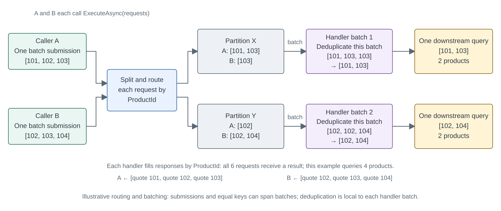

Requests route individually by `ProductId`. In this example, 101 and 103 share one partition, while 102 and 104 share
another. Each partition combines queued requests from both submissions into a handler batch.

**Each handler deduplicates within its own batch.** The two handlers query `[101, 103]` and `[102, 104]` respectively,
then assign responses by `ProductId` to their own requests: four products are queried, and all six requests get a result.

This is one possible grouping. Actual batches depend on enqueue timing, `BatchSize`, and scheduling; equal keys are
not guaranteed to arrive in one batch.

## How Requests Are Batched: Opportunistic Merging

RequestBatcher uses [BufferQueue](https://github.com/eventhorizon-cli/BufferQueue) to combine queued requests within a
.NET process and pass them to an application handler. The current dependency is
[BufferQueue 2.1.0](https://www.nuget.org/packages/BufferQueue/2.1.0); applications do not register or configure it
separately.

This is **opportunistic batching**: writing a request to BufferQueue sends a push notification that wakes an idle
consumer. It first acquires one execution slot, then pulls up to `BatchSize` requests (default: 128) from one partition
and dispatches that batch. If fewer requests are available, it takes those immediately without waiting to fill the batch.

Callers obtain `IRequestBatcher<TRequest>` or `IRequestBatcher<TRequest, TResponse>` through DI, submit requests, and
await their individual results.

After dispatching a batch, the loop continues. If another slot is available, it can pull and dispatch the next batch
without waiting for the previous batch to finish. Each batch holds one slot until its processing completes.

**With a free execution slot and no data in any partition, it waits for a data notification. When all slots are occupied,
it waits for an executing batch to complete.**

There is no periodic polling or fixed collection window. With a free slot, waiting mainly comes from wake-up and
scheduling; when all slots are occupied, requests must wait for capacity to execute. `BatchSize` limits the number of
requests per handler call: a batch may contain just one request at low traffic or several requests already queued in the
same partition during a burst.

Calling `ExecuteAsync` in a loop and awaiting each call before submitting the next gives RequestBatcher no concurrent
work from that caller to merge. To observe actual batching, submit a bounded number of requests concurrently and inspect
the resulting handler batch sizes. Concurrent submissions can share a batch, but they do not guarantee one batch or a
full `BatchSize`.

**A lower `MaxConcurrency` may let requests accumulate while they wait for an execution slot**; once a slot is released,
the requests already queued can merge. **This queueing comes from concurrency control, not an added collection delay.**
Even with `MaxConcurrency = 1`, **a free slot and one queued request allow that request to run without waiting for `BatchSize` items.**
See [Configuring Partitions and MaxConcurrency](#configuring-partitions-and-maxconcurrency) for configuration tradeoffs, and
[Estimating Handler and Downstream Concurrency Separately](#estimating-handler-and-downstream-concurrency-separately)
for the low-concurrency throughput estimate and internal batching example.

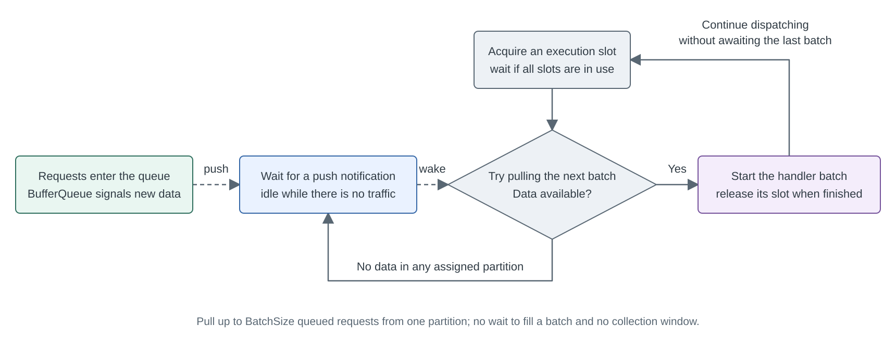

The diagram shows normal consumption and omits cancellation and shutdown. [BufferQueue's consumer loop](https://github.com/eventhorizon-cli/BufferQueue/blob/c276547046223c1d62a13e0537b013622c775266/src/BufferQueue/BufferPullConsumer.cs)
checks the notification version before waiting. If new data was signaled during the scan, it retries the pull to avoid a
missed wake-up.

Requests are held in memory and cannot be recovered after a process failure.

> **Batching does not require callers to assemble a collection.** Separate callers can each submit one `TRequest`
> concurrently. RequestBatcher coalesces requests already queued for the same partition into handler batches of up to
> `BatchSize`. `ExecuteAsync(IEnumerable<TRequest>)` is an additional submission option, not a prerequisite for
> batching.

## When to Use It

**Independent read-only queries are the recommended starting point**: database lookups, cache reads, and downstream
batch-query APIs. They can often share a batch or deduplicate equivalent queries without introducing write side effects.
Requests must still be independent, temporary in-memory queuing must be acceptable, and the downstream operation
must benefit from receiving multiple items:

- database queries that can fetch multiple IDs together, cache multi-gets, and downstream batch reads;
- short traffic bursts where internal queue capacity and downstream concurrency must be bounded;
- work where caller cancellation should discard only requests that have not been dispatched, while dispatched work
  must be allowed to finish independently of that caller;
- related requests that benefit from batch-level merging without relying on handler ordering.

Batch `INSERT`, `UPDATE`, `UPSERT`, and cache writes are also possible, but the application must handle retry
idempotency, concurrent writes across batches, and transaction boundaries. Even equal partition keys do not serialize
handler execution. If partial success within one handler invocation would leave inconsistent state, execute that
invocation in one transaction. A single submission can span several handler batches, so a transaction per handler
does not make the entire submission atomic. RequestBatcher propagates the handler outcome but cannot roll back
writes that have already been committed or recover pending work after a process failure.

## When Not to Use It

RequestBatcher is not a durable background queue or a transaction coordinator:

- Accepted work must survive process failure. Use durable storage or a reliable message broker.
- The operation must commit or roll back with the caller's transaction. Keep it in that transaction.
- The downstream operation requires automatic retries or exactly-once effects. RequestBatcher provides neither.
- The handler requires a minimum batch size or a fixed collection window. RequestBatcher dispatches currently queued
  work without waiting to fill a batch.
- An in-flight downstream operation must stop as soon as its individual caller disconnects, times out, or cancels.
  One handler batch can contain requests from several callers, so caller cancellation tokens are not forwarded to the
  handler and cannot cancel the shared handler call.

**Redis workloads are not necessarily a good fit.** StackExchange.Redis already supports pipelining and connection
multiplexing, so batching savings may not offset RequestBatcher's queueing, scheduling, and result dispatch costs.
Poorly chosen `BatchSize`, `MaxConcurrency`, or other settings can also reduce throughput and increase tail latency.
If the caller already has a set of keys, consider using `MGET`/`MSET` directly. Before introducing RequestBatcher to
combine individual requests, compare throughput, P95/P99 latency, and memory allocations against direct Redis client use.

## Installation and DI Registration

```bash
dotnet add package RequestBatcher
```

The package supports .NET 8 and .NET 10 applications through `net8.0` and `net10.0` assets.

The current version does not support NativeAOT publishing or trimming.

Two registration styles are available:

- **Handler type**: use `AddRequestBatcher` to register a Handler type with an explicit lifetime and keep processing logic in a separate class.
- **Delegate Handler**: use `AddDelegateRequestBatcher`, then pass a static delegate to `ExecuteAsync`; services are injected through its parameters. **Delegate binding is not supported for NativeAOT or trimming.** See [Delegate Handlers](#delegate-handlers).

For primitive request types such as `int` or `string`, prefer [Named RequestBatcher](#named-requestbatcher-instances-and-primitive-requests) to distinguish operations that share the same request type.

### Quickstart

In an ASP.NET Core empty project (`dotnet new web`), install the package above and replace `Program.cs` with this
complete example. It uses an in-memory catalog and the default single partition; no database is required.

```csharp
using Microsoft.Extensions.DependencyInjection;
using RequestBatcher;

var builder = WebApplication.CreateBuilder(args);
builder.Services.AddRequestBatcher<PriceLookup, decimal?, CatalogHandler>(ServiceLifetime.Singleton);

var app = builder.Build();
app.MapGet("/prices/{productId:long}", async (
    long productId,
    IRequestBatcher<PriceLookup, decimal?> batcher,
    CancellationToken cancellationToken) =>
{
    var price = await batcher.ExecuteAsync(new PriceLookup(productId), cancellationToken);
    return price is { } value ? Results.Ok(value) : Results.NotFound();
});
app.Run();

public sealed record PriceLookup(long ProductId);

public sealed class CatalogHandler : IRequestBatchHandler<PriceLookup, decimal?>
{
    private static readonly Dictionary<long, decimal> Prices = new() { [101] = 17.90m };

    public ValueTask HandleAsync(
        IReadOnlyList<RequestBatchEntry<PriceLookup, decimal?>> entries,
        CancellationToken cancellationToken = default)
    {
        entries.SetResponses(request => Prices.TryGetValue(request.ProductId, out var price) ? price : null);

        // Alternatively, replace the call above with per-entry assignment.
        // foreach (var entry in entries)
        // {
        //     entry.SetResponse(Prices.TryGetValue(entry.Request.ProductId, out var price) ? price : null);
        // }

        return ValueTask.CompletedTask;
    }
}
```

Run `dotnet run --urls http://localhost:5080`, then request `GET http://localhost:5080/prices/101` for `17.90`;
an unknown product returns `404`. The handler receives a list even though each caller submits one request.
Concurrent callers may share a handler batch. In your application, replace the catalog lookup with the downstream batch
operation; see the [typed PostgreSQL sample](samples/RequestBatcher.Deduplication) or
[delegate PostgreSQL sample](samples/RequestBatcher.Delegates) for complete database-backed applications.

**A response Handler must assign exactly one response to every entry before completing successfully.** An explicit
`null` is a valid response. Missing assignments fail the entire Handler batch. Callers await the actual Handler
outcome. See [Completion and Failure](#completion-and-failure) for failure and cancellation.

`AddRequestBatcher` registers the handler, coordinator, and internal BufferQueue topic in the application's existing
`IServiceCollection`. The application does not configure BufferQueue directly, and RequestBatcher never builds a
nested service provider.

Scoped and transient handlers are resolved once per handler batch in an asynchronous scope. A singleton handler is
reused across batches and must be thread-safe when `MaxConcurrency > 1`.

Handler execution uses an independent batch context and a DI scope separate from the HTTP request scope; pass needed
business data explicitly in the request. See [Handler Execution Context](#handler-execution-context).

### Partition-Key Routing

A partition key is an optional routing rule for related requests:

```csharp
options.MaxConcurrency = 4;
options.UsePartitionKey(query => query.ProductId, partitionCount: 8);
```

Equal finite, integer-valued numeric keys or equal non-null string keys are routed to the same queue partition among the
configured partition count when it is greater than one. A count of one disables keyed routing and skips the selector;
counts below one are rejected.
Different keys can still share a partition, so keys and partitions are not one-to-one.

Partition routing does not force all requests for one key into the same handler batch, and it does not deduplicate
requests. RequestBatcher provides no global, partition-local, or partition-key handler execution ordering guarantee;
partition routing is not a serialization or mutual-exclusion mechanism.

String routing considers the complete key, so a shared prefix alone does not force different keys into one partition.
Exact partition assignments are internal and may change
between versions; equal keys still route together within a batcher instance. Such changes can affect batch composition
and the amount of duplicate work merged inside a handler batch.

### Configuring Partitions and MaxConcurrency

**`UsePartitionKey(selector, partitionCount: 1)` behaves the same at runtime as leaving `UsePartitionKey` unconfigured.**
Setting the count to `1` clears any previously configured key and skips the selector. Counts below `1`
throw `ArgumentOutOfRangeException`; the selector must still be non-null.
A single partition can still supply several concurrent Handler batches.

**Use one partition by default; add partitions only for a clear keyed-routing need with measured benefits.** More partitions do not add Handler
execution slots. Each pull reads only one partition. **At low traffic, multiple partitions can split requests that could
otherwise be combined, producing more small batches and increasing Handler and downstream calls even with explicit batch submission.** The independent experiments in
[Performance Tuning and Benchmarks](#performance-tuning-and-benchmarks) measure this tradeoff.

**Start load testing with `MaxConcurrency = 1`, then increase it gradually if throughput or queueing latency misses your target.**
Too many execution slots can pull requests earlier into smaller batches, reducing merging and deduplication opportunities;
too few can increase queueing. Prefer the smallest value that meets your throughput and latency requirements.

**Lower concurrency can improve merging but also increase tail latency.** With `MaxConcurrency = 1`, a slow batch
occupies the only execution slot while later requests queue. A Handler using `Task.WhenAll` must wait for its slowest
child query before releasing that slot. Compare actual batch sizes, distinct items queried, downstream call counts,
and end-to-end P95/P99 to decide whether reduced downstream work justifies the extra waiting.
If merging is effective but tail latency misses the target, try `2`, then `4`, while checking downstream capacity.

**Low Handler concurrency does not necessarily mean low request throughput.** Each Handler batch processes multiple requests
and may split them into parallel downstream calls, so a low `MaxConcurrency` can still sustain substantial traffic.
Actual capacity depends on batch size, Handler duration, and downstream capacity; see
[Estimating Handler and Downstream Concurrency Separately](#estimating-handler-and-downstream-concurrency-separately).

When keyed routing is needed, set the partition count explicitly through `UsePartitionKey`. This configuration uses
eight queue partitions sharing four handler execution slots:

```csharp
builder.Services.AddRequestBatcher<ProductQueryItem, ProductBatchHandler>(
    ServiceLifetime.Scoped,
    options =>
    {
        // Per-pod handler-batch limit. Six pods x four slots = at most 24 handler batches cluster-wide.
        options.MaxConcurrency = 4;
        options.BatchSize = 100;
        options.MaxPendingRequests = 5_000;

        // Routing/locality only. Eight queue partitions are independent of the four execution slots.
        options.UsePartitionKey(item => item.ProductId, partitionCount: 8);
    });
```

`partitionCount` controls how requests are distributed across queues; equal keys always route to the same partition.
`MaxConcurrency` limits concurrent handler batches for one registered batcher, with all partitions sharing those slots.
A single partition can also supply several concurrent batches.

### Configuration Reference

| Option | Default | Behavior |
| --- | ---: | --- |
| `BatchSize` | `128` | Maximum requests passed to one handler call. |
| `MaxConcurrency` | `1` | Maximum concurrent handler batches. It is independent of the keyed partition count. |
| `MaxPendingRequests` | `8192` | Internal BufferQueue capacity for requests that have not yet been pulled for execution. |
| `FullMode` | `Wait` | `Wait` waits for capacity and splits explicit groups larger than capacity into slices. `Fail` rejects the whole submission without admitting any item unless it fits immediately. |
| `UsePartitionKey(selector, partitionCount)` | Not set (one partition) | Requires `partitionCount >= 1`; `1` disables keyed routing without invoking the selector, and larger counts route equal keys to one partition. |

No ordering is guaranteed for handler execution, including when `MaxConcurrency = 1`.

## APIs

Use `IRequestBatcher<TRequest>` for completion only, or `IRequestBatcher<TRequest, TResponse>` for a result per request.
Response handlers receive `RequestBatchEntry<TRequest, TResponse>` entries containing the request and its response slot.

### Request-Only API

Use `IRequestBatcher<TRequest>` when callers only need the handler outcome:

```csharp
public interface IRequestBatcher<in TRequest>
{
    // Submit one request and wait for its actual handler outcome.
    Task ExecuteAsync(TRequest request, CancellationToken cancellationToken = default);

    // Submit an existing group; the task waits for every request in that submission.
    Task ExecuteAsync(
        IEnumerable<TRequest> requests,
        CancellationToken cancellationToken = default);
}

public interface IRequestBatchHandler<TRequest>
{
    // Process one handler batch. A successful return completes every request in the batch.
    ValueTask HandleAsync(
        IReadOnlyList<TRequest> requests,
        CancellationToken cancellationToken = default);
}
```

### Request/Response API

Use `IRequestBatcher<TRequest, TResponse>` when every accepted request must yield a typed result:

```csharp
public interface IRequestBatcher<in TRequest, TResponse>
{
    // Submit one request and return its typed response.
    Task<TResponse> ExecuteAsync(
        TRequest request,
        CancellationToken cancellationToken = default);

    // Submit a group and return responses in the same order as the input sequence.
    Task<IReadOnlyList<TResponse>> ExecuteAsync(
        IEnumerable<TRequest> requests,
        CancellationToken cancellationToken = default);
}

public interface IRequestBatchHandler<TRequest, TResponse>
{
    // Process one batch and assign exactly one response to every entry.
    ValueTask HandleAsync(
        IReadOnlyList<RequestBatchEntry<TRequest, TResponse>> entries,
        CancellationToken cancellationToken = default);
}
```

RequestBatcher awaits each handler's `ValueTask` once and never returns it to a caller. Synchronously completing
handlers can therefore avoid a `Task` allocation, while asynchronous I/O can use `async ValueTask`.

### Response Assignment APIs

Response handlers assign one response to each `RequestBatchEntry<TRequest, TResponse>`. The following signatures omit implementation details:

```csharp
public sealed class RequestBatchEntry<TRequest, TResponse>
{
    public TRequest Request { get; }
    public void SetResponse(TResponse response);
}

public static class RequestBatchEntryExtensions
{
    public static void SetResponses<TRequest, TResponse>(
        this IReadOnlyList<RequestBatchEntry<TRequest, TResponse>> entries,
        Func<TRequest, TResponse> responseFactory);

    public static void SetResponses<TRequest, TResponse>(
        this IReadOnlyList<RequestBatchEntry<TRequest, TResponse>> entries,
        IEnumerable<TResponse> responses);
}
```

Use one assignment approach per handler batch. `SetResponse` assigns an individual entry. The factory overload evaluates
the factory in entry order and creates every response before assigning any entry. The sequence overload requires exactly
one response per entry and assigns them in entry order. Assigning `null` is valid for nullable response types; every entry
must be assigned exactly once before the handler returns successfully.

## Request-Only Batching

Define the request and the code that handles one batch:

```csharp
public sealed record OrderWriteRequest(long OrderId, decimal Amount);

public interface IOrderStore
{
    Task WriteBatchAsync(
        IReadOnlyList<OrderWriteRequest> requests,
        CancellationToken cancellationToken);
}

public sealed class OrderWriteBatchHandler(IOrderStore store)
    : IRequestBatchHandler<OrderWriteRequest>
{
    public async ValueTask HandleAsync(
        IReadOnlyList<OrderWriteRequest> requests,
        CancellationToken cancellationToken = default)
    {
        await store.WriteBatchAsync(requests, cancellationToken);
    }
}
```

Register the handler and RequestBatcher together. The handler lifetime is part of the registration; the minimal setup
only needs a batch size:

```csharp
services.AddRequestBatcher<OrderWriteRequest, OrderWriteBatchHandler>(
    ServiceLifetime.Scoped,
    options =>
    {
        options.MaxConcurrency = 4;
        options.BatchSize = 256;
        options.MaxPendingRequests = 5_000;
        options.UsePartitionKey(request => request.OrderId, partitionCount: 8);
    });
```

Inject `IRequestBatcher<TRequest>` into the normal application call path:

```csharp
public sealed class OrderService(IRequestBatcher<OrderWriteRequest> batcher)
{
    public Task SaveAsync(
        OrderWriteRequest request,
        CancellationToken cancellationToken = default) =>
        batcher.ExecuteAsync(request, cancellationToken);
}
```

`SaveAsync` returns the same `Task` produced by RequestBatcher. It completes only after the handler has processed the
request; the caller does not need to know which batch or partition contained it.

## Request/Response Batching

Use the response-enabled API when each request should return a value. The handler receives entries that wrap the
original request and its response slot; `entry.Request` is the original `TRequest`. This example deduplicates repeated
product IDs within the current handler batch before querying the store:

```csharp
using System.Collections.Generic;
using System.Linq;
using System.Threading;
using System.Threading.Tasks;
using RequestBatcher;

public sealed record PriceQuery(long ProductId);
public sealed record PriceQuote(long ProductId, decimal Price);

public interface IPriceStore
{
    // The store returns at most one found quote per requested ID, in any order.
    Task<IReadOnlyList<PriceQuote>> FindAsync(
        IEnumerable<long> productIds,
        CancellationToken cancellationToken);
}

public sealed class PriceQueryHandler(IPriceStore store)
    : IRequestBatchHandler<PriceQuery, PriceQuote?>
{
    public async ValueTask HandleAsync(
        IReadOnlyList<RequestBatchEntry<PriceQuery, PriceQuote?>> entries,
        CancellationToken cancellationToken = default)
    {
        var keys = entries
            .Select(entry => entry.Request.ProductId)
            .Distinct()
            .ToArray();
        var prices = await store.FindAsync(
            keys,
            cancellationToken);
        var pricesByProductId = prices.ToDictionary(price => price.ProductId);

        entries.SetResponses(request => pricesByProductId.GetValueOrDefault(request.ProductId));

        // If query deduplication is unnecessary, remove Distinct() and keep the response factory.
        // Alternatively, replace the query and assignment above with ONE of these styles:
        // 1. Query all requested IDs, then assign each entry directly:
        // var prices = await store.FindAsync(entries.Select(entry => entry.Request.ProductId), cancellationToken);
        // var pricesByProductId = prices.ToDictionary(price => price.ProductId);
        // foreach (var entry in entries)
        // {
        //     entry.SetResponse(pricesByProductId.GetValueOrDefault(entry.Request.ProductId));
        // }
        // 2. If an already aligned response sequence is available, use the ordered overload:
        // var prices = await store.FindAsync(entries.Select(entry => entry.Request.ProductId), cancellationToken);
        // var pricesByProductId = prices.ToDictionary(price => price.ProductId);
        // var orderedResponses = entries
        //     .Select(entry => pricesByProductId.GetValueOrDefault(entry.Request.ProductId))
        //     .ToArray();
        // entries.SetResponses(orderedResponses);
        // Never pass raw backend results to the ordered overload: they may be unordered or omit missing keys.
    }
}

public sealed class PriceService(IRequestBatcher<PriceQuery, PriceQuote?> priceBatcher)
{
    public Task<PriceQuote?> FindAsync(
        long productId,
        CancellationToken cancellationToken = default) =>
        priceBatcher.ExecuteAsync(new PriceQuery(productId), cancellationToken);

    public Task<IReadOnlyList<PriceQuote?>> FindManyAsync(
        IEnumerable<PriceQuery> requests,
        CancellationToken cancellationToken = default) =>
        priceBatcher.ExecuteAsync(requests, cancellationToken);
}
```

Register your application's `IPriceStore` implementation (shown as `PriceStore`) and the batcher in the existing
service collection, then inject `IRequestBatcher<PriceQuery, PriceQuote?>` into application services. The runnable
[PostgreSQL Web API sample](samples/RequestBatcher.Deduplication) uses Dapper and PostgreSQL with a named
`IRequestBatcher<int, decimal?>`: callers submit primitive IDs and receive price values.

```csharp
using Microsoft.Extensions.DependencyInjection;
using RequestBatcher;

services.AddScoped<IPriceStore, PriceStore>();
services.AddRequestBatcher<PriceQuery, PriceQuote?, PriceQueryHandler>(
    ServiceLifetime.Scoped,
    options =>
    {
        options.MaxConcurrency = 4;
        options.BatchSize = 100;
        options.MaxPendingRequests = 5_000;
        options.UsePartitionKey(query => query.ProductId, partitionCount: 8);
    });
```

**Both typed and delegate response handlers must explicitly assign exactly one response to every entry before completing successfully.**
After the Handler completes, the framework checks for missing assignments. An unset entry causes an `InvalidOperationException`
and fails all requests in that Handler batch. For nullable responses, explicitly assigning `null` counts as setting a response;
the check verifies assignment, not whether the value is null.

The example uses standard LINQ `Distinct`
to query each product ID once within the current handler invocation. `Distinct` also supports anonymous composite keys,
value tuples, and custom equality comparers. Missing product IDs are absent from the store result and map to `null`.

**Deduplication is limited to the current handler batch:** it does not combine entries across handler batches or queue
partitions. In this example, the Handler indexes the unordered backend results by product ID. The response factory passed
to `SetResponses` looks up the result for each entry, so duplicate product IDs receive the same response.

All responses are computed before assignment; a factory failure leaves unset entries unchanged. Reference-type results
are shared, not cloned.

If deduplication is unnecessary, remove `Distinct()` and keep the same response factory. Alternatively, assign entries
individually with `entry.SetResponse(response)`, or use the ordered `entries.SetResponses(responses)` overload after producing exactly one response per original entry in input order,
including duplicates and missing requests.

For unordered backend results, use a dictionary with the response factory as shown above; the ordered overload must receive the aligned
sequence, never raw backend rows. The explicit-group overload returns responses in input order even when RequestBatcher
splits the requests across handler batches or queue partitions.
The caller's `Task<TResponse>` succeeds only after the handler succeeds, its item's response has been set, and
the handler scope has been disposed successfully.

### Example: Merging Repeated Queries

Several `PriceQuery` requests in one batch may refer to the same `ProductId`. The handler deduplicates product IDs,
issues one batch query, and maps results by `ProductId` to every original request, including duplicates. Response
assignment does not depend on database row order.

Routing by `ProductId` puts equal product IDs in one partition, but does not guarantee the same batch.
**Deduplication applies only within the current handler batch**; separate batches may query the same product again.
It is not a cache across batches.

The runnable [PostgreSQL Web API sample](samples/RequestBatcher.Deduplication) uses primitive `int` IDs in its named
`"price"` pipeline. Its `PriceQueryHandler` deduplicates IDs with `Distinct()`, queries PostgreSQL, and maps rows by
product ID with `entries.SetResponses(id => pricesById.GetValueOrDefault(id)?.Price)`. Callers receive `decimal?`
prices, with `null` for missing products. Both single-ID and list submissions use this handler; list results retain
input order and duplicates even when requests span several handler batches.

## Explicit Group Submission

When the caller already has multiple requests, it can submit them with one call:

```csharp
await batcher.ExecuteAsync(orderWriteRequests, cancellationToken);
```

RequestBatcher snapshots the sequence and submits it as one producer operation. In `Wait` mode, a group no larger than
`MaxPendingRequests` is admitted atomically; a larger group is admitted as consecutive capacity-sized slices as
capacity becomes available. In `Fail` mode, the whole group must fit immediately.

The returned `Task` waits for every request from the submission. **One submission does not force one handler call:** the
sequence may still be split by `BatchSize` or partition routing.

> **An explicit group is not a partition boundary.** With more than one partition, RequestBatcher routes every item
> independently; it does not send the whole submission to one partition. The group stays in one partition when no
> partition key is configured or when every item produces the same partition key. `MaxConcurrency = 1` limits handler
> concurrency but does not merge keyed partitions.

## Single vs. Group Submission

In this documentation, a **submission** is one caller invocation of `ExecuteAsync`. A **handler batch** is the
`IReadOnlyList<TRequest>` or `IReadOnlyList<RequestBatchEntry<TRequest, TResponse>>` passed to one `HandleAsync`
invocation.

**A submission and a handler batch are not the same boundary.**

| Behavior | Single request | Explicit group |
| --- | --- | --- |
| Input | Uses the supplied `TRequest`. | Enumerates once and snapshots the sequence. An empty sequence completes immediately. |
| Capacity | Reserves capacity for one request. | `Wait` admits an oversized group in consecutive capacity-sized slices; `Fail` requires the whole group to fit immediately. |
| Routing | Routes the request using the configured routing mode. | Routes every item independently, so one submission can span several partitions. |
| Handler calls | May be handled together with other requests already queued in the same partition. | Does not create a handler boundary. Items can be split by partition and `BatchSize`, and may run in parallel. |
| Completion | The returned `Task` represents this request's actual handler outcome. | The returned `Task` waits for every item in the submission. |
| Failure | A handler failure fails every request in that handler batch. | Some items may succeed before another handler batch fails. The group `Task` faults, but successful work is not rolled back. |
| Cancellation | Cancellation removes the request only before dispatch. | The same token applies to every item; undispatched items can be canceled while dispatched items continue to their actual outcome. |

## Named RequestBatcher Instances and Primitive Requests

A request can be a primitive ID. Use the `batcherName` overload when several operations accept the same request type:
for example, `"price"` and `"stock"` can each register an independent `int` pipeline. Each name has its own handler,
options, queue capacity, and concurrency limit. Named and unnamed registrations may coexist.

```csharp
using Microsoft.Extensions.DependencyInjection;
using RequestBatcher;

services.AddRequestBatcher<int, decimal?, PriceByIdHandler>(
    batcherName: "price",
    handlerLifetime: ServiceLifetime.Scoped,
    configure: options =>
    {
        options.BatchSize = 100;
        options.MaxConcurrency = 4;
        options.UsePartitionKey(id => id, partitionCount: 8);
    });

var batcher = serviceProvider.GetRequiredKeyedService<IRequestBatcher<int, decimal?>>("price");
var prices = await batcher.ExecuteAsync(new[] { 101, 102, 101 });
```

The handler below uses the `IPriceStore` contract from the request/response example. Register its implementation
in the application's service collection as shown above:

```csharp
public sealed class PriceByIdHandler(IPriceStore store) : IRequestBatchHandler<int, decimal?>
{
    public async ValueTask HandleAsync(
        IReadOnlyList<RequestBatchEntry<int, decimal?>> entries,
        CancellationToken cancellationToken = default)
    {
        var ids = entries.Select(entry => (long)entry.Request).Distinct().ToArray();
        var prices = await store.FindAsync(ids, cancellationToken).ConfigureAwait(false);
        var pricesById = prices.ToDictionary(price => price.ProductId);
        entries.SetResponses(id => pricesById.GetValueOrDefault(id)?.Price);
    }
}
```

Results follow input order, including duplicates; missing products return null. An explicit list can split into
multiple handler batches.

In application services, inject the named batcher through the constructor. Register `PriceLookup` with
`services.AddScoped<PriceLookup>()`; the attribute selects the same `"price"` name used during batcher registration:

```csharp
using Microsoft.Extensions.DependencyInjection;
using RequestBatcher;

public sealed class PriceLookup(
    [FromKeyedServices("price")] IRequestBatcher<int, decimal?> batcher)
{
    public Task<IReadOnlyList<decimal?>> FindAsync(
        IEnumerable<int> productIds,
        CancellationToken cancellationToken = default) =>
        batcher.ExecuteAsync(productIds, cancellationToken);
}
```

In ASP.NET Core MVC, the same attribute can inject the batcher directly into a Controller Action parameter:

```csharp
using Microsoft.AspNetCore.Mvc;
using Microsoft.Extensions.DependencyInjection;
using RequestBatcher;

[ApiController]
[Route("api/prices")]
public sealed class PricesController : ControllerBase
{
    [HttpPost("query")]
    public Task<IReadOnlyList<decimal?>> FindAsync(
        [FromBody] int[] productIds,
        [FromKeyedServices("price")] IRequestBatcher<int, decimal?> batcher,
        CancellationToken cancellationToken) =>
        batcher.ExecuteAsync(productIds, cancellationToken);
}
```

Register MVC with `builder.Services.AddControllers()` and map it with `app.MapControllers()`. Minimal API handler
parameters support the same attribute, as shown in the runnable sample. See Microsoft's official documentation for
[keyed services and constructor injection](https://learn.microsoft.com/en-us/dotnet/core/extensions/dependency-injection/overview#keyed-services)
and [Controller Action injection](https://learn.microsoft.com/en-us/aspnet/core/mvc/controllers/dependency-injection?view=aspnetcore-8.0#action-injection-with-fromkeyedservices).

The request-only overload also accepts `batcherName`. Names are case-sensitive and must not be null, empty, or
whitespace; a request type and name identify one pipeline, regardless of response type. Use the original overload
for the unnamed default. Configure each batcher through its registration callback; settings are fixed at registration
and cannot be changed at runtime. `UsePartitionKey` routes requests within the selected batcher and
does not select a batcher or serialize its handler batches.

The [named versus unnamed benchmark](docs/evaluations/named-batching/README.md) keeps request/response types,
handlers and batching options identical, comparing single and explicit submissions with singleton and scoped handlers.

The runnable [PostgreSQL sample](samples/RequestBatcher.Deduplication) uses a named `int` price-query batcher with
`decimal?` responses, widens IDs for its PostgreSQL `bigint` column, and accepts a JSON `int[]` at `POST /prices/query`.

## Delegate Handlers

Delegate handlers keep short batch-processing logic next to the `ExecuteAsync` call that submits the work, so you
can read and update the submission and handling code together. They suit straightforward batch lookups or result
mapping. At the call site, use a static lambda, static anonymous method, static local function, or static method
group. When the logic grows or needs to be reused and tested independently, use a separate `IRequestBatchHandler`
class.

Delegate binding requires dynamic code and is not supported for NativeAOT or trimming.

Use `AddDelegateRequestBatcher` to declare the request/response contract and options, then supply a static handler
target at the call site:

**Handlers must use static implementations without capturing locals or instance state.** Lambdas, anonymous
methods and local functions must explicitly declare `static`; method groups must refer to ordinary or generic
static methods. Receive services through injected parameters. Delegates may be passed directly or through variables,
fields, parameters, properties or factories, including explicit construction, parentheses and casts.

```csharp
using Microsoft.Extensions.DependencyInjection;
using RequestBatcher;

services.AddKeyedScoped<IPriceStore, PriceStore>("catalog");
services.AddDelegateRequestBatcher<int, decimal?>(
    batcherName: "price",
    configure: options =>
    {
        options.BatchSize = 100;
        options.MaxConcurrency = 4;
    });

var batcher = serviceProvider.GetRequiredKeyedService<IRequestBatcher<int, decimal?>>("price");
var prices = await batcher.ExecuteAsync(
    new[] { 101, 102, 101 },
    static async ValueTask (
        IReadOnlyList<RequestBatchEntry<int, decimal?>> entries,
        [FromKeyedServices("catalog")] IPriceStore store,
        CancellationToken batchCancellation) =>
    {
        var ids = entries.Select(entry => (long)entry.Request).Distinct().ToArray();
        var rows = await store.FindAsync(ids, batchCancellation).ConfigureAwait(false);
        var pricesById = rows.ToDictionary(row => row.ProductId);
        entries.SetResponses(id => pricesById.GetValueOrDefault(id)?.Price);
    });
```

Alternatively, replace the lambda above with a static method or static local function. Choose one form per pipeline:

```csharp
var price = await batcher.ExecuteAsync(101, HandlePricesAsync);

static async ValueTask HandlePricesAsync(
    IReadOnlyList<RequestBatchEntry<int, decimal?>> entries,
    [FromKeyedServices("catalog")] IPriceStore store,
    CancellationToken batchCancellation)
{
    var ids = entries.Select(entry => (long)entry.Request).Distinct();
    var rows = await store.FindAsync(ids, batchCancellation).ConfigureAwait(false);
    var pricesById = rows.ToDictionary(row => row.ProductId);
    entries.SetResponses(id => pricesById.GetValueOrDefault(id)?.Price);
}
```

This uses the `IPriceStore` contract from the request/response example above; register your own implementation
(shown as `PriceStore`). Request-only pipelines use `AddDelegateRequestBatcher<TRequest>()` with a first lambda
parameter of `IReadOnlyList<TRequest>`. Both modes support individual requests and explicit lists through the
`ExecuteAsync` extension methods; the original interfaces have no added members.

For simple or shared request types such as `int` or `string`, prefer a distinct `batcherName` for each
business operation. For example, name a price `int` pipeline `"price"` when another operation also uses `int`,
to avoid delegate collisions or accidental binding. Omit `batcherName` to use the default pipeline. A request type
and name can use only one registration mode: delegate registrations require the handler on every submission, while
typed-handler registrations use the original overloads.

The pipeline binds one handler delegate. Repeated calls with an equal delegate reuse it; a
different delegate fails before enqueueing. Different handler targets represent different handlers even when their
bodies look identical, so use different batcher names for different operations. Concurrent first calls bind atomically.
Services are supplied per dispatched batch, not captured from the caller's scope.

The first parameter must be the exact batch list type. Other parameters are required DI services, with
`[FromKeyedServices(key)]` selecting a keyed service. The key must be explicit; inherited keys are unsupported.
Web applications may write `[FromServices]` on ordinary
service parameters; it is optional because services are injected by convention. The handler may omit the batch
lifecycle `CancellationToken`; if present, it must declare exactly one and must not give it a default such as
`= default`. This injected token is shared by the batch and is distinct from the optional caller
`ExecuteAsync` `cancellationToken`. The lambda may return `void`,
`Task` or `ValueTask`; `async void` and result-bearing return types are rejected. Every response entry must still
receive a response. List results preserve order and duplicates even when submission spans multiple handler batches.

The delegate handler and its bound delegate are always singleton per pipeline; registration has no
`ServiceLifetime` argument. Injected services retain their registered lifetimes: singleton instances are shared by
the container, scoped instances are shared within one batch, and transient instances are resolved separately for
each parameter. Resolved services are never cached in the singleton handler. Typed-handler registrations continue
to honor their explicit handler lifetime.

Each batch that injects services owns an async DI scope, and callers complete after scope disposal. A delegate
without service parameters skips scope creation.

**The built-in analyzer provides basic compile-time checks.** Both diagnostics are errors by default:

- `RB0001` rejects known non-static lambdas, local functions and instance methods.
- `RB0002` checks known delegate signatures, including batch-list and return types, parameter modifiers and defaults,
  and the restrictions on `CancellationToken` and `[FromKeyedServices]`.

Delegate targets may be unknown after passing through parameters, properties or factories. These forms remain
allowed; callers must ensure the eventual target is static. Runtime binding validates the actual signature, service
binding and delegate identity, but cannot reliably distinguish static-lambda source from a non-capturing ordinary
lambda. Ordinary typed-handler calls are unaffected, and consumers can disable the analyzers. See the
[delegate-handler design](docs/delegate-handlers-design.md).

Measured time and allocations are recorded in the
[delegate-handler performance comparison](docs/evaluations/delegate-handlers/README.md).

The standalone [delegate PostgreSQL sample](samples/RequestBatcher.Delegates) uses delegate handlers for both price updates and
`POST /prices/query` list lookups. Each static lambda injects a keyed scoped `PriceStore` per handler batch.
The [typed-handler sample](samples/RequestBatcher.Deduplication) provides the original handler-class examples separately.

## Request Processing Flow

1. A caller submits one request through `ExecuteAsync(request)` or an explicit group through `ExecuteAsync(requests)`.
2. RequestBatcher admits the submission according to the configured capacity policy and routes each item to an in-memory partition.
3. The internal `BatchDispatchLoop` acquires a free handler slot, pulls up to `BatchSize` requests already queued in
   one partition, and automatically commits the queue's consumption progress.
4. Requests canceled before dispatch are skipped; the remaining requests are passed to the handler. Requests from
   different submissions can share one handler call.
5. The handler outcome completes the corresponding request tasks; an explicit group's `Task` waits for every item.

An explicit submission can span multiple handler batches. RequestBatcher does not wait to fill `BatchSize` or use a
fixed collection window. When a handler slot is available, it processes the requests already queued, even just one.


The architecture diagram shows the coordinator, the in-memory partition queue, and the separate `Task` completion
path for each accepted request.

### Capacity and Backpressure

`MaxPendingRequests` sets the bounded BufferQueue capacity for requests that remain queued. A batch is auto-committed
when the dispatch loop pulls it, before its handler starts. Therefore, up to `MaxConcurrency * BatchSize` pulled
requests can be executing in addition to queued capacity. It is not a limit on the size of an explicit submission or
on the number of callers waiting for capacity:

- `FullMode = Wait` waits asynchronously for enough capacity and honors caller cancellation while waiting.
- In `Wait` mode, a group no larger than the capacity is admitted atomically. A larger group is split into consecutive
  capacity-sized slices. Cancellation can leave already dispatched requests running while undispatched requests are
  canceled.
- `FullMode = Fail` requires the whole submission to fit immediately. Otherwise, including when a group is larger than
  the capacity, it returns a faulted `Task` with `RequestBatchQueueFullException` without admitting any item.

The default is `FullMode = Wait`. `MaxPendingRequests` bounds queued requests, not the number of callers or submissions
waiting for capacity, and it is not a process-wide memory limit. Asynchronous waiting does not hold a thread, but each
pending request and its completion state still consumes memory. Apply an ingress concurrency or rate limit when total
waiting work must be bounded.

Replace the Quickstart `MapGet` block with the following example to add a cancellation timer while preserving the HTTP
request's cancellation signal. Keep the remaining Quickstart code; its registration uses the default `Wait` mode:

```csharp
app.MapGet("/prices/{productId:long}", async Task<IResult> (
    long productId,
    IRequestBatcher<PriceLookup, decimal?> batcher,
    CancellationToken requestCancellation) =>
{
    using var admissionCancellation = CancellationTokenSource.CreateLinkedTokenSource(requestCancellation);
    admissionCancellation.CancelAfter(TimeSpan.FromMilliseconds(200));

    try
    {
        var price = await batcher.ExecuteAsync(new PriceLookup(productId), admissionCancellation.Token);
        return price is { } value ? Results.Ok(value) : Results.NotFound();
    }
    catch (RequestBatchQueueFullException)
    {
        return Results.StatusCode(StatusCodes.Status503ServiceUnavailable);
    }
});
```

The `RequestBatchQueueFullException` branch applies when the batcher uses `FullMode = Fail`; the default is `Wait`. To
enable that branch, replace the Quickstart registration with:

```csharp
builder.Services.AddRequestBatcher<PriceLookup, decimal?, CatalogHandler>(
    ServiceLifetime.Singleton,
    options => options.FullMode = RequestBatchFullMode.Fail);
```

The 200 ms timer is illustrative: it starts before `ExecuteAsync` and can cancel capacity waits and undispatched requests.
**It does not guarantee that `ExecuteAsync` returns within 200 ms.** After dispatch, the caller still waits for the actual
handler outcome. Cancellation exceptions propagate for the application to handle; a handler cancellation must not be
automatically classified as an admission timeout.

### Routing and Dispatch

**The internal queue's partition count is not the handler concurrency level.** Partitions organize queueing and routing;
all partitions share `MaxConcurrency` handler slots. Multiple batches from one partition can also execute concurrently.

Without `UsePartitionKey`, or with `partitionCount: 1`, the queue uses one partition and does not route by key.
With a larger count, equal keys route to the same partition. Supported keys are finite integer-valued numeric keys
and non-null string keys. Equal keys can still span multiple handler batches; routing does not deduplicate requests
or guarantee handler execution order.

In the diagram, `P` is the internal partition count and `H = MaxConcurrency` is the handler-batch concurrency limit.

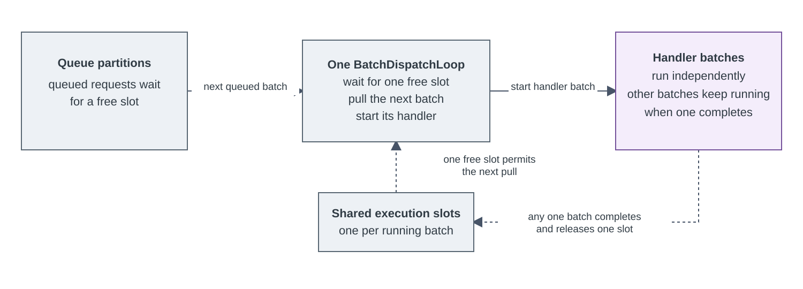

One `BatchDispatchLoop` owns all `P` partitions and shares `H` global execution slots. It waits for a free slot before
pulling a queue batch, then starts its handler and returns to waiting for another slot. When all slots are occupied,
requests remain in BufferQueue. As soon as any one handler batch completes, its slot becomes free and the loop can pull
the next batch while the other handlers keep running. It does not wait for all currently running batches to finish.

When keyed routing is enabled, the queue rotates pull opportunities among readable partitions. This does not promise
equal handler execution time or fairness between individual keys.

A handler runs on the dispatch call path until it completes or reaches an incomplete asynchronous wait. CPU-heavy
or synchronously blocking work before that point can delay other batches even when execution slots remain free.
`MaxConcurrency` is an upper bound; it does not automatically parallelize synchronous handler code.

### Handler Execution Context

A Handler batch can combine requests from multiple callers, and the Handler runs in its own batch execution context.
Do not rely on access to an originating request's `HttpContext` through `IHttpContextAccessor`, or on caller ambient
state such as `AsyncLocal` values, `ILogger.BeginScope` scopes, `Activity.Current`, or `Baggage`. The Handler's DI scope
is also separate from the HTTP request scope: a scoped dependency does not reuse the originating request-scoped
instance or state initialized there.

Read values the Handler needs before submission, such as currency, language, or a business correlation ID, and carry
them as immutable request data. Do not pass an `HttpContext`, request service provider, or request-scoped service
instance to preserve caller context. RequestBatcher tracing connects `Execute` and `Handle` spans with links; those
links do not restore caller ambient context. Activities created inside a Handler still use the Handler batch span as
their parent.

### Completion and Failure

- A successful handler call marks every request in that handler batch as successful. An explicit submission's task
  waits for all its requests, including those assigned to other handler batches.
- If the handler throws a non-cancellation exception, every request in that handler batch fails with the original
  exception.
- Response tasks represent a handler `OperationCanceledException` as cancellation. A single response preserves its
  cancellation token and throws `TaskCanceledException` when awaited; the original cancellation exception instance,
  message, and derived type are not preserved.
- RequestBatcher does not retry a failed handler.
- The batch overload waits for the whole submitted group and faults if any handler call involved in that submission
  fails.
- If several handler calls fail for one explicit group, `await` throws one original exception following normal `Task`
  semantics. All distinct exception instances remain available through `Task.Exception.InnerExceptions`; one handler
  exception fanned out to several requests is recorded once.

### Caller Cancellation

Caller cancellation can remove a request only before handler dispatch. Once the handler starts, RequestBatcher reports
the real handler outcome instead of changing the caller's `Task` to canceled. This prevents cancellation from hiding a
side effect that may already have happened.

The token passed to the handler belongs to RequestBatcher's processing lifetime, not to an individual caller. One
caller's cancellation therefore cannot cancel work for the other requests in the same batch.

If all callers cancel after a batch has been dispatched, the batch still runs and its tasks report the actual handler
outcome. Use the Handler's own downstream timeout or cancellation policy when the database or API call must stop; caller
cancellation is not a shared downstream timeout.

For example, replace the `store.FindAsync` call in the earlier `PriceQueryHandler` with:

```csharp
using var batchTimeout = CancellationTokenSource.CreateLinkedTokenSource(cancellationToken);
batchTimeout.CancelAfter(TimeSpan.FromSeconds(2));
var prices = await store.FindAsync(keys, batchTimeout.Token).ConfigureAwait(false);
```

This links to the Handler's batch token; two seconds is only an example. The store must forward the token to a downstream
operation that supports cancellation. A timer cannot forcibly stop an operation that ignores cancellation; configure
client or database command timeouts as appropriate. If the Handler propagates `OperationCanceledException`, response tasks
become canceled as described in [Completion and Failure](#completion-and-failure).

For an explicit group, the caller token is applied to every item. Cancellation can therefore leave a mix of canceled
items and items that were already dispatched. The returned `Task` still waits for all items; it faults if any item
faults, otherwise it is canceled when at least one item was canceled. Completed side effects are not rolled back.

### Shutdown and Disposal

`DisposeAsync` stops accepting new requests, drains every accepted submission (including submissions waiting for
capacity) before canceling the consumer, then releases coordinator-owned resources. A stalled downstream call can keep
disposal waiting. Concurrent and repeated disposal calls share the same operation.
When registered through `AddRequestBatcher`, the application container owns async disposal.

## Performance Tuning and Benchmarks

### Preparing Inputs for an Agent

If you want an AI Agent to help choose an initial configuration before adopting RequestBatcher, share the following
existing-system measurements and business constraints. Use the same endpoint and time window, distinguish typical from
peak traffic, and mark whether each value describes one instance or the whole cluster. Use the proposal as a starting
point, then adjust it through load testing.

| Existing data | What to provide | What it helps decide |
| --- | --- | --- |
| Entry HTTP QPS | Typical and peak QPS per instance, including short bursts | Initial per-instance load and concurrency range |
| Request items per entry | Mean, P95, and maximum item count per entry | `BatchSize` and downstream fan-out assumptions |
| Downstream calls per entry | Calls per incoming request, items per call, and whether calls are sequential or parallel | Handler fan-out shape and child-call capacity |
| Downstream RT and limits | Mean, P95, P99 RT, plus errors, timeouts, and rate-limit behavior | `MaxConcurrency` headroom and failure constraints |
| Downstream batch capability | Supported items per call, payload limits, and RT at representative batch sizes | Downstream sub-batch size and `BatchSize` starting point |
| End-to-end latency target | Current mean, P95, P99, target values, and allowed additional queueing time | Queueing budget and concurrency/throughput tradeoffs |
| Pod and resource state | Pod count, traffic balance, CPU, memory, GC, connection-pool wait, and other saturation signals | Per-pod concurrency and partition strategy |
| Same-window duplication and hot keys | Duplicate-ID ratio and hot-key distribution during the same window; do not substitute an all-day duplicate rate | Whether deduplication or partition-key routing is useful |

Also state the business semantics: read versus write behavior, ordering requirements, deduplication rules, cancellation
and failure handling, and downstream QPS, concurrency, or connection-pool limits. Mark missing values as `unknown`; a single-item RT
does not establish a batch RT, so use a small targeted test when batch behavior is unknown.

**Minimum useful input:** per-instance peak QPS, items per entry, downstream call pattern, downstream mean/P99 RT,
batch limits, and the end-to-end latency target.

An Agent can use these inputs to propose initial `MaxConcurrency`, `BatchSize`, `MaxPendingRequests`, and partition
settings, together with assumptions and measurements still needed. The proposal is not an optimum or a performance
guarantee; adjust it with correctness and load tests in the target environment.

### Partition Measurements: Single Submissions

**These are single-machine tests with simulated downstream latency, for reference only. Repeat the measurements
with your own deployment, request distribution and real downstream service.**

Test environment: Apple M2 Max, macOS 27.0.1, .NET 10.0.0 (Arm64), and BenchmarkDotNet 0.15.8.
In-process asynchronous delays simulate downstream latency.

The two submission APIs were measured as **independent experiments**, each comparing one and four partitions at
`BatchSize = 64`, `MaxConcurrency = 4`, and eight producers. Each chart compares partition counts within a workload;
workloads differ in request count and downstream cost. The charts show **in-process QPS**, counting Execute calls.

**One request queries one product**; several requests may query the same product. A **wave** is one round in which
eight producers submit their requests and await every response before the next round. The chart shows **total requests
per wave** and their product distribution. Each `ExecuteAsync(request)` call submits one request; producers start
their calls before awaiting the results. Each Handler invocation processes at most 64 requests, with at most four
Handler batches executing concurrently.

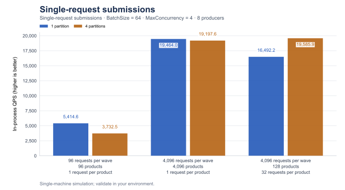

**Changing the partition count from one to four** spreads small request sets across queues and creates more partial
batches. Each batch still makes a downstream call and occupies an execution slot, so the same wave requires more
calls and waiting. **Prefer one partition for this workload** so queued requests can merge.

With enough unique-product requests, both configurations form nearly full batches and additional partitions show
no established benefit. Repeated-product requests gain more opportunities for within-batch deduplication when routed
by product. The simulated downstream latency increases with distinct product count, so less duplicate querying helps.
**Check that the real downstream benefits from this locality before adding partitions.**

### Partition Measurements: Explicit Batch Submissions

**This is also a single-machine simulation for reference; validate it in your own environment.**

Each `ExecuteAsync(requests)` call submits a list: a 96-request wave makes eight calls of 12 requests; a 4,096-request
wave makes 128 calls of 32 requests. A call can split across Handler batches, and separate calls can share a Handler
batch. The Handler limit remains 64 requests per batch.
Compare one and four partitions within this experiment, not against the single-submission chart.

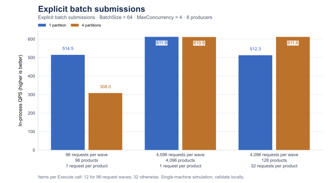

Explicit submission enqueues a group without fixing the Handler batch boundary. **Changing the partition count from
one to four still splits small request sets into more Handler calls. Grouping requests at the caller therefore does
not prevent partial batches caused by partition routing.** Use explicit submission when a list is already available,
and choose partition count according to the batches actually formed.

For large unique-product workloads, more partitions show no established timing benefit and increase allocation.
The repeated-product workload benefits from fewer duplicate downstream queries while retaining nearly full Handler
batches. **Evaluate actual batch size, downstream work and allocation together**, rather than choosing partitions from
the caller's list size alone.

The distinct-item workloads simulate 12 ms per downstream batch call. The repeated-key workload uses 128 product
IDs and `8 + ceil(distinct IDs in the Handler batch / 8)` ms, so querying fewer distinct items reduces simulated RT.
This benefit depends on the workload and downstream behavior; equal keys can still span batches.
**Start with one partition by default. Add partitions cautiously, only when measured benefits outweigh smaller batches and routing costs.**
Already having a list is a reason to use explicit submission, not a reason to add partitions. Both APIs still form
Handler batches from requests available in one partition.

See the [complete evaluation](docs/evaluations/partition-submissions/README.md) for item QPS, Handler batch QPS, allocations, confidence intervals,
correctness checks and limitations. Each chart shows means; time uncertainty is reported separately.

### Sizing `MaxConcurrency` with Little's Law

For queries, assume one handler batch makes one downstream batch call and other handler work takes negligible time.
Then estimate concurrency using **downstream batch-call QPS** and mean response time (RT, in seconds):

```text
Average concurrent calls = batch-call QPS × RT
MaxConcurrency_per_pod ≈ ceil(average concurrent calls / pod_count × headroom)
```

Use monitoring data for an existing operation, or expected values and load-test results for a new one. QPS and RT must
refer to the same operation and configuration. Recalibrate with production metrics after launch.

Distinguish Execute call QPS, request-item QPS and Handler batch QPS. One explicit submission may contain many items
and span several Handler batches. Under sustained backlog, a rough Handler
capacity estimate is `MaxConcurrency / mean Handler seconds`; item capacity additionally depends on the **actual**
mean batch size. Use measured batch size in this estimate rather than configured `BatchSize`.
Leave headroom and verify the downstream can sustain the load.

For example, six active pods making a combined 1,920 downstream batch queries per second at a mean RT of 50 ms have
about `1,920 × 0.050 = 96` concurrent calls on average. With even traffic distribution, that is `96 / 6 = 16` per pod.

**16 estimates average load; it is not a recommended concurrency limit by itself.** Allow headroom within downstream
rate limits and connection-pool capacity, then load-test to verify latency and throughput.

### Tuning `BatchSize`, Partitions, and `MaxConcurrency` Together

Continuing the example, the existing calls each query 20 distinct products: `1,920 × 20 = 38,400` request items/s,
with possible duplicates across calls. Try `BatchSize = 80`: suppose a handler receives 80 items and deduplicates them
to 60 products. It queries those products in two parallel calls of 30, awaits both, and assigns results to all 80 items.

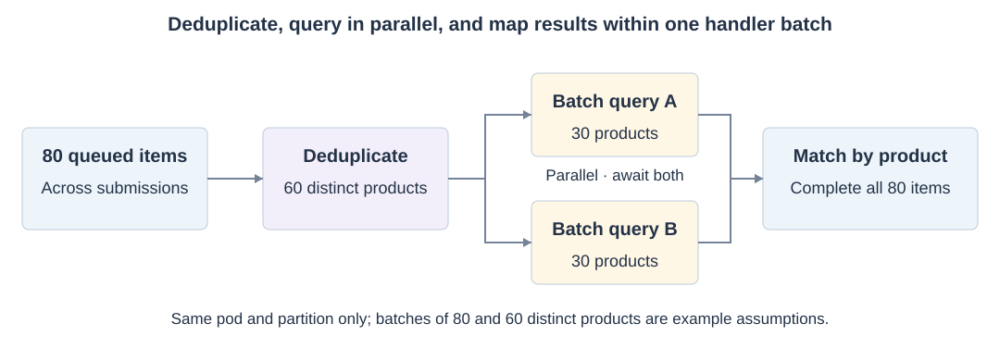

**Merging lets different submissions share a deduplication opportunity; splitting keeps individual downstream calls
small.** Choose the sizes separately: `BatchSize` limits items before deduplication, while the handler controls products
per downstream call.

Under these assumptions, handlers process `38,400 / 80 = 480` batches/s, making `480 × 2 = 960` downstream calls and
querying `960 × 30 = 28,800` product items/s. That is **50% fewer calls and 25% fewer product items queried**, while
all requests still receive results.

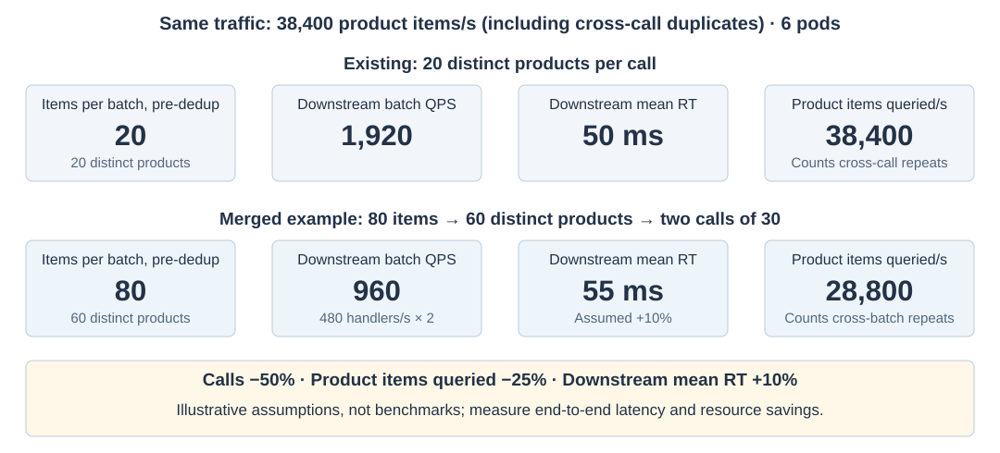

The diagram assumes downstream mean RT rises from 50 ms to 55 ms. **These are illustrative estimates, not benchmark
results.** Fewer calls and repeated queries are potential benefits; longer RT is a cost. Compare end-to-end latency
and actual resource use to decide whether the tradeoff is worthwhile.

`BatchSize = 80` guarantees neither batches of 80 nor 60 distinct products after deduplication. Split the actual distinct
products: with no duplicates, the handler needs three calls of `30 + 30 + 20`. Only requests currently queued in the same
pod and partition can merge, **without an added wait to fill a batch**. Partition count and consumption speed both
affect merging, so start load testing with fewer partitions.

### Estimating Handler and Downstream Concurrency Separately

**`MaxConcurrency` limits concurrent Handler batches for one registered batcher, not the downstream calls within each batch.**
Start load testing at `MaxConcurrency = 1` and increase it as needed, for example by testing `2–4`. A `BatchSize`
of roughly `3–10` times the desired downstream sub-batch size `S` is another tuning starting point.

Inside the Handler, deduplicate when appropriate, split the resulting items into sub-batches of at most `S`,
run those downstream calls in parallel, await all of them, and map the results back to every original request. The actual
number of child calls is `ceil(U / S)`, where `U` is the post-deduplication item count: low traffic creates fewer calls
without waiting to fill a full batch, while backlog allows more small sub-batches to run concurrently.
**Downstream call counts can therefore adapt to actual batch size while Handler concurrency stays low.**

**`MaxConcurrency = 1` means one Handler batch at a time, not one request or one downstream call at a time.**
Assume sustained load, 120 actual requests for distinct products in each Handler batch, and a downstream that supports
four concurrent queries taking about 20 ms each. `Chunk(30)` splits the 120 requests into four parallel queries,
and `Task.WhenAll` waits for the slowest. Temporarily ignoring scheduling, deduplication, and response-mapping overhead,
this means **one batch of 120 requests completes every 20 ms (0.02 seconds)**.

**One second contains fifty 20 ms intervals.** Each interval completes one batch of 120 requests,
so about 50 batches finish each second, with 120 items per batch:
**`50 batches/s × 120 items/batch = 6,000 items/s`**.

This explains why low Handler concurrency can support high throughput; **it does not mean one slot is sufficient for every workload**.

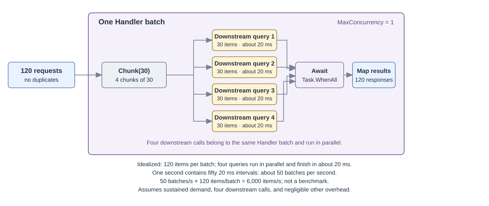

This is an idealized estimate under sustained load, not a measured result. More generally,
`item throughput ≈ MaxConcurrency × actual mean batch size / mean Handler seconds`.
Use actual batch size and complete Handler duration, not the configured maximum `BatchSize`.
Increase `MaxConcurrency` gradually if throughput or queueing latency misses your target, checking downstream saturation as well.

The concrete sequence is **`Distinct → Chunk → start async queries → Task.WhenAll → assign responses`**.
This replacement Handler uses `PriceQuery`, `PriceQuote`, and `IPriceStore` from
[Request/Response Batching](#requestresponse-batching). Each downstream query receives at most 30 distinct products:

```csharp
public sealed class ChunkedPriceQueryHandler(IPriceStore store)
    : IRequestBatchHandler<PriceQuery, PriceQuote?>
{
    public async ValueTask HandleAsync(
        IReadOnlyList<RequestBatchEntry<PriceQuery, PriceQuote?>> entries,
        CancellationToken cancellationToken = default)
    {
        const int downstreamBatchSize = 30;
        var ids = entries
            .Select(entry => entry.Request.ProductId)
            .Distinct()
            .ToArray();

        IEnumerable<PriceQuote> prices;
        if (ids.Length <= downstreamBatchSize)
        {
            prices = await store.FindAsync(ids, cancellationToken).ConfigureAwait(false);
        }
        else
        {
            var queries = ids
                .Chunk(downstreamBatchSize)
                .Select(async chunk => await store.FindAsync(chunk, cancellationToken).ConfigureAwait(false))
                .ToArray();
            var results = await Task.WhenAll(queries).ConfigureAwait(false);
            prices = results.SelectMany(rows => rows);
        }

        var pricesById = prices.ToDictionary(row => row.ProductId);
        entries.SetResponses(request => pricesById.GetValueOrDefault(request.ProductId));
    }
}
```

**Check the deduplicated count first: up to 30 items use one direct query; only larger sets use `Chunk(30)` and `Task.WhenAll`.**
The single-query path avoids chunk arrays, a query Task array, and an extra `WhenAll` wait.
Count the products actually queried, not the original requests: 120 requests that deduplicate to 20 products need just one query.

`Chunk(30)` splits the IDs already available without waiting to fill a chunk. In the split path, `ToArray()` enumerates the queries
and starts each asynchronous call; `Task.WhenAll` waits for all of them. **It does not throttle concurrency,
and asynchronous I/O does not need a `Task.Run` wrapper.** After all queries succeed, mapping by product ID assigns a
response to every original entry, including duplicates and an explicit `null` for missing products.
If any query fails, the Handler fails after all started queries finish, failing its entire Handler batch.

The `IPriceStore` implementation must support concurrent calls. For example, these queries must not share an EF Core
`DbContext`; the store should provide an independent context or connection for each query.

These values are tuning starting points, not benchmark conclusions. If each sub-batch makes one downstream call and all
Handler slots fan out fully, one batcher's upper bound is `C * ceil(B / S)` child calls at once (`C = MaxConcurrency`,
`B = BatchSize`); this is not a strict QPS limit. Across Handlers, batchers, or pods, use a shared rate or concurrency
budget when the downstream service needs a hard limit.

Returning to the earlier product-query example, Handler-batch QPS is 480. Estimate Handler concurrency using the mean duration of the whole Handler, including all child
queries, response mapping, and scope disposal, rather than a single downstream call's RT:

```text
MaxConcurrency_per_pod ≈ ceil(handler-batch QPS × mean handler duration / pod_count × headroom)
```

Also check downstream concurrency against the maximum number of calls per handler. For example, with
`MaxConcurrency = 4`, batches of 80 can each split into three parallel queries, allowing `4 × 3 = 12` downstream calls
at once from one batcher. Account for all pods as well.

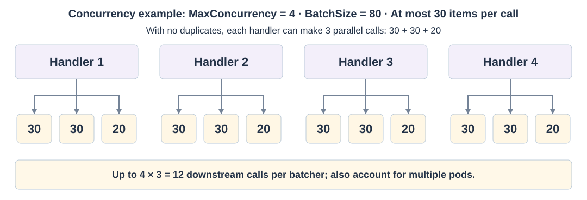

The value 4 illustrates the relationship; it is not a recommendation for the traffic above. To strictly limit downstream
calls, use a shared concurrency limit for child queries in the handler.

### Validating Merging and Deduplication with Load Tests

Use the existing 20-product batch calls as the baseline. Keep request data, arrival rate, duplicate fraction, hot-key
distribution, and downstream resource limits consistent. Cover low, normal, and burst traffic, comparing:

- **Work performed:** actual batch sizes, distinct products per batch, downstream call counts, and total product items
  queried, counting repeated queries across batches.
- **Latency and throughput:** downstream and handler mean RT, caller end-to-end P95/P99, queue wait, throughput, errors,
  and throttling.
- **Resource costs:** application and downstream CPU, memory allocations, and connection-pool use.

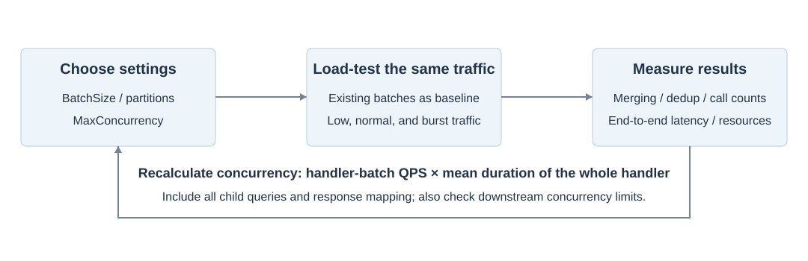

After each adjustment, recalculate concurrency using measured handler-batch QPS and duration, then retest merging.
**Aim to reduce downstream work while meeting latency and resource requirements**; larger batches or lower downstream
QPS alone do not determine the best configuration.

Size `MaxPendingRequests`, the queue capacity, from `items/second per batcher × acceptable queue time`, then verify
admission latency and memory use under bursts.

## Observability

### OpenTelemetry Integration

The core [`RequestBatcher`](https://www.nuget.org/packages/RequestBatcher) package exposes the `RequestBatcher`
ActivitySource and Meter through built-in .NET APIs, without an OpenTelemetry dependency. Install the optional
[`RequestBatcher.OpenTelemetry`](https://www.nuget.org/packages/RequestBatcher.OpenTelemetry) package for registration
extensions and coordinated sampling of submissions and Handler batches. The two packages are versioned independently.

Install the integration and the hosting/instrumentation/exporter packages used by your application:

```bash
dotnet add package RequestBatcher
dotnet add package RequestBatcher.OpenTelemetry
dotnet add package OpenTelemetry.Extensions.Hosting
dotnet add package OpenTelemetry.Instrumentation.AspNetCore
dotnet add package OpenTelemetry.Exporter.OpenTelemetryProtocol
```

Register tracing and metrics with your application's existing providers:

```csharp
using Microsoft.Extensions.DependencyInjection;
using OpenTelemetry.Metrics;
using OpenTelemetry.Trace;

builder.Services.AddOpenTelemetry()
    .WithTracing(tracing => tracing
        .AddAspNetCoreInstrumentation()
        .AddRequestBatcherInstrumentation()
        .AddOtlpExporter())
    .WithMetrics(metrics => metrics
        .AddRequestBatcherInstrumentation()
        .AddOtlpExporter());
```

Installing the package alone does not enable collection; register the extension on each provider you use.

### Tracing

| Span | What to inspect |
| --- | --- |
| `RequestBatcher.Execute` | One `ExecuteAsync` submission, under the caller's current span when present; otherwise a root span. Duration includes capacity waiting, queueing, Handler processing, and result completion. |
| `RequestBatcher.Handle` | One Handler batch, as an independent trace root. Its children show instrumented database and HTTP calls made by the Handler. |

Start with `Execute` and follow its links to the `Handle` spans that processed its requests. A submission can span
several Handler batches, and one Handler batch can combine requests from several submissions. Links let you navigate
between these traces; they do not make the spans parent and child or guarantee execution order.

Named instances append the registered name, for example `RequestBatcher.Execute pricing-queries` and
`RequestBatcher.Handle pricing-queries`. Use these attributes when filtering or inspecting spans:

- `requestbatcher.name`: the configured batcher name, when present.
- `requestbatcher.request.type`: the public request type's short name, such as `Int32`, without its namespace.
- `requestbatcher.batch.size`: the number of requests in a Handler batch.
- `requestbatcher.batch.submission.count`: how many distinct `ExecuteAsync` submissions contributed to that batch.
  Several items from one submission count once within each batch.

Handlers run in the independent batch execution context described in [Handler Execution Context](#handler-execution-context).
Pass required business data explicitly in requests. Execute/Handle span links connect the traces without restoring
caller ambient context; Activities created inside a Handler follow its batch span normally.

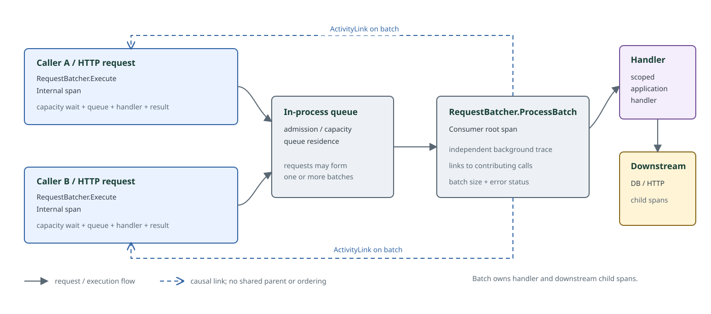

#### Sampling

With the tracing extension registered, the application's sampler decides whether to sample each `Execute` span.
The integration determines `Handle` sampling from the `Execute` spans whose requests entered that Handler batch:

| Execute spans represented in the batch | Handle sampling |
| --- | --- |
| At least one is sampled | Sample the Handler batch. |
| All are unsampled | Do not sample the Handler batch. |

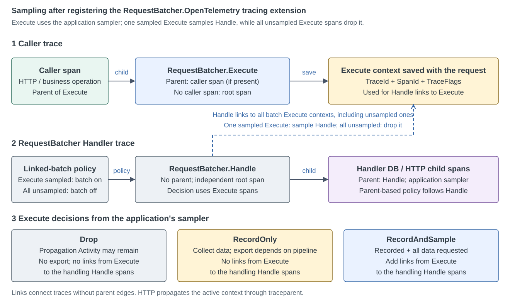

Handler database and HTTP child spans still use the application's sampler. With `ParentBasedSampler`, children
follow their parent's sampling decision; spans without a parent use its configured root sampler.
For example, `ParentBasedSampler(new AlwaysOnSampler())` samples roots and follows the parent for child spans.
The integration uses the table above for the independent `Handle` root.

You can choose direct `AddSource("RequestBatcher")` registration without the integration package. In that case, the
application's sampler decides `Handle` sampling independently, so a sampled `Execute` may lack its corresponding
recorded Handler trace. Sampling and exporter/link limits can also leave trace associations incomplete; configure the
SDK's span link limit if large batches require more links. A 0% sampling rate does not completely disable instrumentation.

The [observability design](docs/observability-design.md)
contains the detailed sampling flow, context/link implementation, and performance evaluations.

### Metrics

For metrics alone, you can choose direct Meter registration without installing the integration package:

```csharp
builder.Services.AddOpenTelemetry()
    .WithMetrics(metrics => metrics.AddMeter("RequestBatcher"));
```

Alternatively, install [`RequestBatcher.OpenTelemetry`](https://www.nuget.org/packages/RequestBatcher.OpenTelemetry) and
use the metrics `AddRequestBatcherInstrumentation()` extension shown above.

| Instrument | Type | Unit | Meaning |
| --- | --- | --- | --- |
| `requestbatcher.requests.submitted` | `Counter<long>` | `{request}` | Accepted requests. |
| `requestbatcher.requests.processed` | `Counter<long>` | `{request}` | Requests processed by a Handler, including failed attempts. |
| `requestbatcher.batches.processed` | `Counter<long>` | `{batch}` | Handler batches processed. |
| `requestbatcher.batch.size` | `Histogram<long>` | `{request}` | Requests per Handler batch. |
| `requestbatcher.batch.duration` | `Histogram<double>` | `ms` | Handler batch duration in milliseconds, including handler scope disposal. |

Counters accumulate counts. Histograms record distributions; the `ms` duration unit means milliseconds.

Dimensions contain only the short request type (`requestbatcher.request.type`) and optional batcher name
(`requestbatcher.name`). Types with the same short name share a dimension; use batcher names to distinguish pipelines.
Request payloads, tenant values, and partition keys are not recorded.

Instrument names already contain `requestbatcher.`. The sample's Prometheus exporter produces names such as
`requestbatcher_batches_processed_total`; leave an additional `requestbatcher` exporter namespace/prefix unset to
avoid `requestbatcher_requestbatcher_*`.

With a custom `System.Diagnostics.Metrics.MeterListener`, explicitly subscribe to each instrument you want:

```csharp
listener.InstrumentPublished = (instrument, meterListener) =>
{
    if (instrument.Meter.Name == "RequestBatcher")
    {
        meterListener.EnableMeasurementEvents(instrument);
    }
};
```

- Discovery and measurement callbacks alone do not subscribe. Call `EnableMeasurementEvents` once per desired
  instrument per listener; filter `instrument.Name` if needed.
- Register `long` callbacks for counts and batch size and a `double` callback for duration. Call `Start()` before
  submitting work and keep the listener alive until the batcher has shut down. Earlier measurements are not replayed.
- Callbacks run synchronously and may run concurrently. Keep them lightweight and thread-safe, avoid blocking I/O,
  and prevent exceptions from escaping. Copy any tags needed after the callback returns. Custom listeners provide
  their own aggregation and export.

### Logs

Built-in logs use the application's `Microsoft.Extensions.Logging` pipeline; no OpenTelemetry integration package is
required. The category prefix is `RequestBatcher.RequestBatchCoordinator`. Configure the whole library in
`appsettings.json`:

```json
{"Logging":{"LogLevel":{"RequestBatcher":"Warning"}}}
```

`Warning` retains Warning and more severe logs. Use `Debug` for startup and shutdown diagnostics, or `Trace` to also
see each batch start and completion. Handler failures include the original exception; request payloads are not logged.

## Sample Application

The [continuous-read observability sample](samples/RequestBatcher.Observability/README.md) starts the Cart and Pricing Web APIs, a C# traffic generator, PostgreSQL,
and Grafana OTel LGTM with Docker Compose. It shows complete call spans, independent linked batch spans,
and downstream database spans while concurrent Cart requests submit 2–10 item carts that share RequestBatcher batches.

The [PostgreSQL Web API sample](samples/RequestBatcher.Deduplication) demonstrates two pipelines in a Minimal API:

- `POST /prices` submits a structured `PriceUpdate` to the unnamed write batcher. The handler merges updates by
  product ID, keeps the highest version in its batch, and performs a PostgreSQL upsert.
- `GET /prices/{productId}` submits one `int` ID to the named `"price"` batcher and returns a price value, or `404`
  when the product is missing.
- `POST /prices/query` submits a JSON `int[]` to the same named batcher and returns a `decimal?` array in input order,
  preserving duplicates and returning `null` for missing products.

Both query endpoints inject `[FromKeyedServices("price")] IRequestBatcher<int, decimal?>`. With product `101` stored
at `17.90` and products `102` and `999` absent, submitting `[101,102,101,999]` returns `[17.90,null,17.90,null]`.
The list can span multiple handler batches; duplicate IDs share a database lookup only within each handler batch.
See the [sample README](samples/RequestBatcher.Deduplication/README.md) for Docker startup and complete curl commands.

The standalone [delegate-handler PostgreSQL sample](samples/RequestBatcher.Delegates) uses `AddDelegateRequestBatcher` and static lambdas
for both `POST /prices` updates and `POST /prices/query` list lookups. The query pipeline is named `"price"` and accepts
primitive `int` IDs with `decimal?` responses. Each lambda receives a keyed scoped `PriceStore` from its batch scope;
the delegate handler is singleton and registration has no lifetime argument. The original sample remains the
handler-class version. The delegate sample has its own HTTP and database ports; see its
[README](samples/RequestBatcher.Delegates/README.md) for startup and curl commands.

Maintainers can publish packages independently using the [release workflow](docs/package-release-design.md).

## Upgrade Notes

The response wrapper is `RequestBatchEntry<TRequest, TResponse>`. When upgrading code that used
`RequestBatchItem<TRequest, TResponse>`, update that type and its extension class name to `RequestBatchEntry`
and `RequestBatchEntryExtensions`, then rebuild all consumers. This is a source and binary breaking change;
response assignment and completion behavior are unchanged.

## License

RequestBatcher is available under the [MIT License](LICENSE).
