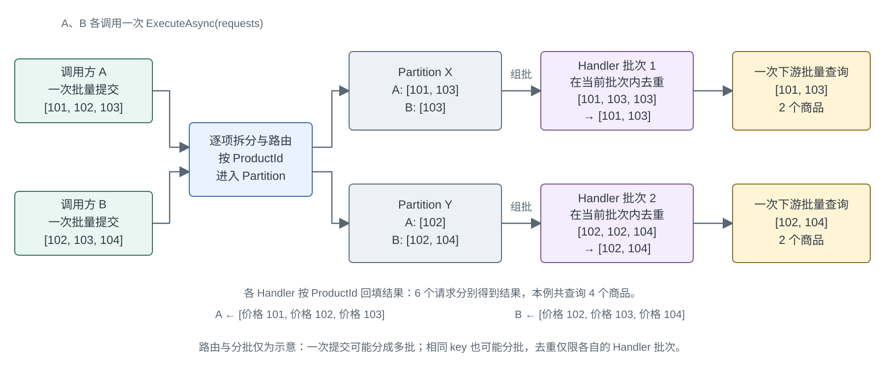
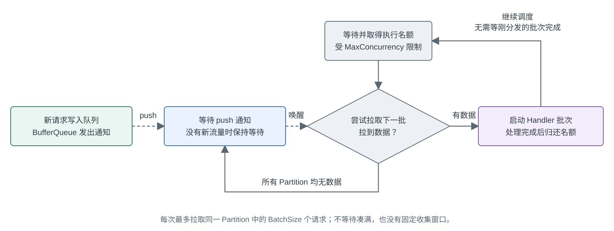
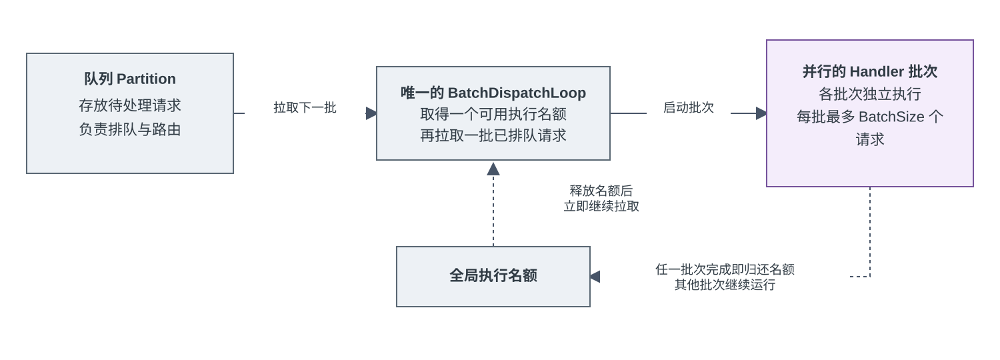
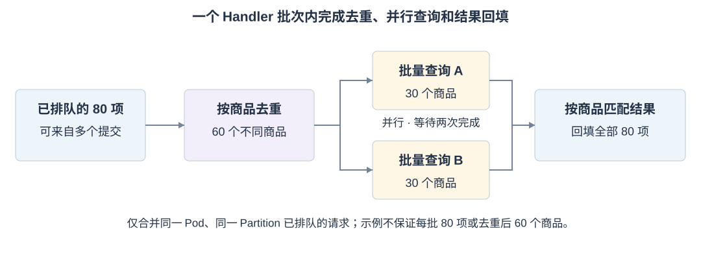
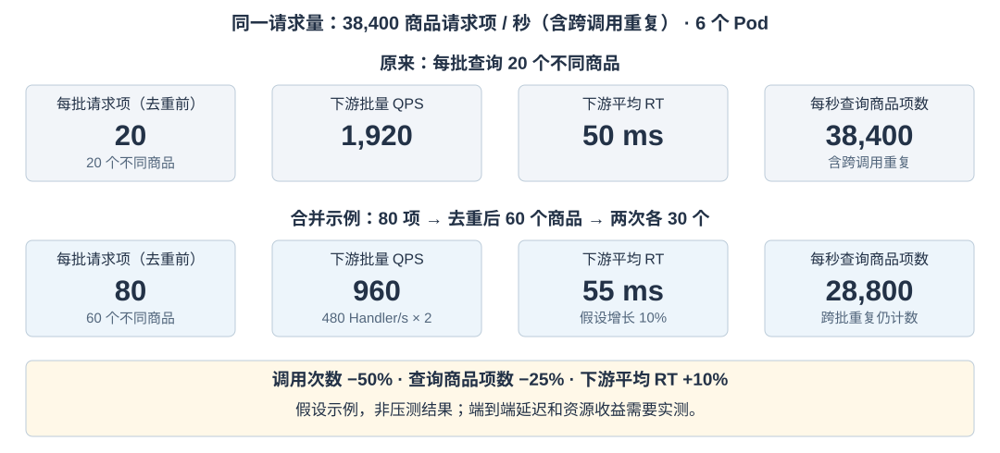
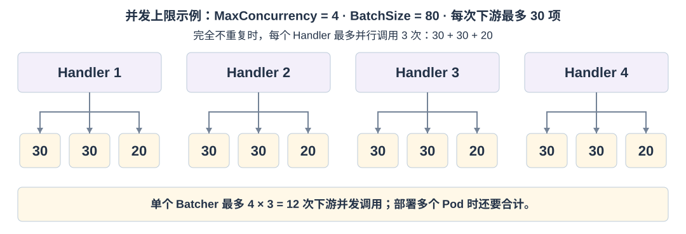
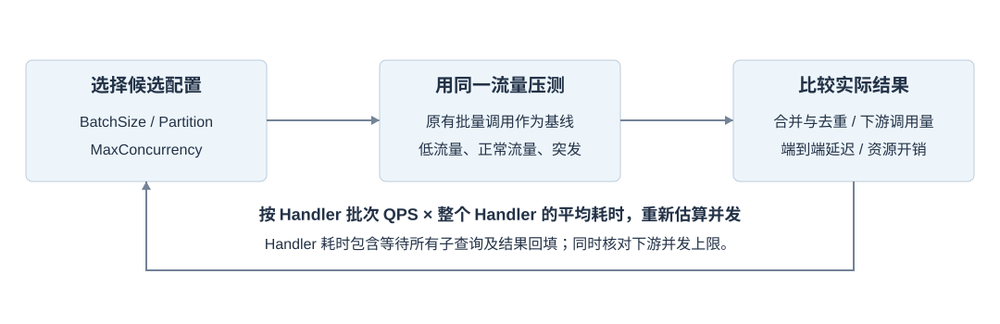
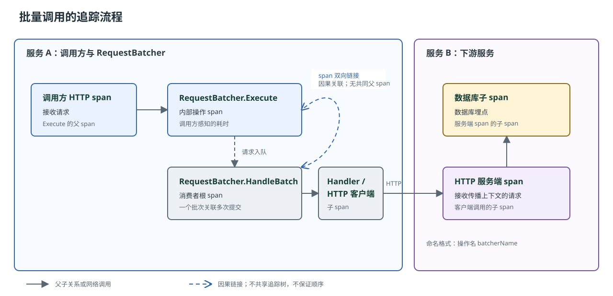

# RequestBatcher

[](https://www.nuget.org/packages/RequestBatcher)
[](https://www.nuget.org/packages/RequestBatcher.OpenTelemetry)
[](https://github.com/eventhorizon-cli/RequestBatcher/actions/workflows/dotnet-build.yml)
[](https://codecov.io/gh/eventhorizon-cli/RequestBatcher)
[](LICENSE)

[English](README.md) | **简体中文**

RequestBatcher 是一个运行在进程内的 .NET 批处理库，**原生支持单请求和批量请求**。调用方通过
`ExecuteAsync(request)` 提交单个请求，或通过 `ExecuteAsync(requests)` 提交一批请求，并等待对应结果。

RequestBatcher 会合并已经排队的请求，限制 Handler 批次并发数和队列容量，再将批次交给应用的 Handler 处理。
它适用于支持一次处理多个数据项的数据库、缓存和下游 API。



多个独立的并发请求可以先合并为一个批次，再执行一次下游批量操作。图示仅用于说明：只有已经在同一 Partition 中排队的请求
才可能合并为同一批。

**一次批量 API 调用，不等于一次 Handler 调用。** 下图中，A、B 各调用一次批量 API，分别提交商品
`[101, 102, 103]` 和 `[102, 103, 104]` 的查询请求。



请求按 `ProductId` 逐项路由。图中，101、103 进入一个 Partition，102、104 进入另一个；来自 A、B 的请求
在各 Partition 中合并成 Handler 批次。

**去重由 Handler 在当前批次内完成。** 两个 Handler 批次分别查询 `[101, 103]` 和 `[102, 104]`，再按
`ProductId` 为各自批次中的请求回填结果：本例共查询 4 个商品，6 个请求各自得到结果。

这只是可能的分批结果。实际批次受入队时机、`BatchSize` 和调度影响，相同 Key 不保证一次收齐。

## 请求如何合并：机会式合并

上面的示意图展示了请求可能如何合并。本节说明这种批次是如何形成的。

RequestBatcher 基于 [BufferQueue](https://github.com/eventhorizon-cli/BufferQueue)，将 .NET 进程内已经排队的并发请求
合并为批次，交给应用的 Handler 处理。当前依赖 [BufferQueue 2.1.0](https://www.nuget.org/packages/BufferQueue/2.1.0)，
应用无需单独注册或配置它。

这种批次处理可以理解为**机会式攒批（Opportunistic Batching）**：请求写入 BufferQueue 后会发出通知，唤醒空闲的消费流程。
消费流程先占用一个执行名额，再通过拉取 API 从一个 Partition 拉取最多 `BatchSize` 条请求（默认 128 条），随后分发这一批。
如果当前不足一批，就直接取出已有请求，不额外等待凑满。

调用方通过 DI 获取 `IRequestBatcher<TRequest>` 或 `IRequestBatcher<TRequest, TResponse>`，提交请求并等待各自的结果。

调度循环分发一个批次后会继续运行。只要还有空闲名额，就可以继续拉取和分发下一批，无需等待刚分发的批次完成。
每一批独占一个执行名额，处理结束后归还。

**只有所有分配的 Partition 都没有数据时，才等待下一次通知。**

这个过程不依赖定时轮询，也没有固定的收集窗口。有空闲名额时，等待主要来自唤醒和调度；名额占满时，请求仍需排队。
`BatchSize` 只限制每批的最大数量：低流量时一批可能只有一个请求，突发流量时则可能合并同一 Partition 中的多个请求。



图中展示正常消费流程，省略了取消与停止分支。[BufferQueue 的消费循环](https://github.com/eventhorizon-cli/BufferQueue/blob/c276547046223c1d62a13e0537b013622c775266/src/BufferQueue/BufferPullConsumer.cs)
会在进入等待前检查通知版本；如果这期间有新数据通知到达，就重新尝试拉取，避免漏掉唤醒。

请求仅保存在进程内，进程故障后无法恢复尚未完成的请求。

> **调用方无需先收集请求，也能获得批量处理。** 多个调用方可以并发地各自提交一个
> `TRequest`；RequestBatcher 会将同一 Partition 中已排队的零散请求合并为最多 `BatchSize` 项的处理批次。
> `ExecuteAsync(IEnumerable<TRequest>)` 只是额外的提交方式，并不是产生批量处理的前提。

## 适用场景

**优先推荐用于彼此独立的只读查询**，例如数据库查询、缓存读取和下游批量查询 API。这类请求通常更容易合批，
等价查询也更容易去重，无需处理写入副作用。前提是请求彼此独立、可以接受在内存中短暂排队，且下游一次处理多项确实更高效：

- 按多个 ID 批量查询数据库、批量读取缓存，或调用下游批量查询接口；
- 需要限制内部队列容量和下游并发量的短时流量突发；
- 调用方取消时，只需要撤销尚未分发的请求；已分发的操作应继续执行并返回实际处理结果；
- 可以在同一处理批次内合并相关请求，且正确性不依赖 Handler 执行顺序。

批量 `INSERT`、`UPDATE`、`UPSERT` 和缓存写入也可以使用，但应用需要自行处理重试幂等性、跨批次并发写入冲突和事务边界。
即使 Partition Key 相同，不同 Handler 批次也可能并发执行。如果一次 Handler 调用只成功一部分会造成数据不一致，
应由 Handler 在同一个事务中完成该批更新。一次提交可能拆成多个 Handler 批次，因此每个 Handler 各自使用事务，
并不能保证整次提交的原子性。RequestBatcher 只负责传递 Handler 的处理结果，不会回滚已经提交的数据，也无法在进程故障后恢复待处理请求。

## 不适用场景

RequestBatcher 既不是持久化后台队列，也不是事务协调器：

- 已接收的请求必须在进程故障后仍可恢复。此时应使用持久化存储或可靠消息队列。
- 操作必须随调用方事务一起提交或回滚。应将它留在原事务中。
- 下游操作必须依赖自动重试，或副作用必须严格恰好一次（exactly-once）。RequestBatcher 不提供这些保证。
- 下游操作必须等待最小批量凑齐，或者依赖固定的收集窗口。RequestBatcher 会直接处理当前已排队的请求。
- 单个调用方断开、超时或取消后，正在执行的下游操作也必须立即停止。一个处理批次可能包含来自多个调用方的
  请求，因此单个调用方的 `CancellationToken` 不会传给 Handler，也不能取消这个共享的 Handler 调用。

## 安装与 DI 注册

```bash
dotnet add package RequestBatcher
```

包提供 `net8.0` 和 `net10.0` 资产，支持 .NET 8 和 .NET 10 应用。

启动时通过 `AddRequestBatcher` 注册带返回值的 Handler 和批处理服务。Handler 依赖应用自己的 `IPriceStore` 实现；调用时从
同一个 DI 容器获取 `IRequestBatcher<PriceQuery, PriceQuote?>`，或在应用服务的构造函数中注入它。

```csharp
using Microsoft.Extensions.DependencyInjection;
using RequestBatcher;

// 应用启动时，注册存储服务和带返回值的批处理服务。
services.AddScoped<IPriceStore, PriceStore>();
services.AddRequestBatcher<PriceQuery, PriceQuote?, PriceQueryHandler>(
    ServiceLifetime.Scoped,
    options =>
    {
        // 4 个 Handler 批次并发执行名额，由 8 个队列 Partition 共享。
        options.MaxConcurrency = 4;
        options.BatchSize = 100;
        options.MaxPendingRequests = 5_000;
        // 相同的商品 ID 路由到同一 Partition；不同批次仍可能并发执行。
        options.UsePartitionKey(query => query.ProductId, partitionCount: 8);
    });

// 调用处从应用自己的 Service Provider 获取带返回值的泛型接口。
var batcher = serviceProvider.GetRequiredService<IRequestBatcher<PriceQuery, PriceQuote?>>();
var quote = await batcher.ExecuteAsync(new PriceQuery(ProductId: 101));
```

代码示例需要引入 `Microsoft.Extensions.DependencyInjection` 和 `RequestBatcher` 命名空间。下方[带返回值批处理](#带返回值批处理)定义了
`PriceQuery`、`PriceQuote`、`PriceQueryHandler` 以及 `IPriceStore` 依赖。应用服务中推荐通过构造函数注入
`IRequestBatcher<PriceQuery, PriceQuote?>`。

## API 概览

响应包装类型统一命名为 `RequestBatchEntry<TRequest, TResponse>`。升级已有代码时，将
`RequestBatchItem<TRequest, TResponse>` 和 `RequestBatchItemExtensions` 分别改为
`RequestBatchEntry<TRequest, TResponse>` 和 `RequestBatchEntryExtensions`，并重新编译所有调用方。
这是源码与二进制不兼容的变更；响应赋值与完成行为保持一致。

### 无返回值 API

当调用方只需要知道 Handler 是否成功完成时，使用 `IRequestBatcher<TRequest>`：

```csharp
public interface IRequestBatcher<in TRequest>
{
    // 提交一个请求，等待它实际的 Handler 处理结果。
    Task ExecuteAsync(TRequest request, CancellationToken cancellationToken = default);

    // 提交调用方已有的一组请求；返回的 Task 等待整次提交完成。
    Task ExecuteAsync(
        IEnumerable<TRequest> requests,
        CancellationToken cancellationToken = default);
}

public interface IRequestBatchHandler<TRequest>
{
    // 处理一个批次；成功返回后，该批次中的所有请求都会完成。
    ValueTask HandleAsync(
        IReadOnlyList<TRequest> requests,
        CancellationToken cancellationToken = default);
}
```

### 带返回值 API

当每个请求都需要一个强类型返回值时，使用 `IRequestBatcher<TRequest, TResponse>`：

```csharp
public interface IRequestBatcher<in TRequest, TResponse>
{
    // 提交一个请求，返回它的强类型结果。
    Task<TResponse> ExecuteAsync(
        TRequest request,
        CancellationToken cancellationToken = default);

    // 提交一组请求，返回结果的顺序与输入序列保持一致。
    Task<IReadOnlyList<TResponse>> ExecuteAsync(
        IEnumerable<TRequest> requests,
        CancellationToken cancellationToken = default);
}

public interface IRequestBatchHandler<TRequest, TResponse>
{
    // 处理一个批次，并为每个条目设置且仅设置一个结果。
    ValueTask HandleAsync(
        IReadOnlyList<RequestBatchEntry<TRequest, TResponse>> entries,
        CancellationToken cancellationToken = default);
}
```

RequestBatcher 只会在内部等待每次 Handler 调用返回的 `ValueTask` 一次，不会将它返回给调用方。同步完成的 Handler
可以因此避免分配 `Task`；普通异步 I/O 仍可直接使用 `async ValueTask` 实现。

## 无返回值批处理

先定义请求类型和批量 Handler：

```csharp
public sealed record OrderWriteRequest(long OrderId, decimal Amount);

public interface IOrderStore
{
    Task WriteBatchAsync(
        IReadOnlyList<OrderWriteRequest> requests,
        CancellationToken cancellationToken);
}

public sealed class OrderWriteBatchHandler(IOrderStore store)
    : IRequestBatchHandler<OrderWriteRequest>
{
    public async ValueTask HandleAsync(
        IReadOnlyList<OrderWriteRequest> requests,
        CancellationToken cancellationToken = default)
    {
        await store.WriteBatchAsync(requests, cancellationToken);
    }
}
```

注册时同时指定 Handler 和生命周期；最小配置只需设置批次上限：

```csharp
services.AddRequestBatcher<OrderWriteRequest, OrderWriteBatchHandler>(
    ServiceLifetime.Scoped,
    options =>
    {
        options.MaxConcurrency = 4;
        options.BatchSize = 256;
        options.MaxPendingRequests = 5_000;
        options.UsePartitionKey(request => request.OrderId, partitionCount: 8);
    });
```

在常规应用服务中注入 `IRequestBatcher<TRequest>`：

```csharp
public sealed class OrderService(IRequestBatcher<OrderWriteRequest> batcher)
{
    public Task SaveAsync(
        OrderWriteRequest request,
        CancellationToken cancellationToken = default) =>
        batcher.ExecuteAsync(request, cancellationToken);
}
```

`SaveAsync` 直接返回 RequestBatcher 创建的 `Task`。只有 Handler 完成包含该请求的批次后，这个 `Task` 才会
完成；调用方无需知道请求进入了哪个批次或 Partition。

## 带返回值批处理

如果每个请求都需要返回一个值，请使用带返回值的 API。Handler 接收由
`RequestBatchEntry<TRequest, TResponse>` 包装的条目列表；每个条目都包含原始请求和返回值槽位，其中 `entry.Request`
是原始的 `TRequest`。下面的示例使用标准 LINQ
`Distinct`，先在当前处理批次内合并重复的商品 ID，再查询存储层：

```csharp
using System.Collections.Generic;
using System.Linq;
using System.Threading;
using System.Threading.Tasks;
using RequestBatcher;

public sealed record PriceQuery(long ProductId);
public sealed record PriceQuote(long ProductId, decimal Price);

public interface IPriceStore
{
    // 存储层对每个请求的 ID 最多返回一条结果，返回顺序不固定。
    Task<IReadOnlyList<PriceQuote>> FindAsync(
        IEnumerable<long> productIds,
        CancellationToken cancellationToken);
}

public sealed class PriceQueryHandler(IPriceStore store)
    : IRequestBatchHandler<PriceQuery, PriceQuote?>
{
    public async ValueTask HandleAsync(
        IReadOnlyList<RequestBatchEntry<PriceQuery, PriceQuote?>> entries,
        CancellationToken cancellationToken = default)
    {
        var keys = entries
            .Select(entry => entry.Request.ProductId)
            .Distinct()
            .ToArray();
        var prices = await store.FindAsync(
            keys,
            cancellationToken);
        var pricesByProductId = prices.ToDictionary(price => price.ProductId);

        entries.SetResponses(request => pricesByProductId.GetValueOrDefault(request.ProductId));

        // 如果不需要查询去重，可以删除 Distinct()，保留同一个响应工厂。
        // 也可以将上面的查询和赋值替换为下面两种方式之一：
        // 1. 查询所有请求 ID，再逐个为条目设置结果：
        // var prices = await store.FindAsync(entries.Select(entry => entry.Request.ProductId), cancellationToken);
        // var pricesByProductId = prices.ToDictionary(price => price.ProductId);
        // foreach (var entry in entries)
        // {
        //     entry.SetResponse(pricesByProductId.GetValueOrDefault(entry.Request.ProductId));
        // }
        // 2. 已经得到与输入顺序对齐的结果序列时，使用按输入顺序赋值的重载：
        // var prices = await store.FindAsync(entries.Select(entry => entry.Request.ProductId), cancellationToken);
        // var pricesByProductId = prices.ToDictionary(price => price.ProductId);
        // var orderedResponses = entries
        //     .Select(entry => pricesByProductId.GetValueOrDefault(entry.Request.ProductId))
        //     .ToArray();
        // entries.SetResponses(orderedResponses);
        // 不要将原始后端结果直接传给按顺序赋值的重载：结果可能无序，也可能缺少某些请求的 ID。
    }
}

public sealed class PriceService(IRequestBatcher<PriceQuery, PriceQuote?> priceBatcher)
{
    public Task<PriceQuote?> FindAsync(
        long productId,
        CancellationToken cancellationToken = default) =>
        priceBatcher.ExecuteAsync(new PriceQuery(productId), cancellationToken);

    public Task<IReadOnlyList<PriceQuote?>> FindManyAsync(
        IEnumerable<PriceQuery> requests,
        CancellationToken cancellationToken = default) =>
        priceBatcher.ExecuteAsync(requests, cancellationToken);
}
```

先在应用现有的服务集合中注册应用自己的 `IPriceStore` 实现（示例中写作 `PriceStore`）和 Batcher，再在应用服务中注入
`IRequestBatcher<PriceQuery, PriceQuote?>`。可运行的 [PostgreSQL Web API 示例](samples/RequestBatcher.Deduplication)
则使用 Dapper 和 PostgreSQL 实现了一个独立的命名价格查询管线：它接收 `int` ID，返回 `decimal?`，并将 ID
扩展为 `long` 查询 PostgreSQL 的 `bigint` 列。上面的 `PriceQuery` 示例仍是通用的结构化请求示例：

```csharp
using Microsoft.Extensions.DependencyInjection;
using RequestBatcher;

services.AddScoped<IPriceStore, PriceStore>();
services.AddRequestBatcher<PriceQuery, PriceQuote?, PriceQueryHandler>(
    ServiceLifetime.Scoped,
    options =>
    {
        options.MaxConcurrency = 4;
        options.BatchSize = 100;
        options.MaxPendingRequests = 5_000;
        options.UsePartitionKey(query => query.ProductId, partitionCount: 8);
    });
```

Handler 返回前，必须为每个请求设置一次返回值，不能遗漏或重复设置。示例使用标准 LINQ `Distinct`，只为当前
Handler 调用中的每个不同商品 ID 查询一次存储层。`Distinct` 也支持匿名组合键、值元组和自定义相等比较器。存储层未
返回的商品 ID 会映射为 `null`。

**去重只发生在当前 Handler 批次内**：它不会合并不同处理批次或不同队列 Partition 中的条目。Selector 重载会先按 Key
为后端无序结果建立字典，再为每个条目的原始请求计算一次结果，因此重复条目会得到相同返回值。

所有返回值计算成功后才会统一赋值；结果工厂抛出异常不会留下部分赋值。引用类型结果会被共享，不会复制。

如果不需要去重，移除 `Distinct()` 并保留相同的结果工厂即可。还可以逐个调用
`entry.SetResponse(response)`，或先生成严格按原始输入顺序排列、包含重复和缺失请求位置的结果，再调用
`entries.SetResponses(responses)`。

面向 Key 的 Selector 重载适合后端无序结果；有序重载不能直接接收后端原始行。显式批量重载即使将请求拆到多个
处理批次或队列 Partition，仍会按输入顺序返回结果。
只有 Handler 成功完成、对应请求的返回值已设置，且 Handler 作用域成功释放后，调用方的 `Task<TResponse>` 才会成功完成。

## 显式批量提交

调用方已经持有多个请求时，可以一次提交：

```csharp
await batcher.ExecuteAsync(orderWriteRequests, cancellationToken);
```

RequestBatcher 会先为请求序列创建快照，再统一提交给内部队列。`Wait` 模式下，请求数量不超过
`MaxPendingRequests` 时，会等到队列有足够空间后将整组请求一起入队；超过该上限时，会按输入顺序分段，每段最多
`MaxPendingRequests` 个请求，等待队列腾出足够空间后依次入队。`Fail` 模式下，如果队列剩余空间不足以容纳整组
请求，就立即拒绝整组请求。

返回的 `Task` 会等待本次提交中的所有请求。**一次提交不等于一次 Handler 调用**：请求仍可能按 `BatchSize` 或
Partition 路由拆成多个处理批次。

> **显式批量提交不是 Partition 边界。** 配置多个 Partition 后，RequestBatcher 会逐项路由，并不会将整次提交
> 强制放入同一 Partition。未配置 Partition Key，或每项请求计算出相同的 Partition Key 时，整组请求才会落在同一个
> Partition。`MaxConcurrency = 1` 只限制 Handler 并发数，不会合并带有不同 Key 的 Partition。

## 单条提交与显式批量提交

本文中的**提交**是指调用方执行一次 `ExecuteAsync`；**处理批次**是指一次 `HandleAsync` 收到的
`IReadOnlyList<TRequest>` 或 `IReadOnlyList<RequestBatchEntry<TRequest, TResponse>>`。

**提交和处理批次不是同一个边界。**

| 行为 | 单条提交 | 显式批量提交 |
| --- | --- | --- |
| 输入 | 直接提交传入的 `TRequest`。 | 枚举一次序列并创建快照；空序列立即完成。 |
| 容量 | 占用一个请求的排队空间。 | `Wait` 等待队列有足够空间后入队，超过容量上限的请求组会按输入顺序分段入队；`Fail` 在无法立即容纳整组请求时拒绝整组。 |
| 路由 | 按当前路由模式处理这个请求。 | 每个请求独立路由，因此一次提交可以跨多个 Partition。 |
| Handler 调用 | 可能与同一 Partition 中已排队的其他请求一起交给 Handler。 | 不形成处理批次边界；请求可按 Partition 和 `BatchSize` 拆分，并可能并行执行。 |
| 完成 | 返回的 `Task` 表示这个请求的实际处理结果。 | 返回的 `Task` 等待本次提交中的每个请求。 |
| 失败 | 这次 Handler 调用失败时，该处理批次中的所有请求都会失败。 | 部分请求可能已经成功，其他处理批次仍可能失败；整组 `Task` 会失败，但不会回滚已经成功的操作。 |
| 取消 | 只能取消尚未交给 Handler 的请求。 | 同一个 `CancellationToken` 用于整组中的每个请求；尚未分发的请求可以取消，已分发的请求继续返回实际结果。 |

## Named RequestBatcher 与基础类型请求

请求可以直接使用商品 ID。多种操作使用相同请求类型时，通过 `batcherName` 重载区分，例如 `"price"` 和
`"stock"` 都可以使用 `int`，各自拥有独立的 Handler、配置、队列容量和并发限制。命名注册可以与原有默认注册共存。

```csharp
using Microsoft.Extensions.DependencyInjection;
using RequestBatcher;

services.AddRequestBatcher<int, decimal?, PriceByIdHandler>(
    batcherName: "price",
    handlerLifetime: ServiceLifetime.Scoped,
    configure: options =>
    {
        options.BatchSize = 100;
        options.MaxConcurrency = 4;
        options.UsePartitionKey(id => id, partitionCount: 8);
    });

var batcher = serviceProvider.GetRequiredKeyedService<IRequestBatcher<int, decimal?>>("price");
var prices = await batcher.ExecuteAsync(new[] { 101, 102, 101 });
```

下面的 Handler 复用带返回值示例中的 `IPriceStore`，其实现仍需要在应用容器中注册：

```csharp
public sealed class PriceByIdHandler(IPriceStore store) : IRequestBatchHandler<int, decimal?>
{
    public async ValueTask HandleAsync(
        IReadOnlyList<RequestBatchEntry<int, decimal?>> entries,
        CancellationToken cancellationToken = default)
    {
        var ids = entries.Select(entry => (long)entry.Request).Distinct().ToArray();
        var prices = await store.FindAsync(ids, cancellationToken).ConfigureAwait(false);
        var pricesById = prices.ToDictionary(price => price.ProductId);
        entries.SetResponses(id => pricesById.GetValueOrDefault(id)?.Price);
    }
}
```

结果按输入顺序返回，重复 ID 各自保留一个结果，未找到的商品返回 `null`。输入列表仍可能被拆成多个 Handler 批次。
构造函数注入或 ASP.NET Core Controller Action 参数注入时，都可以在 Batcher 参数上标注
`[FromKeyedServices("price")]`。参见 [.NET 依赖注入中的 Keyed services](https://learn.microsoft.com/en-us/dotnet/core/extensions/dependency-injection/overview#keyed-services)
和 [使用 `FromKeyedServices` 注入 Action 参数](https://learn.microsoft.com/en-us/aspnet/core/mvc/controllers/dependency-injection?view=aspnetcore-8.0#action-injection-with-fromkeyedservices)。

在应用服务构造函数中注入命名 Batcher，并通过 `services.AddScoped<PriceLookup>()` 注册该服务。
属性中的 `"price"` 与注册 Batcher 时使用的名称一致：

```csharp
using Microsoft.Extensions.DependencyInjection;
using RequestBatcher;

public sealed class PriceLookup(
    [FromKeyedServices("price")] IRequestBatcher<int, decimal?> batcher)
{
    public Task<IReadOnlyList<decimal?>> FindAsync(
        IEnumerable<int> productIds,
        CancellationToken cancellationToken = default) =>
        batcher.ExecuteAsync(productIds, cancellationToken);
}
```

在 MVC Controller Action 参数中也可以使用同一个属性：

```csharp
using Microsoft.AspNetCore.Mvc;
using Microsoft.Extensions.DependencyInjection;
using RequestBatcher;

[ApiController]
[Route("api/prices")]
public sealed class PricesController : ControllerBase
{
    [HttpPost("query")]
    public Task<IReadOnlyList<decimal?>> FindAsync(
        [FromBody] int[] productIds,
        [FromKeyedServices("price")] IRequestBatcher<int, decimal?> batcher,
        CancellationToken cancellationToken) =>
        batcher.ExecuteAsync(productIds, cancellationToken);
}
```

使用 MVC Controller 时注册 `AddControllers()` 并调用 `MapControllers()`。当前 PostgreSQL 示例使用 Minimal API，
同样在 Endpoint 参数上标注 `[FromKeyedServices("price")]`。无返回值重载也支持 `batcherName`。

名称区分大小写，不能为 `null`、空字符串或纯空白。同一请求类型与名称只能注册一条管线，包括不同返回类型的情况。
默认服务继续使用原有不带名称的重载。各个 Batcher 的参数通过注册回调配置，注册后固定，不支持运行时调整。
`UsePartitionKey` 仅负责选定 Batcher 内部的请求路由，不负责选择 Batcher，也不保证 Handler 批次串行执行。

[命名与默认注册的性能对比](docs/evaluations/named-batching/README.md)保持请求、响应类型、Handler 和批处理配置一致，
分别测量 Singleton、Scoped Handler 下的逐条提交与显式批量提交。

可运行的 [PostgreSQL 示例](samples/RequestBatcher.Deduplication) 使用名为 `"price"` 的 `int` 请求和 `decimal?`
响应，查询时将 ID 扩展为 PostgreSQL `bigint`，并提供 `POST /prices/query` 接收 JSON `int[]`。

## 委托 Handler

委托 Handler 适合逻辑较简单的批处理场景，例如批量查询和结果回填。在 `ExecuteAsync` 调用处使用静态 Lambda、
静态匿名方法、静态局部函数或静态方法组，可以将请求提交与处理逻辑放在一起，便于结合调用上下文阅读和修改。
处理逻辑较复杂，或需要多处复用、独立组织测试时，更适合使用单独的 `IRequestBatchHandler` 类。

**委托 Handler 已针对稳定调用做过性能优化**：签名检查和通过表达式树编译强类型调用器只发生在首次绑定；
后续提交优先通过引用比较校验委托，批次执行复用缓存的调用器，不进行反射调用、`DynamicInvoke` 或参数数组构造。
自动绑定依赖动态代码，不支持 NativeAOT 或裁剪。

现有相同配置的内存 Benchmark 中，委托与传统 Handler 的逐条提交均值相差约 1%，内存分配接近，
未观察到明显的稳定调用性能退化。该结果不包含首次绑定的编译开销，具体配置和结果见
[性能对比](docs/evaluations/delegate-handlers/README.md)。

**Handler 必须使用静态实现，不捕获局部变量或实例状态**。Lambda、匿名方法和局部函数要显式加 `static`，
方法组应指向普通或泛型静态方法；所需服务通过参数注入。
委托可以直接传入，也可以通过变量、字段、参数、属性或工厂传递，支持显式创建、括号和类型转换。

使用 `AddDelegateRequestBatcher` 注册请求、响应类型及批处理选项，不需要提供 Handler 类型：

```csharp
using Microsoft.Extensions.DependencyInjection;
using RequestBatcher;

services.AddKeyedScoped<IPriceStore, PriceStore>("catalog");
services.AddDelegateRequestBatcher<int, decimal?>(
    batcherName: "price",
    configure: options =>
    {
        options.BatchSize = 100;
        options.MaxConcurrency = 4;
    });

var batcher = serviceProvider.GetRequiredKeyedService<IRequestBatcher<int, decimal?>>("price");
var prices = await batcher.ExecuteAsync(
    new[] { 101, 102, 101 },
    static async ValueTask (
        IReadOnlyList<RequestBatchEntry<int, decimal?>> entries,
        [FromKeyedServices("catalog")] IPriceStore store,
        CancellationToken batchCancellation) =>
    {
        var ids = entries.Select(entry => (long)entry.Request).Distinct().ToArray();
        var rows = await store.FindAsync(ids, batchCancellation).ConfigureAwait(false);
        var pricesById = rows.ToDictionary(row => row.ProductId);
        entries.SetResponses(id => pricesById.GetValueOrDefault(id)?.Price);
    });
```

也可以将上面的 Lambda 替换为静态方法或静态局部函数。同一管线选择其中一种写法：

```csharp
var price = await batcher.ExecuteAsync(101, HandlePricesAsync);

static async ValueTask HandlePricesAsync(
    IReadOnlyList<RequestBatchEntry<int, decimal?>> entries,
    [FromKeyedServices("catalog")] IPriceStore store,
    CancellationToken batchCancellation)
{
    var ids = entries.Select(entry => (long)entry.Request).Distinct();
    var rows = await store.FindAsync(ids, batchCancellation).ConfigureAwait(false);
    var pricesById = rows.ToDictionary(row => row.ProductId);
    entries.SetResponses(id => pricesById.GetValueOrDefault(id)?.Price);
}
```

这里复用前文带返回值示例中的 `IPriceStore`，使用时需要注册自己的实现，示例中写作 `PriceStore`。
无返回值时，使用 `AddDelegateRequestBatcher<TRequest>()` 注册，Lambda 首参数改为 `IReadOnlyList<TRequest>`。
两种模式都通过 `ExecuteAsync` 扩展方法支持单条和显式列表提交。

对于 `int`、`string` 这类容易在多个业务中复用的请求类型，建议用 `batcherName` 区分业务管线。
例如，价格查询使用 `"price"`，其他同样以 `int` 为请求类型的业务使用各自的名称，避免共用管线时发生委托绑定冲突。
省略 `batcherName` 时，注册的是默认管线。

同一请求类型与名称只能选择一种注册模式：委托模式每次提交都传入 Handler；
原有 Handler 类型继续使用原有重载，`IRequestBatcher` 接口不增加成员。

该管线只绑定一个处理委托，后续传入相等的委托会复用绑定；传入不同委托会在入队前报错。
不同的 Handler 目标即使代码内容相同，也属于不同 Handler，应使用不同的 `batcherName`。并发首次调用只会绑定一次。
委托由管线以单例持有，服务参数在每个实际执行批次中注入，不捕获调用方的请求作用域。

首参数必须是对应的批次列表类型。其余参数默认从 DI 解析必需服务，`[FromKeyedServices(key)]` 选择 Keyed 服务；
必须显式指定 Key，不支持继承 Key。
Web 应用也可以标注 `[FromServices]`，普通服务按约定注入，因此此标注可省略。Handler 可以完全省略批次生命周期的
`CancellationToken`；如果声明，只能声明一个，且不得写 `= default` 等默认值。这个注入的 Token 由批次共享，
与调用方可选的 `ExecuteAsync` `cancellationToken` 参数不同。支持返回 `void`、`Task` 或 `ValueTask`，拒绝 `async void`
和带返回值的 Task/ValueTask。每个响应条目仍需设置结果；列表即使被拆成多批，也会保留输入顺序、重复和缺失项。

委托 Handler 和绑定的委托始终是每条管线独立的单例，因此注册不提供 `ServiceLifetime` 参数。注入服务仍遵循各自的
DI 生命周期：Singleton 在容器内共享，Scoped 在同一批次内共享，Transient 每个参数分别解析。单例 Handler 不缓存
解析后的服务实例。原有类型 Handler 注册继续遵循显式指定的生命周期。

有服务参数时，每批创建并异步释放独立 DI Scope，释放完成后调用方才收到完成结果；没有服务参数则不创建 Scope。

**内置 Analyzer 提供基础的编译期检查**，两个诊断默认都作为编译错误报告：

- `RB0001`：能确定 Handler 来自非静态 Lambda、非静态局部函数或实例方法时，提示改用静态实现。
- `RB0002`：检查能确定的委托签名，包括批次列表类型、返回类型、参数修饰符和默认值，
  以及 `CancellationToken` 和 `[FromKeyedServices]` 的使用限制。

委托经过参数、属性或工厂传递后，Analyzer 可能无法确定它的目标。这类写法仍然允许使用，
调用方应保证最终传入的是静态实现。运行时会验证实际签名、服务绑定和委托是否与已绑定的委托一致，
但无法可靠区分源码中的静态 Lambda 与不捕获变量的普通 Lambda。
原有 Handler 调用不受影响，使用方也可以禁用 Analyzer。详见[委托 Handler 设计](docs/delegate-handlers-design.md)。

[独立的委托版 PostgreSQL 示例](samples/RequestBatcher.Delegates)使用委托 Handler 完成价格写入和
`POST /prices/query` 列表查询，每个静态 Lambda 都从批次 Scope 注入 Keyed Scoped `PriceStore`。
[原有示例](samples/RequestBatcher.Deduplication)继续单独展示 Handler 类的写法。

## 处理语义

### 完成与失败

- Handler 正常完成时，该处理批次中的所有请求均记为成功。一次显式批量提交的 `Task` 仍需等待本次提交中的全部请求，
  包括分配到其他 Handler 批次的请求。
- Handler 抛出非取消异常时，该处理批次中的所有请求均以原始异常失败。
- 带返回值的单条请求遇到 Handler 抛出的 `OperationCanceledException` 时，返回的 Task 为取消状态。
  等待该 Task 会抛出带原始 Token 的 `TaskCanceledException`，不保留原取消异常的实例、消息和派生类型。
- RequestBatcher 不会自动重试失败的 Handler。
- 显式批量重载会等待本次提交中的所有请求；只要涉及的某次 Handler 调用失败，最终 `Task` 就会失败。
- 一次显式批量提交可能跨越多个 Handler 调用。如果其中多次调用失败，`await` 会按普通 `Task` 语义抛出其中一个
  原始异常；所有不同的异常实例都可以从 `Task.Exception.InnerExceptions` 读取。同一次 Handler 异常即使影响
  多个请求，也只记录一次。

### 调用方取消

调用方取消只能移除尚未交给 Handler 的请求。一旦 Handler 开始执行，RequestBatcher 会返回实际处理结果，而不会
将调用方的 `Task` 改成已取消。这样可以避免取消状态掩盖已经发生的副作用。

传给 Handler 的 `CancellationToken` 属于 RequestBatcher 自身的处理生命周期，不属于任何一个调用方。因此，
一个调用方取消不会中止同一批中的其他请求。

显式批量提交会将调用方传入的同一个 `CancellationToken` 应用于组内每个请求。因此取消后可能同时存在“尚未
分发而取消”的请求和“已经分发并继续执行”的请求。返回的 `Task` 仍会等待全部请求；其中存在失败时最终状态为
失败，否则只要有请求被取消，最终状态就是取消。已经完成的副作用不会回滚。

### 容量与背压

`MaxPendingRequests` 是内部 BufferQueue 中仍处于排队状态的请求容量上限。分发循环拉取批次时会自动提交消费进度，
随后才启动 Handler。因此，除了排队容量外，最多还有 `MaxConcurrency * BatchSize` 个已拉取请求正在执行。它不限制
一次显式提交的请求数量，也不限制正在等待容量的调用方数量：

- `FullMode = Wait` 在队列空间不足时异步等待，并支持调用方在等待期间取消。
- `Wait` 模式下，一组请求的数量不超过 `MaxPendingRequests` 时，会等到队列能容纳整组请求后一起入队；超过时，
  按输入顺序分段，每段最多 `MaxPendingRequests` 个请求，等待队列腾出足够空间后依次入队。
  中途取消时，已分发的请求仍会继续处理，尚未分发的请求会被取消。
- `FullMode = Fail` 在队列剩余空间不足以容纳本次提交的全部请求时，立即拒绝整次提交，包括请求总数超过
  `MaxPendingRequests` 的情况。此时返回的 `Task` 会失败，异常为 `RequestBatchQueueFullException`，本次提交的请求
  均不会入队。

### 停止与释放

`DisposeAsync` 会停止接收新请求，处理完已经接收的所有提交（包括仍在等待容量的提交），然后释放协调器持有的资源。
并发或重复调用共享同一次释放操作。通过 `AddRequestBatcher` 注册时，由应用容器负责异步释放。

## 依赖注入

`AddRequestBatcher` 会将 Handler、协调器和内部 BufferQueue Topic 注册到现有的 `IServiceCollection` 中。应用无需
直接配置 BufferQueue，RequestBatcher 也不会创建嵌套的 Service Provider。

`Scoped` 和 `Transient` Handler 会在每个处理批次专属的异步作用域中解析一次。`Singleton` Handler 会跨批次
复用；当 `MaxConcurrency > 1` 时，它必须保证线程安全。

## 请求处理流程

**内部队列的 Partition 数量不代表 Handler 并发数。** Partition 只用于组织请求的排队和路由；同时执行的 Handler
批次数由全局 `MaxConcurrency` 限制。

同一 Partition 中的多个批次可以并发执行，所有 Partition 共享同一组执行名额。

未配置 `UsePartitionKey` 时，RequestBatcher 固定使用一个内部 Partition，避免将彼此无关的请求分散到多个队列，
也让它们自然地保留在一起进行批量处理。

配置有限整数数值键或非 `null` 字符串键以及显式 Partition 数量后，队列使用指定数量的 Partition，使相同键保持
局部性，同时让不同键可以独立推进。`P` 只是路由细节；`H = MaxConcurrency` 始终是全局 Handler 批次并发上限。
单个 Partition 可以连续产生多个异步 Handler 批次，因此 Partition 数量不会限制为一次只能执行一个批次。

1. 调用方通过 `ExecuteAsync` 提交单个请求。
2. RequestBatcher 根据容量配置接收请求，并将它路由到一个内存 Partition。
3. 内部 `BatchDispatchLoop` 先获取一个空闲执行名额，再拉取并自动提交最多 `BatchSize` 个已排队请求。
4. 处理结果会完成该批次中每个调用方持有的 `Task`。

已接收请求的排队时长主要取决于全局执行名额何时可用，而不是等待凑满 `BatchSize`。RequestBatcher 不会为凑满
单个批次设置额外的收集窗口：只要有执行名额，它就会立即用当前已排队的请求发起 Handler 调用，即使只有一个请求。
`BatchSize` 只限制单次调用的最大请求数。



架构图展示了协调器、内存队列中的各个 Partition，以及每个已接收请求独立完成 `Task` 的处理路径。

### 调度流程

`H = MaxConcurrency` 是全局同时执行的 Handler 批次数上限。未配置 Partition Key 时，内部只有一个 Partition；配置
数值或字符串 Partition Key 时，`P` 是传给 `UsePartitionKey` 的显式 Partition 数量。



一个 `BatchDispatchLoop` 负责所有 Partition，并共享同一组全局执行名额。它只有在取得执行名额后才会从队列拉取
批次，因此请求只在 BufferQueue 中等待，不会进入应用自行维护的转交队列。名额按一次 Handler 批次调用完成释放，
而不是批次内某个请求单独完成时释放。任一正在执行的 Handler 批次完成后，其名额会立即归还，调度循环随即可以
拉取并启动下一批；无需等待其他正在执行的批次全部完成。

## 配置

| 选项 | 默认值 | 行为 |
| --- | ---: | --- |
| `BatchSize` | `128` | 单次 Handler 调用包含的请求数量上限。 |
| `MaxConcurrency` | `1` | Handler 批次最大并发数；它始终是 Handler 并发上限，与按键路由的 Partition 数量相互独立。 |
| `MaxPendingRequests` | `8192` | 内部 BufferQueue 中尚未被拉取执行的请求容量上限。 |
| `FullMode` | `Wait` | 队列空间不足时，`Wait` 等待空位，`Fail` 立即拒绝本次提交。 |
| `UsePartitionKey(selector, partitionCount)` | 未配置（单 Partition） | 配置按键路由和显式 Partition 数量；`partitionCount` 必须大于 1，相同键值的请求进入同一 Partition。 |

Handler 执行不保证顺序，包括 `MaxConcurrency = 1` 的情况。

### Partition 数量与并发数

**不调用 `UsePartitionKey` 时，所有请求只使用一个 Partition**，不随 CPU 数量或 `MaxConcurrency` 增加。
单 Partition 仍能连续提供多个并发执行的 Handler 批次。需要提高下游并发时，应调整 `MaxConcurrency`。

**没有按 Key 路由的需求时，单 Partition 是更合适的默认选择。** 现有 [Partition Benchmark](docs/evaluations/bufferqueue-2.0.3/README.md#issue-6-partitions)
在 `BatchSize = 64`、`MaxConcurrency = 8` 下对比了 1 个和 8 个 Partition：无 Key 场景中，多 Partition 的
吞吐量为单 Partition 的 0.97–1.01 倍，没有显示出稳定优势。

在预先入队的 64 个无 Key 请求中，单 Partition 形成 1 个批次，8 个 Partition 则形成 8 个批次。保持单
Partition 可以避免这种批次拆散，减少不满批次的 Handler 调用，同时保留由 `MaxConcurrency` 控制的异步并发能力。

需要按 Key 路由时，再通过 `UsePartitionKey` 显式设置 Partition 数量。下面配置使用 8 个队列 Partition，共享
4 个 Handler 执行名额：

```csharp
builder.Services.AddRequestBatcher<ProductQueryItem, ProductBatchHandler>(
    ServiceLifetime.Scoped,
    options =>
    {
        // 单 Pod 的 Handler 批次并发上限。6 个 Pod x 4 个名额 = 集群最多 24 个 Handler 批次并发。
        options.MaxConcurrency = 4;
        options.BatchSize = 100;
        options.MaxPendingRequests = 5_000;

        // 只负责路由和局部性。8 个队列 Partition 与 4 个执行名额相互独立。
        options.UsePartitionKey(item => item.ProductId, partitionCount: 8);
    });
```

`partitionCount` 决定请求分布在哪些队列中，相同键值始终路由到同一 Partition。`MaxConcurrency` 限制同一个
批处理服务中同时执行的 Handler 批次数，所有 Partition 共享这些名额。同一 Partition 也可以同时执行多个批次。

### 用利特尔法则（Little’s Law）估算 `MaxConcurrency`

以查询为例，假设一个 Handler 批次对应一次下游批量查询，且 Handler 的其他耗时可忽略。
此时可使用**下游批量调用 QPS** 和平均响应时间（RT，单位为秒）估算：

```text
平均并发调用数 = 批量调用 QPS × RT
单 Pod MaxConcurrency ≈ ceil(平均并发调用数 / Pod 数量 × 安全系数)
```

已有功能可以取监控数据，新功能可以先用预期值或压测结果；QPS 和 RT 必须来自同一种操作、同一组配置。
上线后再用实际指标校准。

例如，6 个活跃 Pod 的下游批量查询合计为 1,920 QPS，平均 RT 为 50 ms，
对应的平均并发调用数约为 `1,920 × 0.050 = 96`。流量均匀分配时，每 Pod 平均约 `96 / 6 = 16` 个并发调用。

**16 是平均负载的估算值，不是直接推荐的并发上限。** 设置 `MaxConcurrency` 时，应结合流量波动、下游限流和连接池容量留出余量，
并通过压测确认延迟和吞吐是否满足要求。

### 联合调整 `BatchSize`、Partition 和 `MaxConcurrency`

沿用上例，原来每次批量查询 20 个不同商品，合计 `1,920 × 20 = 38,400` 个请求项/秒，跨调用可能重复。
可以试验 `BatchSize = 80`：假设一次拉到 80 项，Handler 按商品去重后剩 60 个，再按每次 30 个商品并行查询，
等待两次查询完成后，为全部 80 项回填结果。



**合并让不同提交共享一次去重机会；拆分让下游每次仍只处理较小的批量。** 两者的大小可以分别选择：
`BatchSize` 限制去重前的请求项数，下游每次查询多少个商品由 Handler 控制。

按上述假设，Handler 每秒处理 `38,400 / 80 = 480` 批，下游执行 `480 × 2 = 960` 次查询，共查询
`960 × 30 = 28,800` 个商品项。与原来相比，**调用次数减少 50%，查询商品项数减少 25%**，所有请求仍得到结果。



图中假设下游平均 RT 从 50 ms 增至 55 ms，**这是估算示例，不是压测结果**。更少的调用和重复查询是潜在收益，
更长的 RT 是代价；是否值得，还要比较端到端延迟和实际资源消耗。

`BatchSize = 80` 不保证每批有 80 项，也不保证去重后只剩 60 个商品。Handler 应按去重后的实际数量拆分，
例如完全没有重复时，需要查询 `30 + 30 + 20` 三批。请求只在同一 Pod、同一 Partition 的当前队列中合并，**不会额外等待凑满**。
Partition 数量和消费速度都会影响合并效果，应从较少的 Partition 开始压测。

### 拆分调用时，分别估算两层并发

**`MaxConcurrency` 限制 Handler 批次并发，不直接限制 Handler 内部的下游调用并发。** 上述示例中的 Handler 批次 QPS
为 480；估算其并发时，应使用整个 Handler 的平均耗时，包括等待所有子查询、结果回填和作用域释放，而不是单次下游 RT：

```text
单 Pod MaxConcurrency ≈ ceil(Handler 批次 QPS × Handler 平均耗时 / Pod 数量 × 安全系数)
```

还要按最坏拆分数量检查下游并发。以 `MaxConcurrency = 4` 为例，80 项最多拆成三次并行查询，
同一个 Batcher 就可能同时执行 `4 × 3 = 12` 次下游调用；多个 Pod 还需合计。



这个 4 只用于说明并发关系，不是上例的推荐配置。若需要严格限制下游调用数，应在 Handler 中为子查询设置共享的并发限制。

### 用压测验证合并与去重收益

以原来每次批量查询 20 个商品为基线，保持请求数据、到达速率、重复比例、热点分布及下游资源限制一致，
覆盖低流量、正常流量和突发流量，重点比较：

- **工作量**：实际每批项数、去重后商品数、下游调用次数和查询总项数（跨批重复查询仍计数）。
- **延迟与吞吐**：下游及 Handler 平均 RT、调用方端到端 P95/P99、排队时间、吞吐量及错误和限流情况。
- **资源开销**：应用和下游的 CPU、内存分配、连接池占用。



每轮调整后，用实测的 Handler 批次 QPS 和耗时重新估算并发，再复测合并效果。
**目标是减少下游工作量，同时满足延迟和资源要求**，不以批次越大或下游 QPS 越低为唯一标准。

`MaxPendingRequests` 控制队列容量，可按 `单个批处理服务的请求项数/秒 × 可接受排队时间` 估算，
再用突发流量验证接收延迟和内存占用。

## Partition Key 路由

Partition Key 是一项可选的路由规则，用于将相关请求路由到同一 Partition：

```csharp
options.MaxConcurrency = 4;
options.UsePartitionKey(query => query.ProductId, partitionCount: 8);
```

值相同的有限整数数值键，或值相同的非 `null` 字符串键，会进入指定数量中的同一 Partition。不同键值仍可能落入
同一 Partition，因此键值与 Partition 不是一一对应关系。`partitionCount` 必须大于 1。

Partition 路由只决定请求进入哪个 Partition：它不会强制同一键值的全部请求进入同一个处理批次，也不会自动去重。
它提供了一个路由边界，不提供执行顺序或互斥保证。

### 示例：合并重复查询请求

同一批次中的多个 `PriceQuery` 可能查询相同的 `ProductId`。Handler 先对商品 ID 去重，再执行一次批量查询，
最后按 `ProductId` 将结果回填给每个原始请求，包括重复请求。回填不依赖数据库返回顺序。

按 `ProductId` 路由会让相同商品的请求进入同一 Partition，但不保证进入同一批次。
**去重只作用于当前 Handler 批次**；不同批次仍可能查询同一个商品，这不是跨批次缓存。

可运行的 [PostgreSQL Web API 示例](samples/RequestBatcher.Deduplication)使用命名的 `int` 价格查询管线展示了完整流程：
`PriceQueryHandler` 将当前批次的 `int` ID 扩展为 `long`，使用 `Distinct()` 去重并查询 PostgreSQL，建立商品 ID 到
结果的字典，再通过 `entries.SetResponses(id => pricesById.GetValueOrDefault(id)?.Price)` 回填结果；商品不存在时返回
`null`。去重只发生在当前 Handler 批次内。

## 路由规则与调度

`MaxConcurrency` 是全局并发 Handler 批次数上限。未配置 Partition Key 时，内部队列固定使用一个 Partition；配置
数值或字符串 Partition Key 时，Partition 数量由 `UsePartitionKey` 的 `partitionCount` 指定，由一个
`BatchDispatchLoop` 从所有 Partition 拉取。Partition 数量在注册时确定，且不受 CPU 数量限制。

| 配置 | 请求如何路由 | 调度行为 |
| --- | --- | --- |
| 未配置 `UsePartitionKey` | 所有请求进入同一个 Partition，避免将无关请求分散到多个队列。 | 批次共享全局执行名额；单个 Partition 可以连续提供多个异步批次。 |
| 配置 `UsePartitionKey(selector, partitionCount)` | 有限整数数值键或非 `null` 字符串键将相同值路由到指定 Partition；不同键仍可能共享 Partition。 | 相同键值的不同 Handler 批次仍可同时分发执行。 |

RequestBatcher 不提供全局、Partition 内或 Partition Key 级别的 Handler 执行顺序保证。Partition Key 只决定队列
路由，不能用于串行化处理。

启用按键路由时，队列会在有数据的 Partition 之间轮转拉取机会，但不保证 Handler 执行时间相等，也不保证不同
键值之间公平。字符串路由使用完整键值，共同前缀本身不会强制不同键值进入同一 Partition。具体分区归属属于
内部实现，可能随版本变化；同一个 Batcher 实例中的相同键值仍会路由到同一 Partition。这些变化可能影响处理批次
的组成，以及 Handler 在单个批次内能够合并的重复工作量。

Handler 会在分发调用链上执行，直到完成或遇到尚未完成的异步等待。在此之前的 CPU 密集计算或同步阻塞会
推迟其他批次的分发，即使仍有空闲执行名额。`MaxConcurrency` 是并发上限，不会自动将同步 Handler 代码并行化。

## 可观测性

### OpenTelemetry 集成

核心 [`RequestBatcher`](https://www.nuget.org/packages/RequestBatcher) 包通过 .NET 内置 API 提供名为
`RequestBatcher` 的 ActivitySource 和 Meter，不依赖 OpenTelemetry。可选的
[`RequestBatcher.OpenTelemetry`](https://www.nuget.org/packages/RequestBatcher.OpenTelemetry) 包提供注册扩展，
并根据请求提交的采样结果决定 Handler 批次是否采样。两个包独立维护版本号。

安装集成包，以及应用需要的 Hosting、Instrument 和 Exporter 包：

```bash
dotnet add package RequestBatcher
dotnet add package RequestBatcher.OpenTelemetry
dotnet add package OpenTelemetry.Extensions.Hosting
dotnet add package OpenTelemetry.Instrumentation.AspNetCore
dotnet add package OpenTelemetry.Exporter.OpenTelemetryProtocol
```

在应用现有的 OpenTelemetry Provider 中注册 Tracing 和 Metrics：

```csharp
using Microsoft.Extensions.DependencyInjection;
using OpenTelemetry.Metrics;
using OpenTelemetry.Trace;

builder.Services.AddOpenTelemetry()
    .WithTracing(tracing => tracing
        .AddAspNetCoreInstrumentation()
        .AddRequestBatcherInstrumentation()
        .AddOtlpExporter())
    .WithMetrics(metrics => metrics
        .AddRequestBatcherInstrumentation()
        .AddOtlpExporter());
```

仅安装包不会自动开始采集；需要在使用的 Provider 中注册对应扩展。

### 链路追踪

| Span | 关注内容 |
| --- | --- |
| `RequestBatcher.Execute` | 一次 `ExecuteAsync` 提交，有调用方当前的 Span 时作为它的子 Span，否则自身为根 Span。耗时包含容量等待、排队、Handler 处理和结果完成。 |
| `RequestBatcher.Handle` | 一次 Handler 批次，是独立链路的根 Span；Handler 内通过 Instrument 采集的数据库和 HTTP 调用显示为它的子 Span。 |

查看链路时，从 `Execute` 沿 Link 跳转到实际处理其请求的 `Handle`。一次提交可以跨多个 Handler 批次，
一个 Handler 批次也可以合并多次提交的请求。Link 用于在这些链路之间跳转，不会改变 Span 的父子关系，也不保证执行顺序。

Named RequestBatcher 会在操作名后追加注册名称，例如 `RequestBatcher.Execute pricing-queries` 和
`RequestBatcher.Handle pricing-queries`。过滤和查看 Span 时，可以关注这些属性：

- `requestbatcher.name`：配置的 Batcher 名称，未配置时省略。
- `requestbatcher.request.type`：公开请求类型的短名，例如 `Int32`，不含命名空间。
- `requestbatcher.batch.size`：一个 Handler 批次中的请求数。
- `requestbatcher.batch.submission.count`：该 Handler 批次合并了多少次不同的 `ExecuteAsync` 提交。
  同一次提交的多项请求，在每个批次中只计一次。

Handler 不会继承调用方的 HTTP Span、日志 Scope、Baggage 或其他 `AsyncLocal` 值。
租户标识等业务数据应通过请求显式传递；Handler 内创建的 Activity 会正常关联到当前批次 Span。



#### 采样

注册 Tracing 扩展后，应用的 Sampler 决定每个 `Execute` Span 是否采样。
集成包根据进入当前 Handler 批次的请求所对应的 `Execute` Span，决定 `Handle` 是否采样：

| 当前批次对应的 Execute Span | Handle 采样行为 |
| --- | --- |
| 至少一个已采样 | 采样该 Handler 批次。 |
| 全部未采样 | 不采样该 Handler 批次。 |

Handler 内数据库和 HTTP 子 Span 仍使用应用的 Sampler。`ParentBasedSampler` 表示子 Span 跟随父 Span 的采样决定，
没有父 Span 时使用指定的根采样器。例如 `ParentBasedSampler(new AlwaysOnSampler())` 会采样根 Span，
子 Span 则跟随父级。集成包对独立的 `Handle` 根 Span 使用上表中的规则。

也可以选择不安装集成包，直接注册 `AddSource("RequestBatcher")`。此时应用的 Sampler 会独立决定 `Handle`
是否采样，因此即使 `Execute` 已采样，对应的 Handler 处理链路仍可能缺失。采样、导出及 Link 数量限制也可能导致
关联不完整；大批次需要保留更多关联时，应调整 SDK 的 Span Link 上限。0% 采样不等于完全关闭 Instrument。

详细采样流程图、上下文与 Link 的实现，以及性能评估，见[可观测性设计](docs/observability-design.md)。

### Metrics

如果只需要 Metrics，可以选择不安装集成包，直接监听 Meter：

```csharp
builder.Services.AddOpenTelemetry()
    .WithMetrics(metrics => metrics.AddMeter("RequestBatcher"));
```

也可以安装 [`RequestBatcher.OpenTelemetry`](https://www.nuget.org/packages/RequestBatcher.OpenTelemetry)，
使用前面示例中的 Metrics `AddRequestBatcherInstrumentation()` 扩展。

| 指标名称 | 类型 | 单位 | 含义 |
| --- | --- | --- | --- |
| `requestbatcher.requests.submitted` | `Counter<long>` | `{request}`（请求） | 已接收的请求数。 |
| `requestbatcher.requests.processed` | `Counter<long>` | `{request}`（请求） | Handler 已处理的请求数，包含失败的处理。 |
| `requestbatcher.batches.processed` | `Counter<long>` | `{batch}`（批次） | 已处理的 Handler 批次数。 |
| `requestbatcher.batch.size` | `Histogram<long>` | `{request}`（请求） | 每个 Handler 批次的请求数。 |
| `requestbatcher.batch.duration` | `Histogram<double>` | `ms`（毫秒） | Handler 批次耗时，包含 Handler 作用域释放。 |

Counter 累加计数；Histogram 记录每个批次的测量值，用于统计批次大小和耗时的分布。

维度只包含请求类型短名（`requestbatcher.request.type`）和可选的 Batcher 名称（`requestbatcher.name`）。
同名类型会共享请求类型维度，需要区分时可以配置不同的 Batcher 名称。不记录请求内容、租户值或 Partition Key。

指标名称已包含 `requestbatcher.`；示例的 Prometheus Exporter 会生成
`requestbatcher_batches_processed_total`。导出端不要重复添加 `requestbatcher` 命名空间/前缀，
以免出现 `requestbatcher_requestbatcher_*`。

自行使用 `System.Diagnostics.Metrics.MeterListener` 采集时，需要显式订阅想采集的指标：

```csharp
listener.InstrumentPublished = (instrument, meterListener) =>
{
    if (instrument.Meter.Name == "RequestBatcher")
    {
        meterListener.EnableMeasurementEvents(instrument);
    }
};
```

- 发现指标或注册测量值回调都不等于订阅。每个监听者对想采集的每个指标调用一次 `EnableMeasurementEvents`；
  如需只采集部分指标，可以按 `instrument.Name` 筛选。
- 为计数和批次大小注册 `long` 回调，为耗时注册 `double` 回调。在提交请求前调用 `Start()`，
  并让监听者存活到 Batcher 关闭完成后。订阅前的测量值不会补发。
- 回调同步执行，也可能被多个线程并发调用，应保持轻量、线程安全，避免阻塞 I/O 和异常向外传播。
  回调返回后仍要使用的标签需要复制。聚合和导出由自定义 Listener 自行实现。

### Logs

内置日志通过应用现有的 `Microsoft.Extensions.Logging` 管道输出，无需安装 OpenTelemetry 集成包。
日志类别前缀为 `RequestBatcher.RequestBatchCoordinator`；可以在 `appsettings.json` 中用 `RequestBatcher` 前缀统一调整级别：

```json
{
  "Logging": {
    "LogLevel": {
      "RequestBatcher": "Warning"
    }
  }
}
```

该配置保留 Warning 及以上级别；Debug 可查看启动和停止日志，Trace 还会记录每批处理的开始与完成。
Handler 失败日志包含原始异常，库本身不会记录请求内容。

## 示例应用

[持续读取可观测性示例](samples/RequestBatcher.Observability/README.md)通过 Docker Compose 启动 Cart、Pricing 两个 Web API、C# 流量生成器、
PostgreSQL 和 Grafana OTel LGTM。生成器并发提交含 2 到 10 条商品的购物车报价，展示调用总耗时、`Handle` 指向本批次 `Execute` 的 Link、
`Execute` 指向处理它的 `Handle` 的 Link，以及下游数据库 Span。

[PostgreSQL Web API 示例](samples/RequestBatcher.Deduplication)包含三个价格操作：

- `POST /prices` 使用未命名的 `IRequestBatcher<PriceUpdate>`，提交完整的结构化 `PriceUpdate` 并写入价格。
- `GET /prices/{productId}` 在 Endpoint 参数上使用 `[FromKeyedServices("price")]` 注入命名的
  `IRequestBatcher<int, decimal?>`，返回单个价格；商品不存在时返回 `404`。
- `POST /prices/query` 使用同一个命名 Batcher 接收 JSON `int[]`，按输入顺序返回可空价格，保留重复 ID，缺失
  商品返回 `null`。

例如先写入商品 `101` 的价格 `17.90`，并假设 `102` 和 `999` 不存在，提交 `[101, 102, 101, 999]` 会返回
`[17.90, null, 17.90, null]`。列表提交仍可能拆成多个 Handler 批次，去重只发生在每个批次内；详见
[示例 README](samples/RequestBatcher.Deduplication/README.md)中的 Docker 启动和 curl 步骤。

[独立的委托版 PostgreSQL 示例](samples/RequestBatcher.Delegates)通过 `AddDelegateRequestBatcher` 注册价格写入与
查询，在 `POST /prices` 和 `POST /prices/query` 的调用处直接传入静态 Lambda。查询管线名为 `"price"`，接受
`int` ID、返回 `decimal?`；委托从每个批次的 Scope 注入 Keyed Scoped `PriceStore`，注册时不指定 Handler 生命周期。
原示例继续展示 Handler 类的写法。委托版使用独立的 HTTP 和数据库端口，启动及 curl 步骤见其
[README](samples/RequestBatcher.Delegates/README.md)。

维护者可按[发布流程](docs/package-release-design.md)独立发布两个包。

## 许可证

RequestBatcher 采用 [MIT License](LICENSE)。
