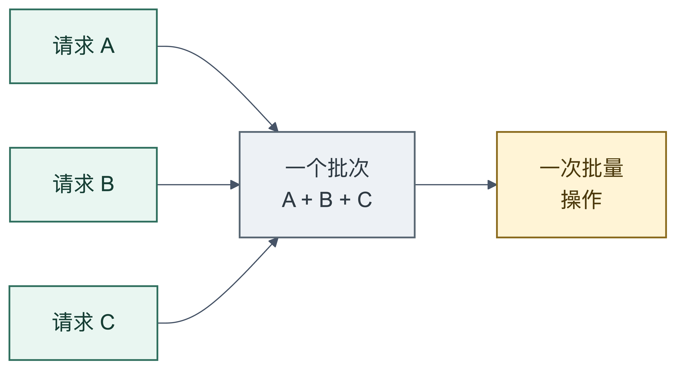
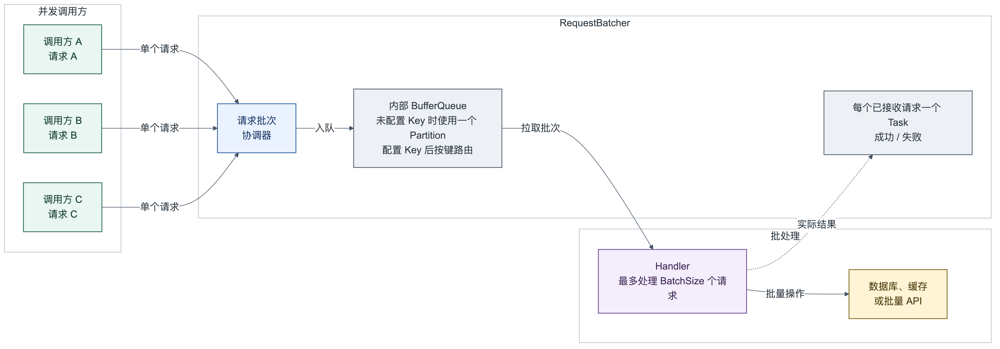
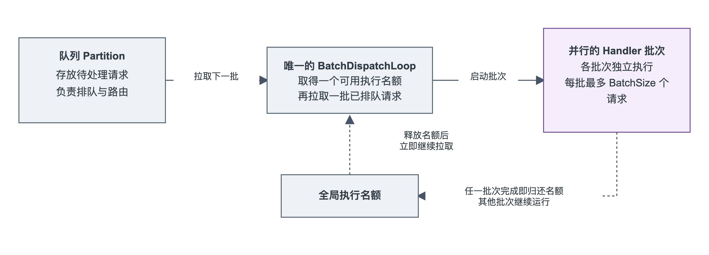

# RequestBatcher

[](https://www.nuget.org/packages/RequestBatcher)
[](https://github.com/eventhorizon-cli/RequestBatcher/actions/workflows/dotnet-build.yml)
[](https://codecov.io/gh/eventhorizon-cli/RequestBatcher)
[](LICENSE)

[English](README.md) | **简体中文**

RequestBatcher 是一个运行在进程内的 .NET 批处理库，用于将单个请求合并后交给下游批量处理。调用方可以逐个提交请求
并等待各自的结果；RequestBatcher 会合并已经排队的请求，限制 Handler 批次并发数和队列容量，再将批次交给应用的
Handler 处理。它适用于支持一次处理多个数据项的数据库、缓存和下游 API。

## 请求如何合并：机会式合并

RequestBatcher 基于 [BufferQueue](https://github.com/eventhorizon-cli/BufferQueue)，将 .NET 进程内已经排队的并发请求
合并为批次，交给应用的 Handler 处理。调用方通过 DI 获取 `IRequestBatcher<TRequest>` 或
`IRequestBatcher<TRequest, TResponse>`，提交请求并等待各自的结果。当前依赖
[BufferQueue 2.0.3](https://www.nuget.org/packages/BufferQueue/2.0.3)，应用无需单独注册或配置它。

RequestBatcher 采用 **机会式合并（Opportunistic Merging）**：请求写入 BufferQueue 后会发出可用数据通知，唤醒消费
流程；只要有空闲执行名额，就会拉取当前已排队的请求。消费流程由 push 通知唤醒，再通过 pull API 取得批次，不依赖
定时轮询，也没有固定的收集窗口。有空闲名额时，等待主要来自唤醒和调度；名额占满时，请求仍需排队。
`BatchSize` 只限制每批的最大数量：低流量时一批可能只有一个请求，突发流量时则可能合并同一 Partition 中的多个请求。

请求仅保存在进程内，进程故障后无法恢复尚未完成的请求。

> **调用方无需先收集请求，也能获得批量处理。** 多个调用方可以并发地各自提交一个
> `TRequest`；RequestBatcher 会将同一 Partition 中已排队的零散请求合并为最多 `BatchSize` 项的处理批次。
> `ProcessAsync(IEnumerable<TRequest>)` 只是额外的提交方式，并不是产生批量处理的前提。



多个独立的并发请求可以先合并为一个批次，再执行一次下游批量操作。图中只是示例：只有已在同一 Partition 排队的请求
才可能合并为同一批。

## 安装与 DI 注册

```bash
dotnet add package RequestBatcher
```

包提供 `net8.0` 和 `net10.0` 资产，支持 .NET 8 和 .NET 10 应用。

启动时通过 `AddRequestBatcher` 注册 Handler 和批处理服务；调用时从同一个 DI 容器获取
`IRequestBatcher<TRequest>`，或在应用服务的构造函数中注入它。

```csharp
// 应用启动时，在应用的 IServiceCollection 中注册。
services.AddRequestBatcher<OrderWriteRequest, OrderWriteBatchHandler>(
    ServiceLifetime.Scoped,
    options =>
    {
        // 4 个 Handler 批次并发执行名额，由 8 个队列 Partition 共享。
        options.MaxConcurrency = 4;
        options.BatchSize = 100;
        options.MaxPendingRequests = 5_000;
        // 相同的订单 ID 路由到同一 Partition；不同批次仍可能并发执行。
        options.UsePartitionKey(request => request.OrderId, partitionCount: 8);
    });

// 调用处从应用自己的 Service Provider 获取服务。
var batcher = serviceProvider.GetRequiredService<IRequestBatcher<OrderWriteRequest>>();
await batcher.ProcessAsync(new OrderWriteRequest(OrderId: 1, Amount: 100m));
```

代码示例需要引入 `Microsoft.Extensions.DependencyInjection` 和 `RequestBatcher` 命名空间。应用服务中推荐通过
构造函数注入 `IRequestBatcher<TRequest>`。若需要强类型返回值，请使用
`AddRequestBatcher<TRequest, TResponse, THandler>` 注册，并注入 `IRequestBatcher<TRequest, TResponse>`。
请求和 Handler 的定义见下方[无返回值批处理](#无返回值批处理)示例；Handler 所需的依赖
（例如你自己的 `IOrderStore` 实现）也应注册在同一个容器中。

## 适用场景

当请求彼此独立、可以接受在内存中短暂排队（不会等待凑满 `BatchSize`，只需等待全局执行名额可用），且下游一次
处理多项更合适时，可以使用 RequestBatcher：

- 能够使用批量 `INSERT`、`UPDATE` 或 `UPSERT` 的数据库写入；
- 原生支持多项输入的缓存读写或下游 API；
- 需要限制内部队列容量和下游并发量的短时流量突发；
- 调用方取消时，只需要撤销尚未分发的请求；已分发的操作应继续执行并返回实际处理结果；
- 可以在同一处理批次内合并相关请求，且正确性不依赖 Handler 执行顺序。

数据库更新还需要注意事务边界：如果一次 Handler 调用只成功一部分会造成数据不一致，应由 Handler 在同一个事务中
完成整批更新。RequestBatcher 只负责传递 Handler 的处理结果，不会回滚已经提交的数据。

## 不适用场景

RequestBatcher 既不是持久化后台队列，也不是事务协调器：

- 已接收的请求必须在进程故障后仍可恢复。此时应使用持久化存储或可靠消息队列。
- 操作必须随调用方事务一起提交或回滚。应将它留在原事务中。
- 下游操作必须依赖自动重试，或副作用必须严格恰好一次（exactly-once）。RequestBatcher 不提供这些保证。
- 下游操作必须等待最小批量凑齐，或者依赖固定的收集窗口。RequestBatcher 会直接处理当前已排队的请求。
- 单个调用方断开、超时或取消后，正在执行的下游操作也必须立即停止。一个处理批次可能包含来自多个调用方的
  请求，因此单个调用方的 `CancellationToken` 不会传给 Handler，也不能取消这个共享的 Handler 调用。

## API 概览

### 无返回值 API

当调用方只需要知道 Handler 是否成功完成时，使用 `IRequestBatcher<TRequest>`：

```csharp
public interface IRequestBatcher<in TRequest>
{
    // 提交一个请求，等待它实际的 Handler 处理结果。
    Task ProcessAsync(TRequest request, CancellationToken cancellationToken = default);

    // 提交调用方已有的一组请求；返回的 Task 等待整次提交完成。
    Task ProcessAsync(
        IEnumerable<TRequest> requests,
        CancellationToken cancellationToken = default);
}

public interface IRequestBatchHandler<TRequest>
{
    // 处理一个批次；成功返回后，该批次中的所有请求都会完成。
    ValueTask HandleAsync(
        IReadOnlyList<TRequest> requests,
        CancellationToken cancellationToken = default);
}
```

### 带返回值 API

当每个请求都需要一个强类型返回值时，使用 `IRequestBatcher<TRequest, TResponse>`：

```csharp
public interface IRequestBatcher<in TRequest, TResponse>
{
    // 提交一个请求，返回它的强类型结果。
    Task<TResponse> ProcessAsync(
        TRequest request,
        CancellationToken cancellationToken = default);

    // 提交一组请求，返回结果的顺序与输入序列保持一致。
    Task<IReadOnlyList<TResponse>> ProcessAsync(
        IEnumerable<TRequest> requests,
        CancellationToken cancellationToken = default);
}

public interface IRequestBatchHandler<TRequest, TResponse>
{
    // 处理一个批次，并为每个条目设置且仅设置一个结果。
    ValueTask HandleAsync(
        IReadOnlyList<RequestBatchItem<TRequest, TResponse>> entries,
        CancellationToken cancellationToken = default);
}
```

RequestBatcher 只会在内部等待每次 Handler 调用返回的 `ValueTask` 一次，不会将它返回给调用方。同步完成的 Handler
可以因此避免分配 `Task`；普通异步 I/O 仍可直接使用 `async ValueTask` 实现。

## 无返回值批处理

先定义请求类型和批量 Handler：

```csharp
public sealed record OrderWriteRequest(long OrderId, decimal Amount);

public interface IOrderStore
{
    Task WriteBatchAsync(
        IReadOnlyList<OrderWriteRequest> requests,
        CancellationToken cancellationToken);
}

public sealed class OrderWriteBatchHandler(IOrderStore store)
    : IRequestBatchHandler<OrderWriteRequest>
{
    public async ValueTask HandleAsync(
        IReadOnlyList<OrderWriteRequest> requests,
        CancellationToken cancellationToken = default)
    {
        await store.WriteBatchAsync(requests, cancellationToken);
    }
}
```

注册时同时指定 Handler 和生命周期；最小配置只需设置批次上限：

```csharp
services.AddRequestBatcher<OrderWriteRequest, OrderWriteBatchHandler>(
    ServiceLifetime.Scoped,
    options =>
    {
        options.MaxConcurrency = 4;
        options.BatchSize = 256;
        options.MaxPendingRequests = 5_000;
        options.UsePartitionKey(request => request.OrderId, partitionCount: 8);
    });
```

在常规应用服务中注入 `IRequestBatcher<TRequest>`：

```csharp
public sealed class OrderService(IRequestBatcher<OrderWriteRequest> batcher)
{
    public Task SaveAsync(
        OrderWriteRequest request,
        CancellationToken cancellationToken = default) =>
        batcher.ProcessAsync(request, cancellationToken);
}
```

`SaveAsync` 直接返回 RequestBatcher 创建的 `Task`。只有 Handler 完成包含该请求的批次后，这个 `Task` 才会
完成；调用方无需知道请求进入了哪个批次或 Partition。

## 带返回值批处理

如果每个请求都需要返回一个值，请使用带返回值的 API。Handler 接收由
`RequestBatchItem<TRequest, TResponse>` 包装的条目列表；每个条目都包含原始请求和返回值槽位，其中 `entry.Request`
是原始的 `TRequest`。下面的示例使用标准 LINQ
`Distinct`，先在当前处理批次内合并重复的商品 ID，再查询存储层：

```csharp
using System.Collections.Generic;
using System.Linq;
using System.Threading;
using System.Threading.Tasks;
using RequestBatcher;

public sealed record PriceQuery(long ProductId);
public sealed record PriceQuote(long ProductId, decimal Price);

public interface IPriceStore
{
    // 存储层对每个请求的 ID 最多返回一条结果，返回顺序不固定。
    Task<IReadOnlyList<PriceQuote>> FindAsync(
        IEnumerable<long> productIds,
        CancellationToken cancellationToken);
}

public sealed class PriceQueryHandler(IPriceStore store)
    : IRequestBatchHandler<PriceQuery, PriceQuote?>
{
    public async ValueTask HandleAsync(
        IReadOnlyList<RequestBatchItem<PriceQuery, PriceQuote?>> entries,
        CancellationToken cancellationToken = default)
    {
        var keys = entries
            .Select(entry => entry.Request.ProductId)
            .Distinct()
            .ToArray();
        var prices = await store.FindAsync(
            keys,
            cancellationToken);
        var pricesByProductId = prices.ToDictionary(price => price.ProductId);

        entries.SetResponses(request => pricesByProductId.GetValueOrDefault(request.ProductId));

        // 如果不需要查询去重，可以删除 Distinct()，保留同一个响应工厂。
        // 也可以将上面的查询和赋值替换为下面两种方式之一：
        // 1. 查询所有请求 ID，再逐个为条目设置结果：
        // var prices = await store.FindAsync(entries.Select(entry => entry.Request.ProductId), cancellationToken);
        // var pricesByProductId = prices.ToDictionary(price => price.ProductId);
        // foreach (var entry in entries)
        // {
        //     entry.SetResponse(pricesByProductId.GetValueOrDefault(entry.Request.ProductId));
        // }
        // 2. 已经得到与输入顺序对齐的结果序列时，使用按输入顺序赋值的重载：
        // var prices = await store.FindAsync(entries.Select(entry => entry.Request.ProductId), cancellationToken);
        // var pricesByProductId = prices.ToDictionary(price => price.ProductId);
        // var orderedResponses = entries
        //     .Select(entry => pricesByProductId.GetValueOrDefault(entry.Request.ProductId))
        //     .ToArray();
        // entries.SetResponses(orderedResponses);
        // 不要将原始后端结果直接传给按顺序赋值的重载：结果可能无序，也可能缺少某些请求的 ID。
    }
}

public sealed class PriceService(IRequestBatcher<PriceQuery, PriceQuote?> priceBatcher)
{
    public Task<PriceQuote?> FindAsync(
        long productId,
        CancellationToken cancellationToken = default) =>
        priceBatcher.ProcessAsync(new PriceQuery(productId), cancellationToken);

    public Task<IReadOnlyList<PriceQuote?>> FindManyAsync(
        IEnumerable<PriceQuery> requests,
        CancellationToken cancellationToken = default) =>
        priceBatcher.ProcessAsync(requests, cancellationToken);
}
```

先在应用现有的服务集合中注册应用自己的 `IPriceStore` 实现（示例中写作 `PriceStore`）和 Batcher，再在应用服务中注入
`IRequestBatcher<PriceQuery, PriceQuote?>`。可运行的 [PostgreSQL Web API 示例](samples/RequestBatcher.Deduplication)
直接用 Dapper 和 PostgreSQL 实现同样的查询流程：

```csharp
using Microsoft.Extensions.DependencyInjection;
using RequestBatcher;

services.AddScoped<IPriceStore, PriceStore>();
services.AddRequestBatcher<PriceQuery, PriceQuote?, PriceQueryHandler>(
    ServiceLifetime.Scoped,
    options =>
    {
        options.MaxConcurrency = 4;
        options.BatchSize = 100;
        options.MaxPendingRequests = 5_000;
        options.UsePartitionKey(query => query.ProductId, partitionCount: 8);
    });
```

Handler 返回前，必须为每个请求设置一次返回值，不能遗漏或重复设置。示例使用标准 LINQ `Distinct`，只为当前
Handler 调用中的每个不同商品 ID 查询一次存储层。`Distinct` 也支持匿名组合键、值元组和自定义相等比较器。存储层未
返回的商品 ID 会映射为 `null`；它不会合并不同处理批次或不同队列 Partition 中的条目。selector 重载会先按 key 为后端无序
结果建立字典，再为每个条目的原始 request 计算一次结果，因此重复条目会得到相同返回值。所有返回值计算
成功后才会统一赋值；factory 抛出异常不会留下部分赋值。引用类型结果会被共享，不会复制。

如果不需要去重，移除 `Distinct()` 并保留相同的 response factory 即可。还可以逐个调用
`entry.SetResponse(response)`，或先生成严格按原始输入顺序排列、包含重复和缺失请求位置的结果，再调用
`entries.SetResponses(responses)`。面向 key 的 selector 重载适合
后端无序结果；有序重载不能直接接收后端原始行。显式批量重载即使将请求拆到多个处理批次或队列 Partition，仍会按输入顺序返回结果。
只有 Handler 成功完成且对应请求的返回值已设置，调用方的 `Task<TResponse>` 才会成功完成。

## 显式批量提交

调用方已经持有多个请求时，可以一次提交：

```csharp
await batcher.ProcessAsync(orderWriteRequests, cancellationToken);
```

RequestBatcher 会先为请求序列创建快照，再统一提交给内部队列。`Wait` 模式下，请求数量不超过
`MaxPendingRequests` 时，会等到队列有足够空间后将整组请求一起入队；超过该上限时，会按输入顺序分段，每段最多
`MaxPendingRequests` 个请求，等待队列腾出足够空间后依次入队。`Fail` 模式下，如果队列剩余空间不足以容纳整组
请求，就立即拒绝整组请求。返回的 `Task` 会等待本次提交中的所有请求。一次提交不等于一次 Handler 调用：请求仍
可能按 `BatchSize` 或 Partition 路由拆成多个处理批次。

> **显式批量提交不是 Partition 边界。** 配置多个 Partition 后，RequestBatcher 会逐项路由，并不会将整次提交
> 强制放入同一 Partition。未配置 Partition Key，或每项请求计算出相同的 Partition Key 时，整组请求才会落在同一个
> Partition。`MaxConcurrency = 1` 只限制 Handler 并发数，不会合并带有不同 Key 的 Partition。

## 单次提交与显式批量提交

本文中的**提交**是指调用方执行一次 `ProcessAsync`；**处理批次**是指一次 `HandleAsync` 收到的
`IReadOnlyList<TRequest>` 或 `IReadOnlyList<RequestBatchItem<TRequest, TResponse>>`。两者不是同一个边界。

| 行为 | 单次提交 | 显式批量提交 |
| --- | --- | --- |
| 输入 | 直接提交传入的 `TRequest`。 | 枚举一次序列并创建快照；空序列立即完成。 |
| 容量 | 占用一个请求的排队空间。 | `Wait` 等待队列有足够空间后入队，超过容量上限的请求组会按输入顺序分段入队；`Fail` 在无法立即容纳整组请求时拒绝整组。 |
| 路由 | 按当前路由模式处理这个请求。 | 每个请求独立路由，因此一次提交可以跨多个 Partition。 |
| Handler 调用 | 可能与同一 Partition 中已排队的其他请求一起交给 Handler。 | 不形成处理批次边界；请求可按 Partition 和 `BatchSize` 拆分，并可能并行执行。 |
| 完成 | 返回的 `Task` 表示这个请求的实际处理结果。 | 返回的 `Task` 等待本次提交中的每个请求。 |
| 失败 | 这次 Handler 调用失败时，该处理批次中的所有请求都会失败。 | 部分请求可能已经成功，其他处理批次仍可能失败；整组 `Task` 会失败，但不会回滚已经成功的操作。 |
| 取消 | 只能取消尚未交给 Handler 的请求。 | 同一个 `CancellationToken` 用于整组中的每个请求；尚未分发的请求可以取消，已分发的请求继续返回实际结果。 |

## 请求处理流程

内部队列的 Partition 数量不代表 Handler 并发数。Partition 只用于组织请求的排队和路由；同时执行的 Handler
批次数由全局 `MaxConcurrency` 限制。同一 Partition 中的多个批次可以并发执行，所有 Partition 共享同一组执行名额。

未配置 `UsePartitionKey` 时，RequestBatcher 固定使用一个内部 Partition，避免将彼此无关的请求分散到多个队列，
也让它们自然地保留在一起进行批量处理。配置有限整数数值键或非 `null` 字符串键以及显式 Partition 数量后，队列
使用指定数量的 Partition，使相同键保持局部性，同时让不同键可以独立推进。`P` 只是路由细节；`H = MaxConcurrency`
始终是全局 Handler 批次并发上限。单个 Partition 可以连续产生
多个异步 Handler 批次，因此 Partition 数量不会限制为一次只能执行一个批次。

1. 调用方通过 `ProcessAsync` 提交单个请求。
2. RequestBatcher 根据容量配置接收请求，并将它路由到一个内存 Partition。
3. 内部 `BatchDispatchLoop` 先获取一个空闲执行名额，再拉取并自动提交最多 `BatchSize` 个已排队请求。
4. 处理结果会完成该批次中每个调用方持有的 `Task`。

已接收请求的排队时长主要取决于全局执行名额何时可用，而不是等待凑满 `BatchSize`。RequestBatcher 不会为凑满
单个批次设置额外的收集窗口：只要有执行名额，它就会立即用当前已排队的请求发起 Handler 调用，即使只有一个请求。
`BatchSize` 只限制单次调用的最大请求数。



架构图展示协调器、内存队列中的各个 Partition，以及每个已接收请求独立完成 `Task` 的详细路径。

### 调度方式

`H = MaxConcurrency` 是全局同时执行的 Handler 批次数上限。未配置 Partition Key 时，内部只有一个 Partition；配置
数值或字符串 Partition Key 时，`P` 是传给 `UsePartitionKey` 的显式 Partition 数量。



一个 `BatchDispatchLoop` 负责所有 Partition，并共享同一组全局执行名额。它只有在取得执行名额后才会从队列拉取
批次，因此请求只在 BufferQueue 中等待，不会进入应用自行维护的转交队列。名额按一次 Handler 批次调用完成释放，
而不是批次内某个请求单独完成时释放。任一正在执行的 Handler 批次完成后，其名额会立即归还，调度循环随即可以
拉取并启动下一批；无需等待其他正在执行的批次全部完成。

## 配置

| 选项 | 默认值 | 行为 |
| --- | ---: | --- |
| `BatchSize` | `128` | 单次 Handler 调用包含的请求数量上限。 |
| `MaxConcurrency` | `1` | Handler 批次最大并发数；它始终是 Handler 并发上限，与按键路由的 Partition 数量相互独立。 |
| `MaxPendingRequests` | `8192` | 内部 BufferQueue 中尚未被拉取执行的请求容量上限。 |
| `FullMode` | `Wait` | 队列空间不足时，`Wait` 等待空位，`Fail` 立即拒绝本次提交。 |
| `UsePartitionKey(selector, partitionCount)` | 未配置 | 配置按键路由和显式 Partition 数量；`partitionCount` 必须大于 1，相同键值的请求进入同一 Partition。 |

Handler 执行不保证顺序，包括 `MaxConcurrency = 1` 的情况。

### Partition 数量与并发数

下面配置使用 8 个队列 Partition，共享 4 个 Handler 执行名额：

```csharp
builder.Services.AddRequestBatcher<ProductQueryItem, ProductBatchHandler>(
    ServiceLifetime.Scoped,
    options =>
    {
        // 单 Pod 的下游并发上限。6 个 Pod x 4 个名额 = 集群最多 24 个 Handler 批次并发。
        options.MaxConcurrency = 4;
        options.BatchSize = 100;
        options.MaxPendingRequests = 5_000;

        // 只负责路由和局部性。8 个队列 Partition 与 4 个执行名额相互独立。
        options.UsePartitionKey(item => item.ProductId, partitionCount: 8);
    });
```

`partitionCount` 决定请求分布在哪些队列中，相同键值始终路由到同一 Partition。`MaxConcurrency` 限制同一个
批处理服务中同时执行的 Handler 批次数，所有 Partition 共享这些名额。同一 Partition 也可以同时执行多个批次。

### 用利特尔法则（Little’s Law）估算 `MaxConcurrency`

利特尔法则应该应用在 Handler 批次流量上，而不是直接应用在请求项流量上。先测量同一种下游批量操作的批次 QPS
和平均响应时间，并将响应时间换算为秒：

```text
并发中的请求数 = 到达速率（QPS）x 响应时间（秒）
L = λ x W
```

如果监控已经提供“下游批量调用 QPS”和“批量调用响应时间”，可以直接估算整个集群的在途批次数：

```text
单 Pod MaxConcurrency ≈ ceil(批量 QPS x 批量响应时间（秒） / Pod 数量 x 安全系数)
```

例如 6 个活跃 Pod 的下游批量调用为 480 QPS、平均响应时间 50 ms，则需要约 `480 x 0.050 = 24` 个在途批次；在流量均匀分配的前提下，每个 Pod
设置 `MaxConcurrency = 4` 可提供总计 24 个名额。这是平均负载下的估算，不是延迟或吞吐保证。是否提高或降低它，还要结合队列等待、下游限流、CPU 和连接池上限
重新测量。

如果监控的是请求项 QPS，就要按每个 Partition 分别测量有效批次大小。对于 Partition `p`，设 `λ_item,p` 为该
Partition 的请求项 QPS，`B_eff,p` 为实测的平均每批请求项数量，`RT_p` 为该批次 Handler 的平均响应时间：

```text
λ_batch,p ≈ λ_item,p / B_eff,p
L_total ≈ Σ(λ_batch,p x RT_p)
单 Pod MaxConcurrency ≈ ceil(L_total / Pod 数量 x 安全系数)
```

`BatchSize` 只是上限，因此流量稀疏时，`B_eff,p` 可能远小于 `BatchSize`。`partitionCount` 会改变每个 Partition
接收的请求速率，进而改变 `B_eff,p`；它不是 Worker 数量，不能直接乘进公式。增加 Partition 数量可能让每批更小，
增大 `BatchSize` 则可能同时提高批次大小和响应时间。修改任一配置后都需要重新测量。

如果已经能直接监控批次 QPS，应优先使用实测值，不要再用请求项 QPS 和批次大小反推。

`MaxPendingRequests` 是排队积压上限，不是执行名额。可以按愿意吸收的排队量（`单个批处理服务的请求项 QPS x 可接受排队时间`）设置，
再用突发流量验证接收延迟和内存占用。

## Partition Key 路由

Partition Key 是一项可选的路由规则，用于将相关请求路由到同一 Partition：

```csharp
options.MaxConcurrency = 4;
options.UsePartitionKey(request => request.OrderId, partitionCount: 8);
```

值相同的有限整数数值键，或值相同的非 `null` 字符串键，会进入指定数量中的同一 Partition。不同键值仍可能落入
同一 Partition，因此键值与 Partition 不是一一对应关系。`partitionCount` 必须大于 1。

Partition 路由只决定请求进入哪个 Partition：它不会强制同一键值的全部请求进入同一个处理批次，也不会自动去重。
它提供了一个路由边界，不提供执行顺序或互斥保证。

### 示例：合并重复更新请求

假设多个 `PriceUpdate` 的 `ProductId` 相同。Handler 可以在当前批次中按商品分组，只写入版本最高的更新。按
`ProductId` 路由能改善局部性，但不同 Handler 调用仍可能同时处理同一个商品。

Partition Key 无法让同一商品的所有更新都进入同一批，因此存储层仍需防止旧版本跨批次覆盖新状态。可运行的
[PostgreSQL Web API 示例](samples/RequestBatcher.Deduplication)展示了完整做法：

- 写 Handler 会在单批内合并同一商品的更新，然后执行一次批量 upsert；
- upsert 条件会忽略后续批次中的旧版本；
- 查询 Handler 会先对商品 ID 去重，再为当前批次执行一次 SQL 查询。

## 路由规则与调度

`MaxConcurrency` 是全局并发 Handler 批次数上限。未配置 Partition Key 时，内部队列固定使用一个 Partition；配置
数值或字符串 Partition Key 时，Partition 数量由 `UsePartitionKey` 的 `partitionCount` 指定，由一个
`BatchDispatchLoop` 从所有 Partition 拉取。Partition 数量在注册时确定，且不受 CPU 数量限制。

| 配置 | 请求如何路由 | 调度行为 |
| --- | --- | --- |
| 未配置 `UsePartitionKey` | 所有请求进入同一个 Partition，避免将无关请求分散到多个队列。 | 批次共享全局执行名额；单个 Partition 可以连续提供多个异步批次。 |
| 配置 `UsePartitionKey(selector, partitionCount)` | 有限整数数值键或非 `null` 字符串键将相同值路由到指定 Partition；不同键仍可能共享 Partition。 | 相同键值的不同 Handler 批次仍可同时分发执行。 |

RequestBatcher 不提供全局、Partition 内或 Partition Key 级别的 Handler 执行顺序保证。Partition Key 只决定队列
路由，不能用于串行化处理。

启用按键路由时，队列会在有数据的 Partition 之间轮转拉取机会，但不保证 Handler 执行时间相等，也不保证不同
键值之间公平。字符串路由使用完整键值，共同前缀本身不会强制不同键值进入同一 Partition。具体分区归属属于
内部实现，可能随版本变化；同一个 Batcher 实例中的相同键值仍会路由到同一 Partition。这些变化可能影响处理批次
的组成，以及 Handler 在单个批次内能够合并的重复工作量。

Handler 会在分发调用链上执行，直到完成或遇到尚未完成的异步等待。在此之前的 CPU 密集计算或同步阻塞会
推迟其他批次的分发，即使仍有空闲执行名额。`MaxConcurrency` 是并发上限，不会自动将同步 Handler 代码并行化。

## 处理语义

### 完成与失败

- Handler 正常完成时，该处理批次中所有调用方的 `Task` 都会成功完成。
- Handler 抛出异常时，这些调用方会收到原始异常。
- RequestBatcher 不会自动重试失败的 Handler。
- 显式批量重载会等待本次提交中的所有请求；只要涉及的某次 Handler 调用失败，最终 `Task` 就会失败。
- 一次显式批量提交可能跨越多个 Handler 调用。如果其中多次调用失败，`await` 会按普通 `Task` 语义抛出其中一个
  原始异常；所有不同的异常实例都可以从 `Task.Exception.InnerExceptions` 读取。同一次 Handler 异常即使影响
  多个请求，也只记录一次。

### 调用方取消

调用方取消只能移除尚未交给 Handler 的请求。一旦 Handler 开始执行，RequestBatcher 会返回实际处理结果，而不会
将调用方的 `Task` 改成已取消。这样可以避免取消状态掩盖已经发生的副作用。

传给 Handler 的 `CancellationToken` 属于 RequestBatcher 自身的处理生命周期，不属于任何一个调用方。因此，
一个调用方取消不会中止同一批中的其他请求。

显式批量提交会将调用方传入的同一个 `CancellationToken` 应用于组内每个请求。因此取消后可能同时存在“尚未
分发而取消”的请求和“已经分发并继续执行”的请求。返回的 `Task` 仍会等待全部请求；其中存在失败时最终状态为
失败，否则只要有请求被取消，最终状态就是取消。已经完成的副作用不会回滚。

### 容量与背压

`MaxPendingRequests` 是内部 BufferQueue 中仍处于排队状态的请求容量上限。分发循环拉取批次时会自动提交消费进度，
随后才启动 Handler。因此，除了排队容量外，最多还有 `MaxConcurrency * BatchSize` 个已拉取请求正在执行。它不限制
一次显式提交的请求数量，也不限制正在等待容量的调用方数量：

- `FullMode = Wait` 在队列空间不足时异步等待，并支持调用方在等待期间取消。
- `Wait` 模式下，一组请求的数量不超过 `MaxPendingRequests` 时，会等到队列能容纳整组请求后一起入队；超过时，
  按输入顺序分段，每段最多 `MaxPendingRequests` 个请求，等待队列腾出足够空间后依次入队。
  中途取消时，已分发的请求仍会继续处理，尚未分发的请求会被取消。
- `FullMode = Fail` 在队列剩余空间不足以容纳本次提交的全部请求时，立即拒绝整次提交，包括请求总数超过
  `MaxPendingRequests` 的情况。此时返回的 `Task` 会失败，异常为 `RequestBatchQueueFullException`，本次提交的请求
  均不会入队。

### 停止与释放

`DisposeAsync` 会停止接收新请求，处理完已经接收的所有提交（包括仍在等待容量的提交），然后释放协调器持有的资源。
并发或重复调用共享同一次释放操作。通过 `AddRequestBatcher` 注册时，由应用容器负责异步释放。

## 依赖注入与日志

`AddRequestBatcher` 会将 Handler、协调器和内部 BufferQueue topic 注册到现有的 `IServiceCollection` 中。应用无需
直接配置 BufferQueue，RequestBatcher 也不会创建嵌套的 Service Provider。

`Scoped` 和 `Transient` Handler 会在每个处理批次专属的异步作用域中解析一次。`Singleton` Handler 会跨批次
复用；当 `MaxConcurrency > 1` 时，它必须保证线程安全。

日志会通过应用现有的 `Microsoft.Extensions.Logging` 管道写入，类别为
`RequestBatchCoordinator<TRequest>`。Handler 异常会连同原始 `Exception` 一起记录，日志不会包含请求内容。

## 示例应用

- [PostgreSQL Web API 示例](samples/RequestBatcher.Deduplication)

## 许可证

RequestBatcher 采用 [MIT License](LICENSE)。
