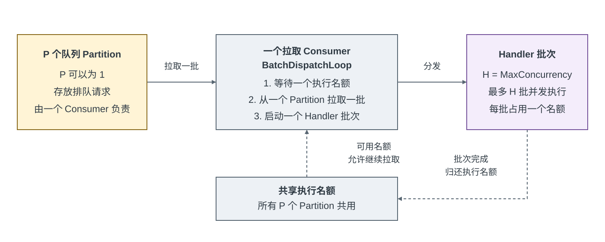

# 并行批次调度设计

[English](batch-dispatch-redesign.md) | **简体中文**

## 范围

本文定义当前的队列拓扑、分发流程、生命周期和验证契约。队列分区用于支持批处理和键亲和性；Handler 并发则由独立的全局执行窗口控制。

## 目标

- 由 `MaxConcurrency` 限制 Handler 批次并发，无需创建同样数量的 BufferQueue 分区。
- 没有可用的 Handler 执行名额时，不从 BufferQueue 拉取批次。
- 不在 BufferQueue 和 Handler 执行之间增加由应用管理的交接队列。
- 允许任一可读分区中的工作使用任一空闲执行名额。
- 准确保持已接收请求的完成、调用方取消、失败和关闭语义。
- `MaxPendingRequests` 限制队列中等待处理的请求数，不包含正在执行的请求。

## 顺序与队列进度

RequestBatcher 不承诺请求顺序，包括 `MaxConcurrency = 1` 的情况：并发调用方没有稳定的追加顺序，分区键也只是路由提示。`UsePartitionKey` 仍会将相同的键确定性地路由到 BufferQueue 的同一分区，但不保证 Handler 串行执行或按键顺序执行。

队列使用 BufferQueue 自动提交。批次一旦被拉取，就不再驻留于队列，队列无法重放该批次。RequestBatcher 仍会根据 Handler 结果、分发前的调用方取消或基础设施故障，确保每个已接收请求恰好完成一次。

## 队列拓扑

在同一个 BufferQueue 消费组内，每个分区属于一个 Consumer，由它负责拉取数据并推进消费进度。RequestBatcher 在这一归属模型上实现进程内请求合批：使用一个拉取 Consumer 消费所有分区，再通过 `MaxConcurrency` 独立控制 Handler 批次并发，因此单个分区可以提供多个并发批次。



实线箭头表示请求流向，虚线箭头表示执行名额的控制流。`P` 表示队列分区数，`H = MaxConcurrency` 表示活动 Handler 批次的上限。循环会先获取名额再拉取；每个完成的批次独立归还名额。图中未展示取消和关闭路径。

注册服务时，RequestBatcher 会确定固定的分区数：

```text
effectivePartitionCount = PartitionKey is configured
    ? PartitionKey.PartitionCount
    : 1
```

`UsePartitionKey(selector, partitionCount)` 要求 `partitionCount` 至少为 1。分区数为 1 时会停用按键路由，清除之前配置的分区键，并使用与默认配置相同的单个队列分区。此模式仍要求 selector 非空，但不会调用它。无论使用数字还是字符串 selector，`partitionCount` 小于 1 时都会抛出 `ArgumentOutOfRangeException`。选项克隆以及请求/响应投影会保留这种无分区键模式。`partitionCount` 大于 1 时，公开签名和路由行为保持不变。测试覆盖两种 selector 重载、无效分区数、重置已有分区键，以及不调用 selector 的单请求和显式批量提交。

分区数在 coordinator 的生命周期内固定；运行时修改配置不会重塑正在使用的 BufferQueue topic。按键分区数独立于 `MaxConcurrency` 和进程可见的 CPU 数量，因此 I/O 密集型服务可以根据自身负载选择足够多的按键队列。

BufferQueue 包含 `effectivePartitionCount` 个内存分区。RequestBatcher 为消费组创建一个拉取 Consumer，使该 Consumer 可以拥有所有分区。BufferQueue 会为每次拉取选择可读分区，因此一个全局执行窗口可以在多个分区之间平衡工作，而不必为每个分区单独保留一个 Handler 任务。

```text
生产者 -> BufferQueue P 个分区 -> BatchDispatchLoop -> H 个 Handler 批次
                                  (仅在有空闲名额时拉取)

P = effectivePartitionCount
H = MaxConcurrency
```

未配置分区键时，单请求和显式批量提交都使用一个队列分区，因此相邻的排队项目不会仅因轮询路由而被拆开。该分区可以提供多个并发执行的 Handler 批次，最多达到 `MaxConcurrency`。系统没有收集等待窗口，也不要求填满批次。配置数字或字符串分区键后，相同的键会按已配置的分区拓扑保持一致路由；同一键对应的不同批次仍可能并发执行。只有配置键 selector 才能使用大于 1 的分区数。未配置 selector 时，所有请求都进入一个分区。仅请求注册和请求/响应注册使用相同策略。

所选按键分区数会改变批次组成和局部性，但不承诺提高吞吐量、不承诺请求顺序，也不保证一次显式提交只调用一次 Handler。公开容量限制、取消边界和生命周期行为保持不变。

`BatchSize` 仍是 BufferQueue 的单次拉取批次大小，也是传给一次 Handler 调用的请求数上限，不会乘以 `H`。

即使只有一个分区，一次显式提交也可能分散到多个 Handler 批次中：每次拉取最多取得当前已排队的 `BatchSize` 个请求，并且不会保留调用方的分组边界。因此，单分区路由不保证一次显式提交只调用一次 Handler，也不保证只产生一个反向 trace link。

## 队列依赖契约

该流水线使用带内存存储的 BufferQueue 2.2.0。单个拉取 Consumer 会按环形顺序扫描已分配分区，并从上次提供批次的分区之后继续。通知会唤醒 Consumer，但不会提升发送通知的分区优先级。这会让可读分区获得均衡的拉取机会，但不保证处理时间相等、按键公平或 Handler 执行顺序。

在受支持的小端序 .NET 目标上，字符串分区键使用完整 UTF-16 键的 XXH3-64 进行路由。BufferQueue 通过其传递依赖 `System.IO.Hashing` 10.0.9 提供此算法。相同键保持分区亲和性；共享前缀不会强制不同键进入同一分区。数字键在所选拓扑中的既有映射保持不变。精确的分区分配属于内部实现，跨依赖版本不保证稳定。因此，依赖升级可能改变 Handler 批次组成和批次级去重机会。

不需要更改公开 API 或目标框架。RequestBatcher 不使用持久化队列存储：进程故障后无法恢复待处理请求，也没有已存储的分区分配需要迁移。取消、容量、异常扇出和关闭继续遵循下文的生命周期契约。

依赖集成测试必须验证自动提交和手动提交两种模式下，对稀疏可读分区的拉取是否均衡；还必须通过 RequestBatcher 的键适配器验证完整字符串路由，包括单项和显式批量生产。现有 coordinator 测试继续验证相同键对应的批次可以并发执行。依赖升级还需通过完整单元测试项目、Release 解决方案构建、格式验证和包创建进行验证。

拉取 API 返回带有计数和索引访问能力的 `IReadOnlyList<T>` 批次。后续拉取和提交后，返回的批次仍保持有效，因此分发时会直接将它传给请求筛选逻辑，不再枚举或物化另一份集合。RequestBatcher 的公开 Handler 签名保持不变，面向 Handler 的请求数组也独立于待处理请求状态。测试覆盖重叠执行期间的批次生命周期、取消过滤、Consumer 故障、容量交接、路由和两个目标框架上的关闭行为。[BufferQueue 2.1.0 的 Tracing I/O 评测](evaluations/bufferqueue-2.1.0/README.md)使用匹配的源码快照比较 2.0.3 与 2.1.0，保持相同的 20 ms 工作负载和采样矩阵，并分别报告耗时与托管分配。

## BatchDispatchLoop

`BatchDispatchLoop` 是面向队列的调度循环。它使用带有 `H` 个许可的信号量和一个在途完成跟踪器。

1. 等待并获取一个执行许可。
2. 推进一次 BufferQueue 异步枚举器。Consumer 使用 `AutoCommit = true`，因此只有队列进度已推进时此操作才会成功。
3. 将 BufferQueue 的 `IReadOnlyList` 快照直接交给执行任务。
4. 在分发调用路径上调用 Handler 批次异步方法。该方法完成或遇到第一个未完成的异步等待后，返回到第 1 步。
5. 执行任务根据 Handler 结果完成每个请求，从在途跟踪器中移除自身，并在 `finally` 中释放许可。

当 `RequestBatchConsumer.ExecuteAsync` 返回同步完成的 `ValueTask` 时，分发循环会内联完成执行并释放许可，不会再创建一个异步 `Task` 包装器。未完成的 `ValueTask` 使用异步完成路径。两种路径都保持相同的恰好一次请求完成、在途跟踪、故障传播和许可释放行为。

正常分发路径中没有 `Task.WhenAll`，也没有每个超级批次的屏障。Handler 因未完成的异步等待而挂起时，只占用自己的执行许可；其他名额中运行的批次可以正常完成。发生该等待之前的同步工作（包括 Handler 构造和作用域解析）会延迟下一次拉取，即使其他执行名额空闲也一样。分发循环不会将每个 Handler 都卸载到 ThreadPool。在途跟踪器仅用于观察最终排空状态和任务故障，不会创建第二个队列。

当所有请求都进入处理时，`RequestBatchConsumer` 会复用队列中不可变的待处理项目快照。遇到第一个被跳过的请求时，它会创建一个筛选列表，其中包含此前已开始处理的请求，再追加后续进入处理的请求。返回的集合只包含活动请求，其 `Count` 始终表示待处理数量；调用方无需单独维护有效长度。没有跳过请求的批次不会分配第二份待处理项目集合，全部取消的批次不会调用 Handler。面向 Handler 的请求数组仍会独立分配；不会池化缓冲区、任务或请求对象。请求筛选和 Handler 输入构造使用同步辅助方法，由执行方法负责调用 Handler 并传播其结果。公开 API、取消边界、失败扇出和关闭行为保持不变。测试覆盖在开头、中间和结尾跳过项目、结果不同的重叠批次、恰好一次的完成回调，以及后续分发后仍被保留的 Handler 输入。延迟下游处理基准会检查持续单项/批量提交和突发提交时的分配与耗时。

coordinator 会将已接收请求保存在并发待处理注册表中，因此完成终态请求时无需为每个项目都获取生命周期锁。准入和停止状态转换仍使用生命周期锁。完成项目会从注册表移除并原子递减待处理计数；只有待处理项目数从 1 变为 0 时，才会重新获取生命周期锁以捕获并通知当前排空信号源。Consumer 故障快照可能观察到同时完成的请求，但每个请求的终态仍会阻止重复完成或重复释放容量。

每个 coordinator 会在 Consumer 启动前创建一个绑定的 `OnRequestFinished` 委托，并将其保存在只读字段中。单项和显式分组准入会把同一个委托传给每个待处理项目。回调仍绑定到所属 coordinator；它只移除该 coordinator 的待处理状态并通知其排空信号源。待处理项目仍保留自己的恰好一次完成保护，因此共享委托不会共享项目状态，也不会改变取消、容量释放、分区路由或 Handler 顺序。公开 API 和生命周期契约不变，也不会池化任务或待处理对象。

每个待处理项目保留请求、完成对象、完成回调和取消注册，但不再额外保留调用方 `CancellationToken` 的副本。注册使用 `CancellationToken.UnsafeRegister(Action<object?, CancellationToken>, object?)`，因此取消回调会收到调用方传入的原始 token。这也涵盖注册已取消 token 时同步调用回调的情况。取消仍只会更改排队中的项目；`TryStartProcessing` 成功后，Handler 的终态结果仍具有决定作用。现有状态转换、恰好一次完成和容量释放契约保持不变。

待处理项目的直接测试覆盖已取消 token 的同步注册、只通知一次完成的排队取消，以及分发后取消时 Handler 成功和失败两种结果。

验证使用现有的成功、失败、取消、Consumer 故障和并发释放回归测试。相同的前后公开流水线基准覆盖单项、不同大小的显式分组、混合提交和分区路由；分配收益与耗时收益分开评估。

每次显式提交都拥有一个 `BatchSubmissionCompletion`，它继承 `TaskCompletionSource` 并实现请求完成契约。其任务使用 `RunContinuationsAsynchronously`；提交组中的所有待处理项目共享该对象。该对象跟踪剩余项目、调用方取消和不同的异常引用。最后一个项目按失败优先于取消、取消优先于成功的顺序发布结果。其他项目仍未完成时，不会发布终态。这样可以避免为每个分组额外分配 TCS 包装器，同时不改变公开 API、逐项路由、终态保护、容量处理或响应收集。这里不使用任务池。现有完成、部分取消、生产者故障和生命周期回归测试适用于两个受支持的目标框架。基础分配测量用于归因每组固定节省；相同的公开流水线基准则比较小组/大组、成功、失败、部分取消、容量等待和混合单项/分组工作负载。

错误记账会原子记录第一个异常引用。重复报告同一个对象不需要加锁或查询集合。只有出现不同异常时才创建引用相等集合；并发写入者会发布一个共享集合，并在向其中添加不同失败时加锁。集合本身兼作锁，因此成功组和只有一个不同异常的组不需要再分配独立的同步对象。异常不会使用用户定义的相等性进行比较。这不会改变公开契约或逐项状态：每个项目仍只执行一次终态转换、剩余数量递减和容量释放。最后一次递减会观察到此前写入的全部错误，再发布完整的原始异常集合。

确定性测试覆盖重复失败、值相等但对象不同的异常、并发首次错误发布和集合创建、取消与失败混合，以及阻止提前发布结果的最后一个挂起项目。相同的前后基准会隔离重复和不同异常的记账成本，并通过公开成功、失败、部分取消、容量等待及小组/大组混合提交路径进行验证。耗时和分配结果必须分别报告；基础操作的收益本身不能证明端到端吞吐量提升。[错误记账评测](evaluations/batch-error-aggregation/README.md)记录了匹配测量及其限制。

分发循环会在推进 BufferQueue 枚举器之前获取许可。当所有 Handler 名额都被占用时，循环不会继续消费工作。此时有界 BufferQueue 最多保存 `MaxPendingRequests` 个排队请求，并直接应用配置的等待或失败准入策略。

## 后台执行上下文

分发循环和 Consumer 监控器会在线程池启动，但不会捕获构造 coordinator 的调用方执行上下文。启动时只在调度每个后台任务期间抑制执行上下文流动，并在同步返回前恢复调用方原有的流动状态，也支持调用方此前已抑制流动的情况。任务边界会隔离 Consumer 枚举和监控器的同步前缀。后台任务内部仍会正常流动上下文，包括跨越 Handler 的 await。

因此，Handler 和 Consumer 故障监控不会继承初始化 coordinator 的 HTTP 请求中的 `Activity.Current`、日志作用域或其他 `AsyncLocal` 状态。提交请求也不会把调用方的环境上下文转移给后台任务。调用方在解析服务和等待完成后仍保留自己的上下文。租户标识等应用数据必须显式放入请求中。Singleton 服务仍遵循通常的 DI 创建语义，不得在构造函数中捕获请求级状态。

每个长期运行任务只增加一个调度边界，不会为每个批次增加边界。批次分发、Handler 作用域所有权、准入、取消和排空仍遵循原有契约。公开 API 和目标框架不变。[Observability](observability-design.md) 定义了可选的跟踪契约：每个已分发批次都可能创建独立的 `RequestBatcher.Handle` Consumer span，并通过 links 关联贡献请求的提交 span。

确定性回归测试覆盖在 Activity 和 AsyncLocal 存在时初始化、后续提交处于另一个 Activity 或没有 Activity、调用方上下文保留、Handler 在 await 期间持有自身上下文、启动前已抑制的流动，以及 Consumer 监控器处理立即和延迟故障。现有生命周期测试覆盖后台启动前释放和后续排空。

## 生命周期与错误

- 分发前取消的请求会以取消状态结束，且绝不会传给 Handler。
- 批次开始分发到 Handler 后，调用方取消不会取代 Handler 的实际结果。
- Handler 异常会让该批次中的所有活动请求收到同一个异常，释放执行名额，并且不会终止分发循环。
- 枚举、自动提交或其他队列基础设施故障会终止循环。coordinator 会让所有排队请求失败、停止准入，并记录故障；`DisposeAsync` 会在清理后报告该故障。
- `DisposeAsync` 先停止准入，等待所有已接收请求得到终态结果，再取消分发循环。若循环正等待执行许可，则会观察到此次取消。正在运行的 Handler 可以先报告其实际结果，之后关闭才会完成。释放 coordinator 所有的资源前，还会等待 Consumer 监控结束。
- `DisposeAsync` 是唯一公开的关闭入口。并发和重复调用共享同一个任务，包括该任务的失败结果。通过 DI 注册时由应用容器负责释放；不公开单独的停止或重启操作。
- Consumer 故障会立即停止准入并使排队工作失败。资源清理会在所有者释放 coordinator 时执行。
- 调用方通过异步释放关闭；不提供单独的可取消关闭等待 API。提交签名和处理语义不变。
- 测试覆盖并发/重复释放、开始关闭后拒绝新请求、排空活动请求和等待容量的提交，以及故障清理。

## 测试

实现必须为以下行为添加或调整确定性测试：

- 一个全局 Consumer 和自动提交配置；
- 所有并发设置下，无键时只有一个分区；
- 显式指定按键分区数，且该数量独立于进程 CPU 数量；
- 多个执行名额下，无键请求能够合并为一个预先排队的批次；
- 单个无键分区产生的多个批次可以并发执行；
- 请求/响应注册保持相同的分区策略；
- 所有执行名额占满时不再继续拉取；
- 某个慢批次不会阻塞可使用其他空闲名额的后续批次；
- 所有执行名额占用时队列会施加背压；
- Handler 故障、枚举故障、取消以及停止/排空行为；
- 从公开契约和测试中移除顺序保证。

## 评测证据

[分区提交评测](evaluations/partition-submissions/README.md)分别改变单项和显式提交的分区数，同时固定批次大小和 Handler 并发。[队列拉取评测](evaluations/queue-pull-capacity/README.md)使用异步工作负载检查分发容量。这些测量用于理解取舍，不构成吞吐量保证。[按节奏到达的评测](evaluations/arrival-scheduling/README.md)补充了调用方延迟、名额占用时长和批次组成的测量，以及 PostgreSQL/Redis 验证。该评测支持在异步工作负载下保留直接分发；有界卸载在这些场景中没有显示出稳定收益。

## 验收标准

- 拓扑遵循分区公式，并且恰好创建一个拉取 Consumer。
- 执行窗口满载时不会拉取批次。
- 不增加应用内部队列，也不通过超级批次 `Task.WhenAll` 汇合 Handler 分发。
- 公开文档说明修订后的顺序和容量语义。
- 单元测试覆盖所述生命周期和并发契约。
- 通过确定性测试验证所选拓扑和批次执行契约。
