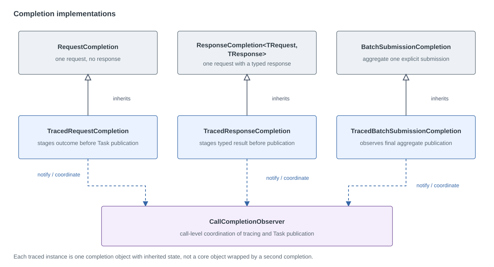
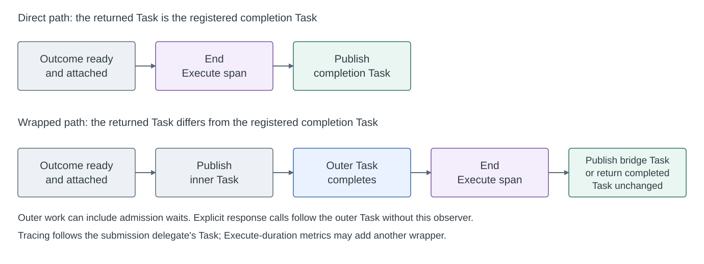

# Request Completion Design

[简体中文](request-completion-design.zh-CN.md)

## Scope and contract

This document explains the current completion types and their ownership. The
[request/response design](request-response-batching-design.md) defines the public API; the
[observability design](observability-design.md) defines tracing, metrics, and execution-context contracts.

A submission is one public `ExecuteAsync` call. An explicit submission can contain many requests and span several
Handler batches; a Handler batch can also contain requests from several submissions. Completion follows the
submission, not the Handler batch. Empty submissions complete without creating a shared completion source.

Each pending item reports its terminal outcome exactly once. A nonempty explicit submission waits for every item,
including when some items fail or are canceled. Setting an entry's response only stores a value: success is published
after the Handler, response validation, and owned async scope disposal succeed. Cancellation may remove queued work;
after dispatch the actual Handler outcome is reported.

## Four public paths, three completion implementations

The table describes accepted, nonempty submissions. Traced variants are selected when the tracing boundary supplies
a completion observer; installing a listener alone does not guarantee that an Execute Activity is created.

| Public call | Core completion | Result handling | Tracing completion boundary |
| --- | --- | --- | --- |
| Single request, no response | `RequestCompletion` | Returns an untyped Task. | `TracedRequestCompletion` can publish the same Task after ending the Execute span. |
| Single request, typed response | `ResponseCompletion<TRequest, TResponse>` | Reads one response entry and publishes `Task<TResponse>`. | `TracedResponseCompletion` can publish the typed Task directly; wrapper paths follow the returned Task. |
| Explicit requests, no response | One shared `BatchSubmissionCompletion` | Waits for every submitted item; no response projection. | `TracedBatchSubmissionCompletion` observes final aggregation; wrapper paths follow the returned Task. |
| Explicit requests, typed responses | One shared `BatchSubmissionCompletion` | `ProcessEntriesAsync` waits for aggregation, then builds an ordered response array. | Follows the outer result-assembly Task; this path does not use `TracedBatchSubmissionCompletion`. |

### Why single and explicit response paths differ

The single-response completion already owns the typed result Task. When admission returns that same Task, the facade
can return it without a separate asynchronous method that waits for an untyped Task and then reads the response.
When admission must wait or otherwise returns another Task, `AwaitSubmissionAsync` still observes that submission
before reading the response.

For an explicit response submission, the shared completion owns only the aggregate terminal outcome. Response values
remain in the original entries. `ProcessEntriesAsync` owns the additional work of reading those entries in caller
order and building `IReadOnlyList<TResponse>`. Its async Task supplies the typed result boundary. There is no
per-item response completion source for this path.

Thus explicit submissions distinguish response and request-only calls in the facade, while sharing aggregation
below it. The asymmetry reflects where the typed result is produced; the explicit response path still has an outer
Task even though it has no separate class named `ResponseBatchSubmissionCompletion`.

## Core type responsibilities

Each traced type inherits its core implementation; it does not wrap a separately allocated core completion.
The observer coordinates publication for one submission.

| Type | Responsibility |
| --- | --- |
| [IRequestCompletion](../src/RequestBatcher/PendingRequests/IRequestCompletion.cs) | Gives pending items a common Task and success/failure/cancellation operations. |
| [RequestCompletion](../src/RequestBatcher/PendingRequests/RequestCompletion.cs) | Completes one request without a response using an untyped `TaskCompletionSource`. |
| [ResponseCompletion](../src/RequestBatcher/PendingRequests/ResponseCompletion.cs) | Completes one request with its entry's response using `TaskCompletionSource<TResponse>`. |
| [BatchSubmissionCompletion](../src/RequestBatcher/PendingRequests/BatchSubmissionCompletion.cs) | Counts down every item in one explicit submission and aggregates terminal outcomes. |
| [PendingBatchRequest](../src/RequestBatcher/PendingRequests/PendingBatchRequest.cs) | Owns one item's queued/processing/terminal transitions, cancellation registration, and exactly-once cleanup. It reports outcomes to the chosen completion. |

All core completion sources use `RunContinuationsAsynchronously`. They and their Tasks are not pooled. Sharing a
completion does not share pending-item lifecycle state: an explicit submission has one pending object per item,
but those objects reference the same aggregate completion.

`BatchSubmissionCompletion` starts with the submitted item count. Each terminal report decrements it once; the last
report publishes the outcome. The outcome is failure if any item failed, otherwise cancellation if any item was
canceled, otherwise success. It retains distinct exception objects and deduplicates repeated references, so one
Handler failure fanned out to many items is not repeated in the aggregate. Exception enumeration and the particular
exception rethrown by `await` have no ordering guarantee.

Response completion maps `OperationCanceledException` to a canceled typed Task with its token. Request-only
completion can instead hold a faulted Task containing that exception. Tracing and metrics preserve the Task outcome
they observe; they do not turn every faulted cancellation exception into cancellation.

## Tracing variants and publication

The tracing variants inherit the corresponding core implementation. Creating a traced completion creates one
completion object containing its inherited state, not a wrapper containing another separately allocated core
completion. Each also references one call observer. Ordinary completions do not acquire tracing-only fields.

| Type | Additional responsibility |
| --- | --- |
| [TracedRequestCompletion](../src/RequestBatcher/Diagnostics/Tracing/TracedRequestCompletion.cs) | Stages one request's outcome and notifies the observer before publishing its Task. |
| [TracedResponseCompletion](../src/RequestBatcher/Diagnostics/Tracing/TracedResponseCompletion.cs) | Stages the typed result, error, or cancellation before publishing its typed Task. |
| [TracedBatchSubmissionCompletion](../src/RequestBatcher/Diagnostics/Tracing/TracedBatchSubmissionCompletion.cs) | Reuses the base counter and aggregate state, intercepting only the final `Publish`. It does not notify once per item. |
| [CallCompletionObserver](../src/RequestBatcher/Diagnostics/Tracing/CallCompletionObserver.cs) | Decides whether the registered completion is the returned Task and coordinates span finalization with publication. |

Two interfaces separate pending-state completion from Activity ownership:

- [IRequestCompletionObserver](../src/RequestBatcher/PendingRequests/IRequestCompletionObserver.cs) registers the one
  observed completion for a call and receives its terminal notification.
- [IRequestCompletionNotification](../src/RequestBatcher/PendingRequests/IRequestCompletionNotification.cs) exposes
  the completion's Task, prepared outcome, and deferred `Publish`. The completion itself implements this interface;
  it is not another allocated notification object.

Preparing an outcome and publishing its Task are separate operations. The observer can inspect the prepared failure
or cancellation and finish tracing before the caller observes completion.

### Observer lifetime and ownership

`RequestBatcherTracing.TraceCall` creates at most one `CallCompletionObserver` for a submission, after starting its
Execute Activity. It creates none when there is no Activity or when `observeCompletion` is false. In particular,
the explicit response path uses `observeCompletion: false` and follows its result-assembly Task instead.

Construction captures the submission's `ExecutionContext` and retains the Activity and optional `SubmissionTraceContext`.
The captured execution context is null when its flow is suppressed; callback isolation still restores the completing
thread's context without importing a submission context.
The submission delegate receives the observer, and the selected traced completion calls `Register(this)` in its
constructor. Registration stores one reference; it is not an event subscription. It must precede completion and
attachment. An explicit submission registers its shared aggregate completion, not one completion per item.
The observer does not own queue admission, request cancellation registrations, or capacity release.

| Event | State and action |
| --- | --- |
| Construct and register | `_attached` and `_completed` are false; `_completion` refers to the traced completion. |
| `OnCompleted` arrives first | Sets `_completed`; holds publication until attachment. The source Task remains unpublished. |
| `TryAttach(task)` arrives first | Sets `_attached`; records Task identity in `_direct`; waits for the final outcome. |
| The other event arrives | Both flags are true; invokes publication outside the lock. `_direct` chooses span ownership. |
| Repeated notification or attachment | A repeated notification is ignored. Attachment returns the first `_direct` decision without attaching again. |

`_completed` means that the completion has prepared its terminal outcome, not that its Task is already completed.
`TryAttach` returning false is a routing decision, not an attachment error: the tracing boundary must follow the
returned Task. It can also mean no completion registered, for example for an empty submission. The lock coordinates
the two arrival orders; per-request state and aggregate countdowns prevent duplicate terminal reports before this
boundary. No state is reset for reuse.

After `submit` returns or throws, `TraceCall` restores the caller's parent Activity in `finally`; the Execute Activity
can remain alive. On the direct path the observer ends it before source publication. On the wrapped path the observer
only publishes the inner source; `TraceCall` or its asynchronous bridge ends the Activity after the outer Task.
If `submit` throws synchronously, `TryAttach(null)` releases any staged internal outcome through the non-direct path,
and the catch block records the thrown failure, completes links, disposes the Activity, and rethrows.

The observer has no `Dispose`, background monitor, global registration, or pool. The traced completion retains the
observer and the observer retains the completion; the Activity, captured context, and link context remain in those
fields rather than being explicitly cleared after publication. Once no live pending item or other operation state
keeps this graph reachable, the GC can reclaim it, including the cycle. Publishing a Task does not promise immediate
collection; ending the Activity and releasing queue capacity are separate lifecycle operations.

### Attachment handles completion racing with submission

1. The traced completion registers itself during construction.
2. A terminal outcome can arrive before the submission delegate returns. `OnCompleted` records it but holds publication
   until attachment.
3. The tracing boundary obtains the returned Task and calls `TryAttach`. Reference identity determines whether that
   Task is the registered completion's Task.
4. If completion arrived first, attachment releases it; otherwise the later terminal notification releases it.
   A lock protects the decision flags, and publication callbacks run outside that lock.

For a direct Task, the observer finalizes reverse links and the Execute Activity before publishing the completion.
It restores the completing thread's execution context after the synchronous callback. A `finally` attempts source
publication even if the direct tracing callback throws.

For a different returned Task, the observer publishes the internal completion without ending the Execute span.
That release lets producer waits or other wrappers finish. Ending the span at the internal notification would omit
the remaining work; withholding the internal completion while waiting for its wrapper would prevent progress.

The tracing boundary follows the returned Task instead. An already-completed Task is finalized synchronously and
returned unchanged. An incomplete Task uses a bridge completion source: it waits for that Task, ends the span, and
publishes the observed success, all faults, or cancellation token. Explicit response submissions use this boundary
to include response-array assembly. Reusing Task identity is an internal fast path, not a public identity guarantee.

The diagram summarizes observer paths after both terminal notification and attachment. Explicit response submissions
also follow the outer Task, but do not use this observer handshake. The compared Task
is the submission delegate's result, before any optional Execute-duration metrics wrapper.

## Related state and wrappers

`TracedPendingBatchRequest` adds a `SubmissionTraceContext` for dispatch correlation without adding another completion
source. Request completion still uses the base pending type and its referenced completion; the tracing boundary
owns the Execute Activity. A context can exist without a completion observer, so traced pending state and
traced completion are separate selections. The normal pending type remains under `PendingRequests`; tracing-only
specializations and span ownership live under `Diagnostics/Tracing`.

`SubmissionTraceContext` collects Execute-to-Handle links; it does not signal caller completion. The Handle span
describes one dispatched batch, while the Execute span describes one public submission.

Enabled Execute-duration metrics can add an outer Task wrapper that records duration before publishing the public
outcome. This is independent of the core completion family and tracing's direct-task optimization. Coordinator drain
signals and metrics-disposal signals are lifecycle completion sources, not completion objects for individual calls.

## Compatibility and validation

This organization changes no public signatures, response ordering, cancellation, lifecycle, span, or metric
contracts. It describes the current design and introduces no additional completion source or per-request work.

- [BatchSubmissionCompletionTests](../tests/RequestBatcher.Tests/PendingRequests/BatchSubmissionCompletionTests.cs)
  cover waiting for all items, mixed outcomes, exception identity, repeated failures, and concurrent aggregation.
- [ResponseCompletionTests](../tests/RequestBatcher.Tests/ResponseCompletionTests.cs) cover typed completion, Handler
  and scope-disposal boundaries, errors, and cancellation.
- [RequestResponseBatcherTests](../tests/RequestBatcher.Tests/RequestResponseBatcherTests.cs) cover ordered explicit
  responses, empty input, and enumeration failures.
- [SharedCompletionTests](../tests/RequestBatcher.Tests/Diagnostics/SharedCompletionTests.cs) cover completion before
  and after attachment, original-task reuse, typed outcomes, aggregate publication, and context restoration.
- [TraceCallCompletionTests](../tests/RequestBatcher.Tests/Diagnostics/TraceCallCompletionTests.cs) cover bridge
  outcomes, multiple faults, and cancellation-token preservation.
- [RequestBatcherTracingTests](../tests/RequestBatcher.Tests/Diagnostics/RequestBatcherTracingTests.cs) cover the
  public span boundaries, including scope disposal for single and explicit response submissions.
