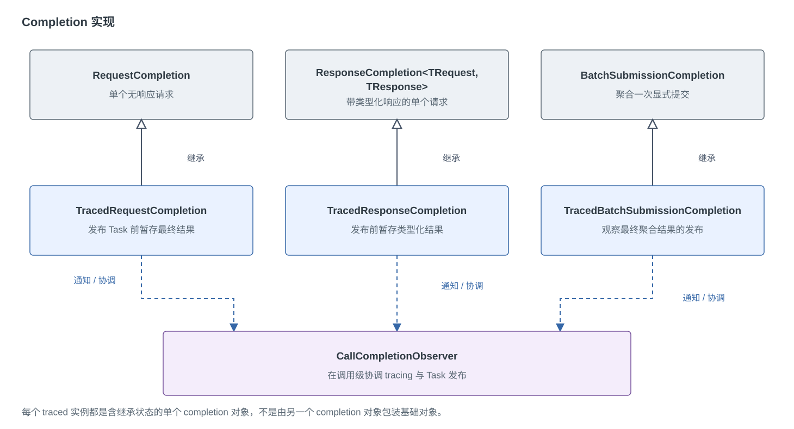
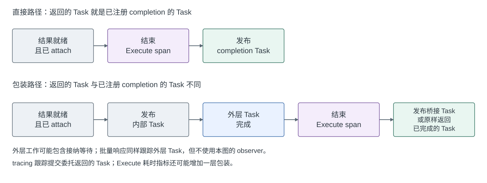

# 请求完成机制设计

[English](request-completion-design.md)

## 范围与契约

本文说明当前 completion 类型的职责和协作方式。公开 API 见[请求与响应设计](request-response-batching-design.md)，
追踪、指标和执行上下文契约见[可观测性设计](observability-design.md)。

一次提交对应一次公开的 `ExecuteAsync` 调用。一次显式提交可以包含多个请求，并拆入多个 Handler 批次；
一个 Handler 批次也可以包含多次提交的请求。提交完成和 Handler 批次完成是两个边界。
空提交直接完成，不创建共享 completion。

每个 pending item 恰好报告一次最终结果。非空显式提交要等所有请求结束，即使其中已有请求失败或取消。
`SetResponse` 只写入响应值；Handler、整个 Handler 批次的响应校验和其异步作用域释放成功后，才发布成功结果。
调用方取消可以移除尚未分发的工作；已经分发的请求报告 Handler 的实际结果。

## 四种公开调用路径，三种底层实现

下表针对已经接纳的非空提交。只有追踪边界提供 completion observer 时才选用对应的 tracing 子类；
注册 listener 本身不保证一定创建 Execute Activity。

| 公开调用 | 底层 completion | 返回值如何产生 | tracing 跟踪哪个完成边界 |
| --- | --- | --- | --- |
| 单请求，无返回值 | `RequestCompletion` | 返回不带结果的 Task。 | `TracedRequestCompletion` 可以在结束 Execute span 后发布同一个 Task。 |
| 单请求，有返回值 | `ResponseCompletion<TRequest, TResponse>` | 读取一个 entry 的响应，完成 `Task<TResponse>`。 | `TracedResponseCompletion` 可以直接发布带结果的 Task；存在外层包装时跟踪实际返回的 Task。 |
| 显式提交，无返回值 | 共享一个 `BatchSubmissionCompletion` | 等所有请求结束，不组装响应。 | `TracedBatchSubmissionCompletion` 观察最终聚合结果；存在外层包装时跟踪实际返回的 Task。 |
| 显式提交，有返回值 | 共享一个 `BatchSubmissionCompletion` | `ProcessEntriesAsync` 等待聚合完成，再按输入顺序组装响应数组。 | 跟踪包含响应组装的外层 Task，这条路径不使用 `TracedBatchSubmissionCompletion`。 |

### 为什么单请求区分返回值，批量却共享 completion

单请求的 `ResponseCompletion` 已经持有 `Task<TResponse>`。接纳路径返回的恰好是这个 Task 时，响应门面可以
直接返回它，省去“等待无返回值的 Task，再读取响应”的额外异步包装。若接纳过程需要等待，或者返回了其他 Task，
仍由 `AwaitSubmissionAsync` 等待提交过程结束后再读取响应。

显式提交的共享 completion 只负责聚合最终结果，响应值仍保存在原始 entry 中。
`ProcessEntriesAsync` 负责等待聚合完成，再按调用方输入顺序读取 entry、构造 `IReadOnlyList<TResponse>`。
这个异步方法的 Task 已经提供了带返回值的完成边界，不需要为每个请求创建独立的 response completion。

因此，批量有无返回值在门面层仍然区分，只是底层共用结果聚合。批量有返回值也有额外的结果处理层，
它表现为异步方法，而不是一个名为 `ResponseBatchSubmissionCompletion` 的类型。

## 基础类型各自负责什么

每个 tracing 子类继承对应的基础实现，不会额外包装一个基础 completion 对象。
observer 按一次提交协调结果发布。

| 类型 | 职责 |
| --- | --- |
| [IRequestCompletion](../src/RequestBatcher/PendingRequests/IRequestCompletion.cs) | 为 pending item 提供统一的 Task，以及成功、失败、取消操作。 |
| [RequestCompletion](../src/RequestBatcher/PendingRequests/RequestCompletion.cs) | 用不带结果的 `TaskCompletionSource` 完成一个请求。 |
| [ResponseCompletion](../src/RequestBatcher/PendingRequests/ResponseCompletion.cs) | 用 `TaskCompletionSource<TResponse>` 完成一个请求，并从 entry 读取响应。 |
| [BatchSubmissionCompletion](../src/RequestBatcher/PendingRequests/BatchSubmissionCompletion.cs) | 为一次显式提交计数，并聚合所有请求的最终结果。 |
| [PendingBatchRequest](../src/RequestBatcher/PendingRequests/PendingBatchRequest.cs) | 管理一个请求的排队、处理和结束状态、取消注册及恰好一次的清理，向选定的 completion 报告结果。 |

基础 completion 都使用 `RunContinuationsAsynchronously`，completion 对象及其 Task 不进入对象池。
显式提交中的每个请求仍有自己的 pending 对象；共享的是它们引用的 completion，不是请求生命周期状态。

`BatchSubmissionCompletion` 的初始计数是提交的请求数。每个请求结束时递减一次，最后一个请求负责发布聚合结果。
只要存在失败，整体就失败；没有失败但存在取消时，整体取消；其余情况成功。
异常按对象引用去重：同一个 Handler 异常扇出给多个请求时只保留一次，值相等但对象不同的异常仍分别保留。
异常的枚举顺序，以及 `await` 抛出其中哪个异常，都不提供顺序保证。

`ResponseCompletion` 会将 `OperationCanceledException` 映射为携带原 token 的 canceled Task。
无返回值的 completion 则可以持有包含该异常的 faulted Task。tracing 和 metrics 保留所观察 Task 的状态，
不会仅凭异常类型就把所有失败改为取消。

## tracing 子类与发布时机

三个 tracing 子类分别继承对应的基础实现。创建 tracing 子类时，只创建一个包含继承状态的 completion 对象，
并不是先创建基础对象再包一层。它还会引用一个调用级 observer。普通 completion 不增加 tracing 专用字段。

| 类型 | 新增职责 |
| --- | --- |
| [TracedRequestCompletion](../src/RequestBatcher/Diagnostics/Tracing/TracedRequestCompletion.cs) | 暂存单请求的最终结果，在发布 Task 前通知 observer。 |
| [TracedResponseCompletion](../src/RequestBatcher/Diagnostics/Tracing/TracedResponseCompletion.cs) | 暂存响应值、错误或取消状态，再交由 observer 协调 Task 发布。 |
| [TracedBatchSubmissionCompletion](../src/RequestBatcher/Diagnostics/Tracing/TracedBatchSubmissionCompletion.cs) | 复用基类的计数和错误聚合，只拦截最终 `Publish`，不会每结束一个请求就通知 observer。 |
| [CallCompletionObserver](../src/RequestBatcher/Diagnostics/Tracing/CallCompletionObserver.cs) | 判断实际返回的 Task 是否就是已注册 completion 的 Task，并协调 span 结束与结果发布。 |

两个接口把 pending 状态的完成通知和 Activity 的管理分开：

- [IRequestCompletionObserver](../src/RequestBatcher/PendingRequests/IRequestCompletionObserver.cs)：注册一次调用所观察的
  completion，并接收它的最终完成通知。
- [IRequestCompletionNotification](../src/RequestBatcher/PendingRequests/IRequestCompletionNotification.cs)：提供 Task、
  已准备好的错误或取消状态，以及延后执行的 `Publish`。它由 completion 自身实现，不是另一个需要分配的通知对象。

准备最终结果和让调用方观察到 Task 完成是两步。observer 可以先读取已经准备好的结果，完成 tracing，随后再发布 Task。

### Observer 的生命周期与归属

`RequestBatcherTracing.TraceCall` 在启动 Execute Activity 后，为一次提交最多创建一个 `CallCompletionObserver`。
没有 Activity，或 `observeCompletion` 为 false 时不创建。显式提交有返回值的路径就使用
`observeCompletion: false`，直接跟踪包含响应组装的 Task。

构造时，observer 捕获提交方的 `ExecutionContext`，并持有 Activity 和可选的 `SubmissionTraceContext`。
若上下文流动被抑制，捕获的执行上下文为 null；回调隔离仍会恢复完成线程的上下文，但不会引入提交方上下文。
提交委托收到 observer 后，选定的 tracing completion 在构造函数中调用 `Register(this)`。
注册只是保存一个引用，不是订阅事件；它必须先于完成通知和 attach。显式提交注册的是共享聚合 completion，
不会为每个请求分别注册。observer 不负责入队、请求取消注册或容量释放。

| 事件 | 状态与动作 |
| --- | --- |
| 构造并注册 | `_attached` 和 `_completed` 都是 false；`_completion` 指向 tracing completion。 |
| `OnCompleted` 先到 | 设置 `_completed`，暂不发布，等待 attach；源 Task 此时尚未发布结果。 |
| `TryAttach(task)` 先到 | 设置 `_attached`，用 `_direct` 记录 Task 引用是否相同，等待最终结果。 |
| 另一个事件到达 | 两个标志均为 true，在锁外执行发布；`_direct` 决定由谁结束 span。 |
| 重复通知或 attach | 重复通知直接忽略；重复 attach 返回第一次的 `_direct` 判断，不重新绑定。 |

`_completed` 表示最终结果已经准备好，不表示对应 Task 已经完成。
`TryAttach` 返回 false 是路径选择，不是绑定失败：追踪边界需要跟踪实际返回的 Task。
空提交等没有注册 completion 的情况也会返回 false。锁协调通知和 attach 的两种到达顺序；
更前面的请求状态及聚合计数负责避免重复报告最终结果。这些状态不会重置以供下一次调用复用。

`submit` 返回或抛出异常后，`TraceCall` 都会在 `finally` 中恢复调用方的父 Activity，此时 Execute Activity
仍可能存活。直接路径由 observer 在发布源 Task 前结束 Activity；包装路径由 observer 放行内部源，
再由 `TraceCall` 或其异步桥接逻辑在外层 Task 结束后关闭 Activity。
若 `submit` 同步抛出异常，`TryAttach(null)` 通过非直接路径放行已经准备好的内部结果，
随后 catch 记录抛出的失败、补齐链接、释放 Activity，并重新抛出异常。

observer 没有 `Dispose`、后台监控、全局注册或对象池。tracing completion 持有 observer，observer 又持有
completion；发布后不会主动清空其中的 Activity、捕获的执行上下文和链接上下文。
当存活的 pending item 或其他操作状态不再让这组对象保持可达时，GC 可以回收它们，包括循环引用。
发布 Task 不保证对象立即回收；结束 Activity、释放队列容量也是分别处理的生命周期操作。

### Attach 为什么需要一次握手

1. tracing completion 在构造时注册自己。
2. 提交方法还没返回 Task，请求就可能已经结束。此时 `OnCompleted` 先记录完成状态，暂不发布。
3. 追踪边界拿到提交方法实际返回的 Task 后调用 `TryAttach`，通过引用相等判断它是否就是 completion 的 Task。
4. 如果完成通知先到，attach 负责放行；如果 attach 先到，后续完成通知负责放行。
   锁只保护判断状态，发布回调在锁外执行。

若返回的就是 completion 的 Task，observer 先补齐反向链接、结束 Execute Activity，再发布结果。
同步回调结束后会恢复完成线程的执行上下文。直接 tracing 回调即使抛出异常，`finally` 仍会尝试发布基础 completion。

若返回的是其他 Task，observer 会先发布内部 completion，但不结束 Execute span，让生产端等待或其他外层包装能够继续。
此时过早结束 span 会漏掉剩余工作；若一直扣住内部 completion 再等待外层 Task，则会阻碍外层完成。

追踪边界改为跟踪实际返回的 Task。已经完成的 Task 会同步结束 span 并原样返回；尚未完成的 Task 则通过一个桥接
completion 等待，先结束 span，再发布成功、全部失败或取消 token。批量有返回值的路径借此覆盖响应数组组装。
Task 引用复用是内部快路径，不是公开 API 对 Task 身份的保证。

下图归纳使用 observer 时，最终完成通知和 attach 都已到达后的发布顺序。
批量响应也跟踪外层 Task，但不经过这次 observer 握手。比较的是提交委托返回的 Task，
不包括可选的 Execute 耗时指标包装。

## 其他关联状态与外层包装

`TracedPendingBatchRequest` 只新增供 dispatch 关联使用的 `SubmissionTraceContext`，不引入额外的 completion source。
请求完成仍沿用基类及其引用的 completion；Execute Activity 由 tracing 边界管理。
有 trace context 不代表一定有 completion observer，两者分别决定是否选择相应的 tracing 类型。
普通 pending 状态留在 `PendingRequests`，tracing 专用类型及 span 管理留在 `Diagnostics/Tracing`。

`SubmissionTraceContext` 收集 Execute 到 Handle 的链接，不负责通知调用方完成。
Handle span 对应一次 Handler 批次，Execute span 对应一次公开提交。

启用 Execute 耗时指标后，metrics 还可能在外层包装 Task，先记录耗时再发布公开调用结果。
这与基础 completion 类型及 tracing 的 Task 复用相互独立。coordinator 的排空信号和 metrics 的释放信号则属于
生命周期 completion source，不对应某次业务调用。

## 兼容性与验证

这里的职责划分不改变公开签名、响应顺序、取消、生命周期或 span、metric 契约，也不引入额外的 completion source
或每请求工作。

- [BatchSubmissionCompletionTests](../tests/RequestBatcher.Tests/PendingRequests/BatchSubmissionCompletionTests.cs)：
  等待所有请求、混合结果、异常引用、重复失败和并发聚合。
- [ResponseCompletionTests](../tests/RequestBatcher.Tests/ResponseCompletionTests.cs)：
  带返回值的完成、Handler 和作用域释放边界、错误与取消。
- [RequestResponseBatcherTests](../tests/RequestBatcher.Tests/RequestResponseBatcherTests.cs)：
  显式提交的响应顺序、空输入和枚举失败。
- [SharedCompletionTests](../tests/RequestBatcher.Tests/Diagnostics/SharedCompletionTests.cs)：
  完成与 attach 的先后顺序、原 Task 复用、带返回值的结果、聚合发布和上下文恢复。
- [TraceCallCompletionTests](../tests/RequestBatcher.Tests/Diagnostics/TraceCallCompletionTests.cs)：
  桥接路径的结果、多个失败和取消 token 保留。
- [RequestBatcherTracingTests](../tests/RequestBatcher.Tests/Diagnostics/RequestBatcherTracingTests.cs)：
  公开 span 边界，包括单请求及批量响应的作用域释放。
