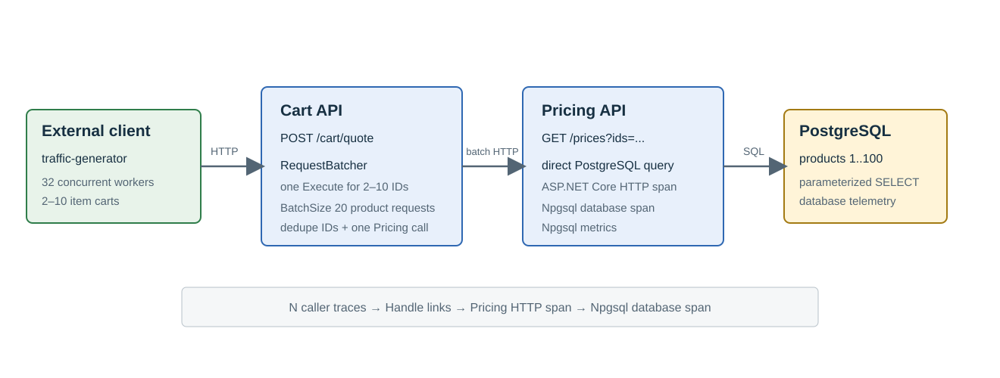

# RequestBatcher cart and pricing observability sample

This Docker Compose sample models a small read-only pricing flow. A separate .NET 8 traffic-generator console app
acts as an external client and calls the Cart Web API. Cart calls the Pricing Web API, which uses the named
`product-reads` RequestBatcher pipeline to read seeded products from PostgreSQL. Grafana OTel LGTM receives traces,
metrics, and logs from the two Web APIs.

The sample is a local observability demonstration, not a benchmark or production deployment. It has two .NET 8
business projects, Cart and Pricing, plus the `GenerateTraffic.cs` file-based C# application. The traffic generator emits no OpenTelemetry
spans, so the Cart ASP.NET Core request span is the root visible in the trace. Product IDs 1 through 100 are seeded by
PostgreSQL's initialization script.

## Start

Run these commands from the repository root:

```bash
docker compose -f samples/RequestBatcher.Observability/compose.yaml config --quiet
docker compose -f samples/RequestBatcher.Observability/compose.yaml up --build -d --wait
docker compose -f samples/RequestBatcher.Observability/compose.yaml ps
```

The Compose build uses the repository root as its context. The default loopback endpoints are:

| Service | URL | Purpose |
| --- | --- | --- |
| Cart | <http://127.0.0.1:5081> | Quote API and health endpoint |
| Pricing | <http://127.0.0.1:5082> | Product price API and health endpoint |
| Grafana | <http://127.0.0.1:3000> | Traces, metrics, logs, and dashboard |
| OTLP/gRPC | `http://127.0.0.1:4317` | Optional local OTLP receiver |
| OTLP/HTTP | `http://127.0.0.1:4318` | OTLP receiver used by the APIs |

Override `CART_PORT`, `PRICING_PORT`, `GRAFANA_PORT`, `OTLP_GRPC_PORT`, or `OTLP_HTTP_PORT` when a default is in use.
The traffic generator defaults to eight workers and a 250 ms delay; override `TRAFFIC_CONCURRENCY` and
`TRAFFIC_DELAY_SECONDS` when starting the stack.

Docker runs the separate `CheckHealth.cs` application to probe each API's `/health` route before starting dependent
services. This checks HTTP availability, not database readiness. Business endpoints live in `CartEndpoints.cs` and
`PricingEndpoints.cs`; the `Program.cs` files compose and start their hosts.

The repository's .NET 10 SDK can also run the single-file applications directly, without a project or scripting tool:

```bash
dotnet run --file samples/RequestBatcher.Observability/GenerateTraffic.cs -- --help
dotnet run --file samples/RequestBatcher.Observability/GenerateTraffic.cs
dotnet run --file samples/RequestBatcher.Observability/CheckHealth.cs -- http://localhost:5081/health
```

Stop the Compose traffic generator before starting an additional local generator if you want to keep the default load.

Check both APIs and submit a manual quote:

```bash
curl --fail http://127.0.0.1:5081/health
curl --fail http://127.0.0.1:5082/health
curl --fail --request POST http://127.0.0.1:5081/cart/quote \
  --header 'Content-Type: application/json' \
  --data '[{"productId":1,"quantity":2},{"productId":2,"quantity":1}]'
```

The quote response contains one line per requested product and the calculated total. Cart validates one to 64 entries,
positive product IDs, and quantities from 1 through 100. Missing products return `404`; invalid input returns `400`.
Pricing also supports direct inspection and explicit grouped reads:

```bash
curl --fail http://127.0.0.1:5082/prices/1
curl --fail 'http://127.0.0.1:5082/prices?ids=1,2,3,64,100'
```

## Observability

Open the [RequestBatcher observability dashboard](http://127.0.0.1:3000/d/requestbatcher-observability/requestbatcher-observability)
and sign in with `admin` / `admin` if prompted. It contains ASP.NET Core HTTP request metrics, application logs, and
Tempo searches for `RequestBatcher.Execute` and `RequestBatcher.ProcessBatch`.

The visible trace starts with the Cart ASP.NET Core request span. Its HTTP client child span reaches Pricing, where the
Pricing ASP.NET Core span submits work to the named `product-reads` batcher. `RequestBatcher.Execute` remains in that
caller trace and measures the full caller-visible duration. Each `RequestBatcher.ProcessBatch` span is an independent
Consumer root linked to its contributing `Execute` spans; its Npgsql query is a child span. Both RequestBatcher span
types carry `requestbatcher.name=product-reads`.

To follow one call into a batch, open the Cart/Pricing trace, copy the `Execute` span's trace ID, and search Tempo with:

```text
{ link:traceID = "CALL_TRACE_ID" && span:name = "RequestBatcher.ProcessBatch" }
```

The pinned Tempo build stores this query field without leading zeroes. Remove leading `0` characters from a copied
trace ID before substituting it above. Select a time range that includes the original call. A 32-item quote can lead
to multiple batch traces because the handler batch limit is 16.

Open the returned batch span to inspect its Npgsql child. Activity links are causal references rather than shared parent
edges, so the reverse-link view depends on the tracing backend and does not imply one shared trace tree. See Grafana's
[TraceQL link query documentation](https://grafana.com/docs/tempo/latest/traceql/construct-traceql-queries/) for the
`link:traceID` and `link:spanID` selectors.




The [sample design](../../docs/observability-sample-design.md) documents the current flow and compatibility contract.
The [sample source](https://github.com/eventhorizon-cli/RequestBatcher/tree/main/samples/RequestBatcher.Observability)
shows the two Web APIs, the traffic generator, and their telemetry setup.

The traffic generator has no trace exporter. Stop it to keep the APIs available for manual requests:

```bash
docker compose -f samples/RequestBatcher.Observability/compose.yaml stop traffic-generator
docker compose -f samples/RequestBatcher.Observability/compose.yaml start traffic-generator
```

## Stop and reset

Stop the stack while preserving the PostgreSQL and LGTM volumes:

```bash
docker compose -f samples/RequestBatcher.Observability/compose.yaml down
```

Remove the containers and both named volumes, including collected telemetry and the seeded database:

```bash
docker compose -f samples/RequestBatcher.Observability/compose.yaml down -v --remove-orphans
```

RequestBatcher is in-process and does not recover pending requests after a process failure.
