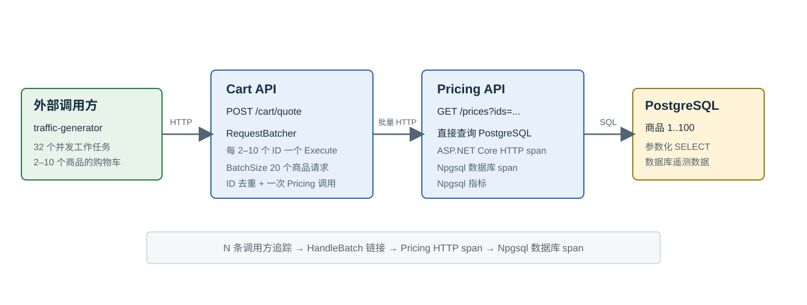

# RequestBatcher Cart 与 Pricing 可观测性示例

[English](README.md) | **简体中文**

本 Docker Compose 示例模拟只读的商品定价流程。独立的 .NET 10 流量生成器作为外部调用方访问 Cart Web API；Cart 使用命名的
`pricing-queries` RequestBatcher 管线合并商品查询，再调用 Pricing Web API。Pricing 直接从 PostgreSQL 读取商品价格。
Grafana OTel LGTM 接收两个 Web API 的 Tracing、Metrics 和 Logs。

示例使用简洁的 OpenTelemetry 服务名 `cart` 和 `pricing`，让服务选择器和 Trace 视图直接聚焦业务服务。
已经写入后端、使用旧名称 `requestbatcher-cart` 或 `requestbatcher-pricing` 的 Telemetry，会在后端保留期结束前继续显示为旧名称。

本示例用于本地演示，不是性能基准或生产部署。Cart、Pricing 和流量生成器都是 .NET 10 项目；每个流量请求携带 2–10 个商品，
且不导出 OpenTelemetry Span，因此 Cart ASP.NET Core 请求 Span 是 Trace 中可见的根。PostgreSQL 初始化脚本会创建商品 ID 1 到 100。

## 启动

从仓库根目录执行：

```bash
# 构建镜像、按依赖顺序启动服务，并等待健康检查通过。
docker compose -f samples/RequestBatcher.Observability/compose.yaml up --build -d --wait
# 查看运行中的服务和端口。
docker compose -f samples/RequestBatcher.Observability/compose.yaml ps
```

Compose 使用仓库根目录作为构建上下文。`up --build -d --wait` 会构建应用镜像，按依赖顺序启动整个环境，并等待健康检查通过。

默认地址如下：

| 服务 | 地址 | 用途 |
| --- | --- | --- |
| Cart | <http://127.0.0.1:5081> | 报价 API 和健康检查 |
| Pricing | <http://127.0.0.1:5082> | 商品价格 API 和健康检查 |
| Grafana | <http://127.0.0.1:3000> | Tracing、Metrics、Logs 和仪表板 |
| OTLP/gRPC | `http://127.0.0.1:4317` | 可选 OTLP 接收端 |
| OTLP/HTTP | `http://127.0.0.1:4318` | API 使用的 OTLP 接收端 |

可通过 `CART_PORT`、`PRICING_PORT`、`GRAFANA_PORT`、`OTLP_GRPC_PORT` 和 `OTLP_HTTP_PORT` 修改端口。流量生成器默认使用 32 个
worker、250 ms 间隔，可通过 `TRAFFIC_CONCURRENCY` 和 `TRAFFIC_DELAY_SECONDS` 调整。

也可以单独运行 C# 流量生成器和健康检查：

```bash
dotnet run --project samples/RequestBatcher.Observability/TrafficGenerator/RequestBatcher.Observability.TrafficGenerator.csproj
dotnet run --file samples/RequestBatcher.Observability/CheckHealth.cs -- http://localhost:5081/health
```

手动验证：

```bash
curl --fail http://127.0.0.1:5081/health
curl --fail http://127.0.0.1:5082/health
curl --fail --request POST http://127.0.0.1:5081/cart/quote \
  --header 'Content-Type: application/json' \
  --data '[{"productId":1,"quantity":2},{"productId":2,"quantity":1}]'
```

## 在 Grafana 中查看

打开 [RequestBatcher observability dashboard](http://127.0.0.1:3000/d/requestbatcher-observability/requestbatcher-observability)，
首次登录使用 `admin` / `admin`。仪表板的 HTTP 面板展示请求速率和耗时，RequestBatcher 面板展示提交请求数、
批次大小和批次耗时，日志和 Trace 面板分别显示两个服务的日志和 Tempo Trace。

在 Grafana Explore 中选择 Tempo，时间范围使用最近 5 分钟或 15 分钟。一次请求的 Trace 从 Cart ASP.NET Core Span 开始，
每个 Cart 请求只创建一个 `RequestBatcher.Execute pricing-queries` Span，并通过原生批量 API 提交完整的 2–10 个商品 ID。共享的
Cart Batch Handler 最多接收 20 个商品请求，可以混合多个并发 Cart 调用，合并并去重商品 ID 后只调用一次 Pricing。每个
`Handle` Span 会通过 ActivityLink 指向参与其中的调用方 `Execute`，并包含 Cart 到 Pricing 的 HTTP 客户端子 Span。Pricing 的 HTTP 服务端 Span 下会看到
Npgsql 官方 Instrument 创建的 PostgreSQL Span。`requestbatcher.batch.size` 记录批次中的商品请求数。

要从某个调用追踪到批次，在 Cart Trace 中复制 `Execute` Span 的 Trace ID，然后在 Tempo TraceQL 中查询：

```text
{ link:traceID = "CALL_TRACE_ID" && span:name =~ "RequestBatcher[.]Handle( .*)?" }
```

选择包含原始调用的时间范围。批次可能少于 20 份提交，因为 RequestBatcher 不会等待填满 `BatchSize`。ActivityLink 是因果关联，
不是共享父子关系，因此它们不会组成一棵共享的 Trace 树。每个 `Handle` Span 会通过 Link 关联到所有参与其中的
`Execute` Span；每个 `Execute` Span 也会通过 Link 关联到处理其请求的所有 `Handle` Span。可以参考 Grafana 的
[TraceQL Link 查询文档](https://grafana.com/docs/tempo/latest/traceql/construct-traceql-queries/)了解
`link:traceID` 和 `link:spanID` 选择器。

直接导航时，从仪表板的 `Handler execution · Handle` 表格打开一条 `Handle` Trace，点击
`RequestBatcher.Handle pricing-queries` Span 行，在 Span 详情中展开 `References`，即可看到参与该批次的多个
`Execute` 调用方上下文。从 `Cart calls · Execute` 表格点击 `Execute` Span 并展开 `References`，可以看到处理该调用的 `Handle`。
Grafana 会在这个列表中同时展示父节点和 Span Link：`cart POST /cart/quote` 是 Execute 在同一条 Trace 中的 HTTP 父节点，
Handler Link 则指向独立的 `Handle` Trace。这里的父节点条目并不是额外添加的 ActivityLink。需要从批次查找其 `Execute` 时，
复制批次的 Trace ID 和 Span ID，然后在 Tempo 中查询：

```text
{ link:traceID = "BATCH_TRACE_ID" && link:spanID = "BATCH_SPAN_ID" && span:name = "RequestBatcher.Execute pricing-queries" }
```

当前固定版本的 Tempo 在查询字段中会去掉前导零；替换上面的 ID 前，请删除复制结果开头的 `0`。选择包含原始批次的时间范围；
当链路后端没有在 Span 详情中提供可点击 Link 时，可以使用上面的 TraceQL 查询。




业务流程图和示例设计分别见 [business-flow.zh-CN.svg](business-flow.zh-CN.svg) 与 [示例设计](../../docs/observability-sample-design.md)。
RequestBatcher 在进程内运行，进程故障后不会恢复待处理请求。

如需执行可选的端到端验证，请查看[集成测试说明](../../tests/it/README.zh-CN.md)（[English](../../tests/it/README.md)）。显式设置
`REQUESTBATCHER_RUN_INTEGRATION_TESTS=1` 后，集成测试夹具会通过 Testcontainers 创建隔离环境，并在验证完成后自动清理；
测试验证每个 Cart HTTP 请求只有一个 `Execute`、跨 Trace 的批次 Link、Pricing/数据库父子 Span 和 Metrics。
